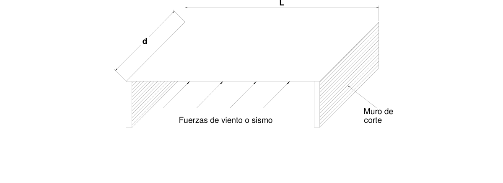
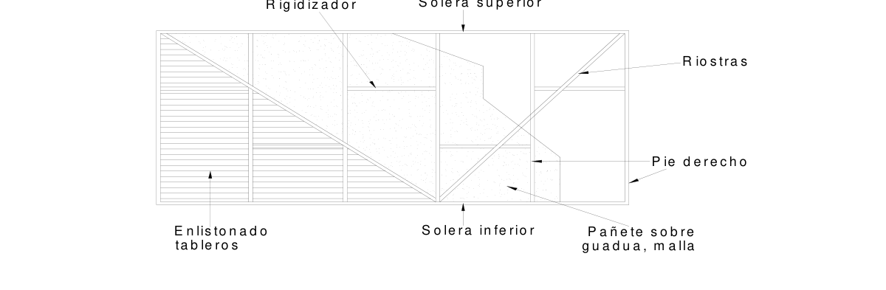

# G.7 — Diafragmas horizontales y muros de corte

### G.7.1 — GENERAL

**G.7.1.1** — Las prescripciones de este capítulo se refieren a diafragmas horizontales y muros de corte, esto es, a los elementos que resisten fuerzas cortantes en su plano, habitualmente rectangulares y relativamente delgados. Los muros de corte están colocados verticalmente, como en paredes y tabiques, mientras que los diafragmas están dispuestos horizontalmente, como en pisos o techos.

**G.7.1.2** — El conjunto de diafragmas y muros de corte deberán diseñarse para resistir adecuadamente las cargas laterales aplicadas, tales como las acciones de viento o sismo, además de las cargas verticales gravitacionales que les correspondan.

**G.7.1.3** — La capacidad resistente a cargas laterales de los diafragmas y muros de corte depende de la disposición y distanciamiento del entramado, del tipo de revestimiento y de su sistema de fijación. Puede calcularse con el método de la longitud equivalente, descrito en G.7.3.6. Alternativamente pueden emplearse las prescripciones del Manual de Diseño para Maderas del Grupo Andino en su capítulo 10.

**G.7.1.4** — Los diafragmas y muros de corte deberán ser suficientemente rígidos para limitar los desplazamientos laterales, reducir la amplitud de vibraciones y proporcionar arriostramiento a otros elementos de la estructura, evitando su pandeo lateral.

**G.7.1.5** — Las uniones de los diafragmas y muros de corte, entre sí y con otros elementos, deberán ser adecuados para resistir las fuerzas cortantes.

**G.7.1.6** — En caso de existir aberturas en los diafragmas o muros de corte, éstas deberán reforzarse con elementos adicionales de igual sección transversal a la de los elementos cortados. Los refuerzos se diseñarán y detallarán para transferir la totalidad de la fuerza cortante a los elementos que enmarcan.

### G.7.2 — DIAFRAGMAS HORIZONTALES

**G.7.2.1** — Un diafragma puede definirse como un conjunto estructural horizontal o ligeramente alejado de la horizontal, de espesor pequeño respecto de sus otras dos dimensiones, que tiene la capacidad de trabajar bajo fuerzas contenidas en su propio plano.

L

Figura G.7.2-1 – Diafragma horizontal y muros de corte

**G.7.2.2** — El diafragma se diseñará como una viga horizontal que se flecta entre los elementos verticales del sistema de resistencia a las fuerzas laterales, sean éstos muros de corte u otros sistemas aporticados. El diseño se hará tanto en la dirección longitudinal como en la transversal e incluirá las debidas comprobaciones de resistencia a la flexión y al corte.

**G.7.2.3** — Los elementos que conforman un diafragma deben estar debidamente ensamblados para asegurar el trabajo conjunto. Estos elementos se clasifican así:

(a) Los tableros, que constituyen el recubrimiento del piso o de la cubierta.

(b) Los montantes, largueros o viguetas que soportan el recubrimiento, así como las taquetes que estabilizan el entramado.

(c) Los cordones, que enmarcan el diafragma y forman parte del sistema de resistencia en el plano.

Normalmente son elementos perimetrales o interiores, identificados como vigas coronas o dinteles colectores.

#### G.7.2.4 — TABLEROS

Los tableros tienen la responsabilidad de resistir la fuerza cortante y usualmente están hechos con láminas contrachapadas o aglomeradas, tablones, tablas o listones de espesor mínimo de 15 mm. El dimensionamiento de los tableros dependerá tanto de su resistencia al corte como del sistema de unión a los elementos portantes, factores que por lo general controlarán el diseño, exigiendo condiciones especiales según sea la disposición de los elementos.

**G.7.2.5** — El sistema de fijación del recubrimiento a los largueros, a los taquetes y a los cordones o elementos perimetrales se diseñará para transferir la totalidad de la fuerza de corte.

**G.7.2.6** — Los requerimientos para clavar tableros de espesor no menor de 15 mm. con clavos de 51 mm (2") de longitud serán los siguientes:

(a) En los bordes con soporte continuo: 150 mm. centro a centro

(b) A lo largo de soportes intermedios: 250 mm. centro a centro en pisos y 300 mm. centro a centro en cubiertas

**G.7.2.7** — Los tableros se clasifican en confinados y no confinados. Tableros confinados son aquellos que tienen todos sus bordes perimetrales apoyados en forma continua sobre largueros o elementos más rígidos. Tableros no confinados son aquellos que poseen dos bordes paralelos sin el soporte continuo de tales elementos.

#### G.7.2.8 — LARGUEROS O ENTRAMADOS PORTANTES

Los elementos utilizados en el entramado portante de los diafragmas horizontales tendrán un espesor mínimo de 40 mm y una altura suficiente para resistir adecuadamente la flexión y el corte a que se vean sometidos. Su diseño corresponderá al de un elemento solicitado por flexión y carga axial, siguiendo las prescripciones del capítulo G.5.

#### G.7.2.9 — VIGAS CORONAS O CABEZALES

La determinación de las fuerzas axiales en un punto de las vigas coronas deberá ser el resultado de igualar el momento flector en ese punto del diafragma, a un par conformado por las vigas coronas actuando como cordones, con un brazo igual a la distancia entre ellas, es decir, entre los centroides de sus secciones transversales. Normalmente gobernará el diseño a tensión por cuanto los esfuerzos admisibles a compresión son ligeramente mayores que los de tensión, pero deberán comprobarse los posibles efectos de esbeltez en el cordón solicitado a compresión. En cualquier caso, deberán analizarse los cordones o vigas coronas trabajando a tensión y a compresión pues la dirección de la fuerza aplicada puede cambiar de sentido.

**G.7.2.10** — Cuando las vigas coronas no estén conformadas por un solo elemento, deberán ser diseñadas para las fuerzas axiales producidas por el momento máximo existente en el diafragma, independientemente de su ubicación.

Teniendo en cuenta que las fuerzas axiales son usualmente el resultado de fuerzas sísmicas o de viento, para efectos de diseño se puede utilizar un coeficiente de duración de la carga $C_{d}=1.33.$

#### G.7.2.11 — DINTELES COLECTORES

Cuando las vigas coronas son paralelas a la dirección de la fuerza aplicada, se convierten en dinteles colectores de la fuerza cortante trasmitida por el diafragma. Si tales vigas coronas se encuentran soportadas directamente por muros cortantes, deberán conectarse a ellos para una transmisión adecuada del esfuerzo cortante. Por otro lado, si las vigas coronas se localizan como puentes de una abertura del diafragma, deberán colectar la fuerza cortante para trasmitirla al sistema de resistencia de fuerzas laterales cuando encuentren su apoyo. Ello indica que las vigas coronas deberán ser diseñadas para la condición más crítica entre su trabajo como cordón del par resistente a flexión y su trabajo como colectora de fuerza cortante, en caso de existir aberturas en el diafragma.

### G.7.3 — MUROS DE CORTE

**G.7.3.1** — Los muros de corte constituyen los elementos verticales del sistema resistente de la edificación, y normalmente transmiten las cargas verticales. Además, soportan los diafragmas horizontales y son los encargados de llevar a los niveles inferiores las cargas horizontales que actúan en su mismo plano y que son originadas por sismo, viento u otras cargas gravitacionales.

R ig id iz a d o rS o le ra s u p e rio r

Figura G.7.3-1 — Elementos de los muros de corte

**G.7.3.2** — Un muro de corte está constituido por un entramado de pies-derechos, soleras superior e inferior, riostras y rigidizadores intermedios cuando sea necesario, y algún tipo de revestimiento por una o por ambas caras.

**G.7.3.3** — La separación de los pies derechos el espesor y características del revestimiento determinan, junto con las riostras, la rigidez y la resistencia a cargas horizontales del muro. La fuerza horizontal actuante determina el diseño de la unión con las soleras. Las dimensiones de los muros de corte definirán el régimen de transferencia y el diseño de los anclajes a la cimentación. El espaciamiento entre anclajes deberá ser menor de 2 m. Ningún eslabón de la cadena de diseños o comprobaciones podrá suprimirse.

**G.7.3.4** — El diseño de los muros de corte deberá considerar los siguientes aspectos:

(a) Proporciones del muro

(b) Diseño de las soleras

(c) Diseño de los pie derechos, rigidizadores intermedios y riostras

(d) Espesor y características del revestimiento y su sistema de unión

(e) Sistema de unión de los muros entre sí y con la cimentación.

**G.7.3.5** — Cada muro de corte considerado por separado, deberá ser capaz de resistir la carga lateral correspondiente a su área de influencia, a menos que se haga un análisis detallado de la distribución de fuerzas cortantes considerando la flexibilidad de los diafragmas horizontales.

**G.7.3.6** — El diseño de los muros de corte depende fundamentalmente de las características del entramado y del revestimiento. Con fines prácticos se basa en los resultados experimentales obtenidos al ensayar muros que pueden considerarse típicos. Se introduce entonces el concepto de "longitud equivalente" para convertir la longitud de un muro de características dadas a la equivalente de un muro de referencia que tiene una resistencia admisible al corte de 700 N/m. La longitud equivalente se obtiene multiplicando la longitud real del muro por el coeficiente correspondiente de la tabla G.7.3-1. Para muros diferentes a los de esta tabla pueden utilizarse los valores especificados en el Manual de Diseño para Maderas del Grupo Andino, capítulo 10, si están considerados en él.

**G.7.3.6.1** — El procedimiento de la longitud equivalente podrá ser aplicado a estructuras relativamente pequeñas que resisten todas las cargas laterales por medio de muros de corte. Estos muros deberán estar dispuestos en dos direcciones ortogonales con espaciamientos menores que 4 m y su distribución deberá ser más o menos uniforme, con rigideces aproximadamente proporcionales a sus áreas de influencia.

**G.7.3.6.2** — En el cálculo de longitudes equivalentes deberán descontarse las aberturas de puertas y ventanas. No se considerarán aquellos muros cuya relación altura/longitud sea mayor que 2 ni los que estén anclados a la cimentación en un solo punto.

**Tabla G.7.3-1**

Coeficientes de conversión a longitud equivalente del muro de referencia

|  | Entramado | Revestimiento | Coeficiente |
|---|---|---|---|
| 1 | Pies derechos de 4 cm x 8 cm a cada 40 cm, clavados a soleras de 4 cm y 8 cm con clavos de 75 mm. | Tablas sin machihembrar 1 cm x 19 cm, clavadas a cada pie derecho con 2 clavos de 63 mm. | 1.00 |
| 2 | Id con pies-derechos a cada 50 cm. | Id. | 0.80 |
| 3 | Id. Con pies-derechos a cada 60 cm. | Id. | 0.67 |
| 4 | Id. Con pies-derechos a cada 40 cm. | Id. Con tablas de 2 cm x 19 cm clavadas a cada pie-derecho con 2 clavos de 63 mm. | 1.00 |
| 5 | Id. | Id. Con 3 clavos de 63 mm. | 1.40 |
| 6 | Id. | Id. Con tablas de 2 cm x 19 cm clavadas a cada pie-derecho con 2 clavos de 75 mm. | 1.30 |
| 7 | Id. | Id. Con 2 clavos de 88 mm. | 1.50 |
| 8 | Id. | Tablas sin machihembrar clavadas a cada pie-derecho con 2 clavos de 63 mm.: tablas de 1 cm x 4 cm. | 0.70 |
| 9 | Id. | Id.: tablas de 1.5 cm x 19 cm. | 0.80 |
| 10 | Id. Con riostras de 2 cm x 8 cm encajadas en pies- derechos, formando ángulos entre 45° y 60° con las soleras. | Tablas sin machihembrar, 2 cm x 19 cm, clavadas a cada pie-derecho con 2 clavos de 63 mm. | 2.60 |
| 11 | Pies-derechos de 4 cm x 8 cm a cada 40 cm. | Entablado simple, sin machihembrar, tablas de 2 cm x 19 cm clavadas a cada pie-derecho con 2 clavos de 63 cm. | 4.30 |
| 12 | Pies-derechos de 4cm x 8 cm con espaciamiento entre 40 cm y 50 cm, clavados a soleras de 4cm x 8 cm con clavos de 75 mm. | Paneles de madera contra-chapada de 1.20 m x 2.40 m, de 6 mm de espesor, con clavos de 50 mm a cada 12.5 cm en sus bordes y a cada 25 cm en pies-derechos intermedios. | 3.00 |
| 13 | Id. | Id. Con paneles de 9 mm de espesor, con clavos de 63 mm. | 3.50 |
| 14 | Id. Con pies-derechos a cada 60 cm y clavos de 90 mm. | Paneles de 8 mm de espesor de madera- cemento de 50 mm a cada 20 cm en sus bordes y cada 20 cm en pies derechos intermedios. | 5.00 |

**Tabla G.7.3-1** — (continuación)

Coeficientes de conversión a longitud equivalente del muro de referencia

|  | Entramado | Revestimiento | Coeficiente |
|---|---|---|---|
| 15 | Id. | Paneles de tableros de partículas de 15 mm de espesor. | 3.00 |
| 16 | Pies-derechos de 4 cm x 8 cm a cada 40 cm, clavados a soleras de 4 cm x 8 cm con clavos de 75 mm. Riostras diagonales de 2 cm x 8 cm en 50% de los paños. | Paneles de yeso con fibras, de 12 mm de espesor, densidad 0.75. | 1.50 |
| 17 | Id. | Revoque de barro de 2 cm de espesor, mínimo, sobre base de caña. | 1.50 |
| 18 | Id. | Id. Con revestimiento por ambos lados. | 2.50 |

█ Notas
