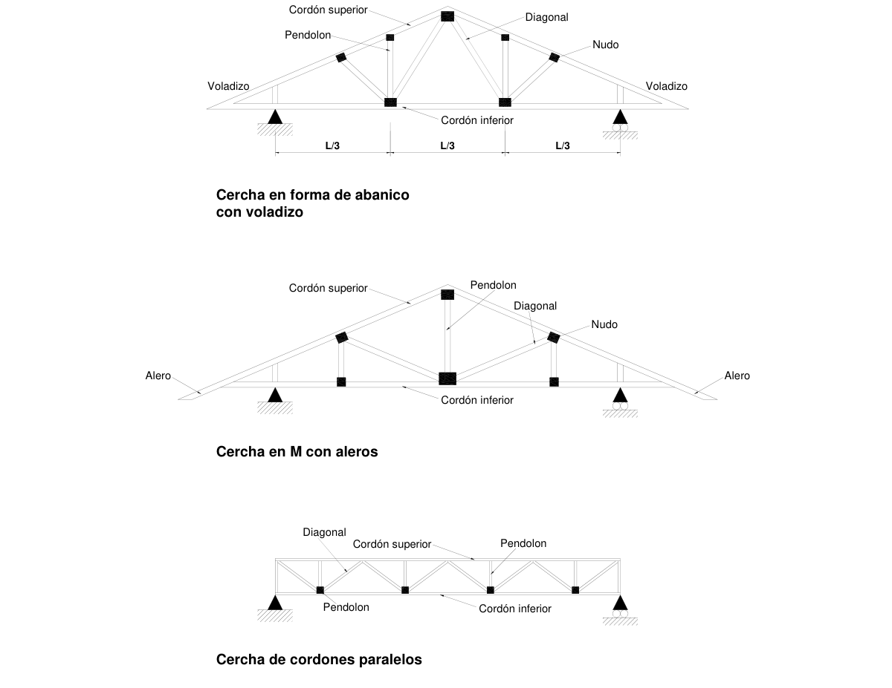

# G.8 — Armaduras

### G.8.1 — GENERAL

Las cerchas o armaduras son componentes estructurales planos, de contorno poligonal, formados por triangulación de elementos simples o compuestos que trabajan a tensión, compresión, tensión con flexión y flexo-compresión.

Existe una gran variedad de configuraciones de cerchas para soporte de cubiertas y entrepisos. Las armaduras de cubierta constituyen una de las aplicaciones más importantes de la madera como parte de sistemas de prefabricación total o parcial. En el diseño de cerchas deben tenerse en cuenta los siguientes requisitos: Cargas, luz a salvar, apoyos, inclinación del cordón superior, distribución de miembros interiores, sistema de unión de los nudos, deflexiones, estabilidad lateral y separación.

#### G.8.1.1 — ALCANCE

Los requerimientos de este capítulo serán aplicables a todo tipo de armaduras y será el diseñador estructural el encargado de determinar las limitaciones de su aplicación, en función de los aspectos mencionados en G.8.1.

Cordón superior

Figura G.8.1-1 — Elementos en armaduras comunes

#### G.8.1.2 — ANÁLISIS

Las armaduras deberán diseñarse para soportar las cargas muertas y vivas y aquellas eventuales como el cielo-raso, las cargas originadas en el montaje y otras cargas especiales.

• Las fuerzas axiales en las barras pueden ser calculadas considerando los nudos como articulaciones.

• Para la determinación de las fuerzas axiales en las barras, las cargas distribuidas en la cuerda superior o inferior podrán ser consideradas como cargas puntuales equivalentes aplicadas en los nudos correspondientes.

• Los momentos de flexión generados por las cargas aplicadas en las cuerdas superiores podrán ser determinados suponiendo que las cuerdas se comportan como vigas continuas apoyadas en los montantes o en los diagonales.

#### G.8.1.3 — CRITERIOS DE DISEÑO

Todos los elementos y uniones de la armadura no deberán sobrepasar las fuerzas máximas admisibles definidas anteriormente.

• En caso de que el espaciamiento entre armaduras sea de 600 mm o menor, los esfuerzos admisibles podrán ser incrementados en 10% siempre que existan elementos que garanticen un arriostramiento lateral adecuado.

• Las barras sometidas a la acción de fuerzas axiales y flexión deberán ser diseñadas a flexo-compresión o en tensión con flexión, de acuerdo con el Capítulo G.5.

• La longitud efectiva fuera del plano de la armadura será el espaciamiento entre ejes de correas • La longitud efectiva en montantes o diagonales será el 80% de la longitud entre centros de uniones.

• La máxima relación de esbeltez, en los elementos sometidos a compresión será de 50. En los elementos sometidos a tensión será de 80.

• Las deflexiones máximas deberán satisfacer los requisitos establecidos en G.3.5.1.

• Cuando no sea posible satisfacer los requisitos de deflexiones admisibles podrán construirse las armaduras usando contraflecha. Esta no será menor de 1/300 de la luz total.

**G.8.1.4** — Las cargas de la cubierta trasmitidas por las correas descansarán directamente en los nudos y si ello no es posible, en el diseño del cordón superior se deberán tener en cuenta, no solamente las fuerzas axiales de compresión sino los momentos flectores originados. El diseño será hecho de acuerdo con la fórmula de flexo-compresión, de G.5.2.1.

**G.8.1.5** — Las cargas de cielo raso producen esfuerzos de flexión en el cordón inferior de las cerchas y por esta razón su diseño se hará en concordancia con la fórmula de tensión con flexión de G.5.1.1.

**G.8.1.6** — En la determinación de la longitud efectiva de los cordones superior e inferior de las cerchas deberá considerarse en forma separada la esbeltez en el plano y fuera del mismo. La sección resistente será, en el primer caso, la altura del miembro y en el segundo caso, el espesor de la cuerda. La separación entre correas o riostras longitudinales será la longitud no arriostrada fuera del plano. Cuando se trate de elementos compuestos o múltiples se emplearán valores equivalentes, según lo definido en G.4.3.5 y G.4.3.6.

**G.8.1.7** — El cálculo de las deflexiones de las armaduras se basará en los métodos habituales en la práctica de la ingeniería. En el caso de que el espaciamiento entre armaduras sea igual o menor que 600 mm se deberá utilizar el módulo de elasticidad promedio $E_{prom}$; en caso contrario se deberá utilizar el $E_{min}$.

El cálculo de las deflexiones en las cerchas considerará la deformación de los nudos y el incremento de deflexión con el tiempo a causa del flujo plástico y de los cambios del contenido de humedad de la madera.

En cerchas fabricadas con pernos la deflexión teórica debe incrementarse por lo menos, en un 100% para incluir las deformaciones debidas a las tolerancias de fabricación, a la acomodación de los pernos dentro de las perforaciones y al flujo plástico.

**G.8.1.8** — Normalmente las cerchas sólo producen cargas verticales en los apoyos, siempre y cuando uno de ellos no ofrezca restricción al desplazamiento horizontal. Si el cordón inferior de la cercha se sitúa por encima del nivel de los apoyos, en el diseño deberán considerarse las fuerzas horizontales en los apoyos así como los esfuerzos cortantes y momentos generados en el último tramo del cordón superior. Se recomienda no elevar el cordón inferior a más de 1/3 de la altura total de la cercha.

**G.8.1.9** — Toda cercha deberá ser adecuadamente asegurada en los apoyos para resistir las fuerzas de levantamiento originadas por el viento y las fuerzas horizontales originadas en sismos o vientos. El calculista de la estructura incluirá el diseño de los apoyos y su anclaje a otros elementos del edificio.

#### G.8.1.10 — DIMENSIONES MÍNIMAS

El calculista de la estructura determinará la sección de todos los miembros componentes de la armadura pero ellos tendrán, por lo menos, 65 mm de altura y 40 mm de ancho. En el caso de usar cuerdas, montantes o diagonales compuestas de elementos múltiples, el ancho de cada uno de ellos podrá ser reducido a 25 mm reales.

(a) En caso de usar cartelas de contrachapado de madera en las uniones, éstas deberán tener un espesor mayor de 10 mm.

(b) Se recomienda el doblado de las puntas de los clavos en el sentido perpendicular a la dirección de las fibras de la cara exterior del contrachapado.

**G.8.1.11** — Las cerchas deberán ser instaladas a plomo, con el espaciamiento correcto y alineadas de tal manera que los cordones superiores e inferiores generen planos perfectos.

**G.8.1.12** — Las cerchas prefabricadas coplanares deberán tener tolerancias no mayores de 1.6 mm. en las uniones en el momento de la fabricación y no mayores a 3.2 mm en las uniones una vez estén en servicio.

**G.8.1.13** — Los clavos, pernos, platinas, conectores o cualquier elemento metálico de unión debe tener una apropiada protección contra la oxidación. En caso de usar cartelas metálicas, éstas deberán estar protegidas contra la corrosión.

**G.8.1.14** — De particular importancia es el diseño e instalación de un eficiente sistema de arriostramiento longitudinal en las cerchas. El diseñador de la estructura deberá indicar claramente en los planos los sistemas de arriostramiento provisional y definitivo que recomienda. Un entablado de carácter permanente y debidamente unido al cordón superior de la cercha constituye un diafragma apropiado, según se definió en el capítulo G.7. Si este no es el caso, será forzoso disponer de un sistema de contravientos alternados o de riostras en el plano de la cubierta con el fin de evitar el efecto castillo de naipes (colapso progresivo), debido a fuerzas horizontales en el sentido longitudinal. Para efectos de arriostramiento temporal durante la construcción se tendrá en cuenta lo estipulado en G.11.5.7.

█ Notas
