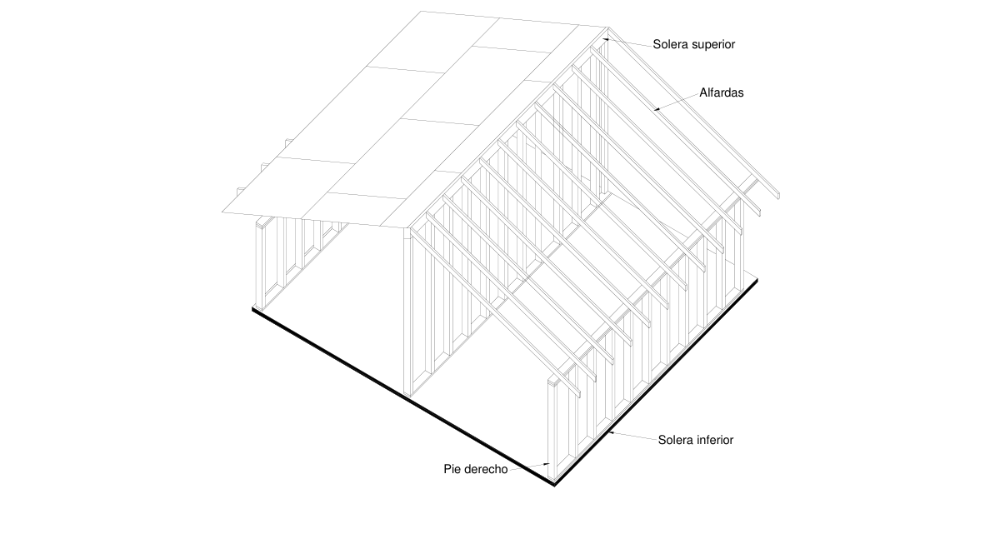
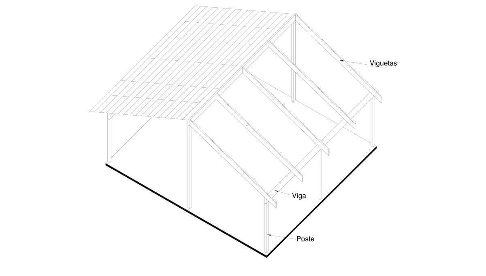
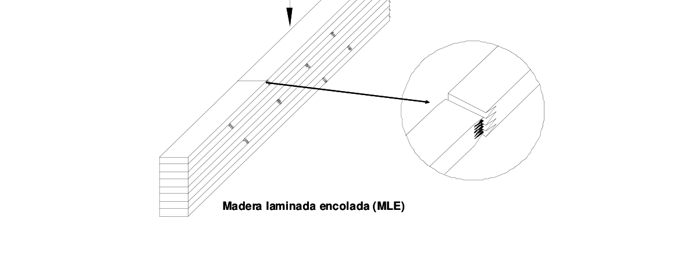

# G.9 — Sistemas estructurales

### G.9.1 — GENERAL

El presente capítulo se refiere a la forma en que diferentes componentes de madera se combinan para formar sistemas estructurales que ofrezcan resistencia, estabilidad y confort a las edificaciones.

### G.9.2 — ALCANCE

Las normas aquí establecidas se aplican a edificaciones parcial o totalmente hechas con madera y sus derivados. El calculista deberá verificar el comportamiento de vigas maestras, viguetas, alfardas, correas, separadores, riostras, tableros, entablados, paneles y demás elementos de soporte de la cubierta, de los cielo-rasos y de los entrepisos para asegurar su resistencia y estabilidad ante las solicitudes de carga. Para ello deberá aplicar las normas contendidas en el presente título G, y dejar registro de los cálculos efectuados.

### G.9.3 — CLASIFICACIÓN

Se distinguen 3 sistemas estructurales básicos con madera:

(a) Sistema de entramados livianos — Para formar las paredes se emplean soportes verticales o pies- derechos a corta distancia y soleras inferiores y correderas superiores que recogen cargas pequeñas transmitidas por entresuelos y alfardas del entrepiso y la cubierta, respectivamente. Consecuentemente, las cargas y las secciones son pequeñas y la rigidez del conjunto depende en gran parte de las láminas, listones o tableros que se instalan en uno o los 2 lados de los entramados de paredes o pisos, según lo establecido en el capítulo G7.

Figura G.9.3-1 — Sistema de entramado liviano El sistema de entramados livianos produce cargas repartidas en la cimentación, ofrece estructuras muy seguras y debido a la multiplicidad de elementos idénticos, favorece la prefabricación liviana de componentes tales como soleras, pies derechos, viguetas, cerchas livianas, entrepisos y recubrimiento de paredes y pisos.

El sistema puede usarse con ventajas en la construcción de viviendas de 1 y 2 pisos.

(b) Sistema de Poste y viga — Los soportes verticales o columnas se sitúan a distancias relativamente grandes y se unen con vigas maestras que recogen viguetas o cerchas con el peso del entrepiso o de la cubierta. Respectivamente los esfuerzos en la madera son usualmente elevados y se requieren grandes secciones. Como las cargas sobre la cimentación son concebidas, se requiere de análisis detallado de arriostramientos, muros de corte o diafragmas para contrarrestar las fuerzas originadas por viento y sismos.

Figura G.9.3-2 — Sistema de poste y viga El sistema de Poste y Viga se utiliza en forma extensiva pernos y platinas en las uniones y por lo general, se dejan las maderas a la vista. Los espacios entre columnas se rellenan con paredes que, como en el caso de entramados livianos, dependen de recubrimientos exteriores e interiores para resistir las fuerzas laterales. Cuando las paredes contengan materiales frágiles como vidrio se deben dejar tolerancias para los asentamientos y posibles movimientos, así como productos elásticos para sellas las juntas. La dificultad de secar secciones grandes puede incidir en la apariencia de las edificaciones pues son de esperar contracciones volumétricas y la aparición de grietas con el tiempo.

(c) Sistemas espaciales — Tipo estructural especial para cubrir grandes luces y consiste en la conexión transversal de entramados uniformes con otros de igual características de manera tal que se logre un comportamiento estructural, eficiente y seguro. Pertenecen a este sistema las Retículas espaciales:

conformadas por cuadriculadas paralelas con vértices desfasados entre ellas unidas con diagonales de 45 o 60 grados formando tetraedros o pirámides. Cúpulas geodésicas: grandes superficies curvas formadas pro pequeñas superficies planas conformadas por triángulos, hexágonos o pentágonos.

Lámelas: grandes estructuras conformadas por barras de pequeña sección entrelazadas entre si.

Figura G.9.3-3 — Cúpula Geodésica En estos tres sistemas estructurales el diseñador tendrá en cuenta además de las cargas gravitacionales, las cargas horizontales generadas por viento y sismo. Para ello deberá especificar en forma apropiada riostras y contravientos, así como diafragmas y muros de corte para dos direcciones ortogonales, según lo establecido en el Capítulo G.7. El espesor del recubrimiento será definido de acuerdo con las fuerzas cortantes calculadas y la separación de los pies derechos.

Debe tenerse en cuenta que la efectividad del sistema resistente de fuerzas horizontales depende de las conexiones y por lo tanto, ellas deben diseñarse para lograr una efectiva transmisión de esfuerzos.

De particular importancia es la fijación de los elementos de recubrimiento como contrachapados, enlistonados y tableros a las estructuras de soporte. En consecuencia, el diseñador deberá especificar el tipo de grapas, tornillos o clavos, así como su espaciamiento y penetración.

### G.9.4 — SISTEMAS ESTRUCTURALES COMBINADOS

Es muy frecuente, especialmente en proyectos de vivienda, combinar estructuras de mampostería o pórticos o paneles de concreto con componentes de madera. El calculista será responsable de analizar y asignar a cada material su participación en la resistencia y rigidez del conjunto y de determinar los detalles de conexión entre ellos.

**G.9.4.1** — En el diseño de conexiones se debe impedir el contacto de los elementos de madera con el agua de mamposterías, concretos o pañetes cercanos. Para ello deben evitarse los empotramientos, dejar las paredes verticales de vigas de madera separadas con aislamientos de aire. Utilizar soportes metálicos o recubrir las maderas con barreras impermeables confiables. Deben igualmente observarse las recomendaciones sobre protección de la madera de los capítulos G.11.4.4, G.11.4.5 Y G.11.4.6.

### G.9.5 — MADERA LAMINADA

La madera laminada (Glulam en inglés) es una técnica que consiste en producir elementos macizos de gran resistencia, por ensamble de tablas pequeñas de excelente calidad, libres de defectos, encoladas con adhesivos estructurales unas a otras en sus extremos (unión “finger Joint”) y caras, de forma tal que se comporten como una sola unidad estructural. Los elementos así formados pueden tener diferentes aplicaciones como columnas, vigas, viguetas, cerchas, pórticos y arcos de grandes dimensiones que pueden ser fabricados rectos o curvos y su longitud estará determinada por las limitaciones del transporte y de los equipos de montaje.

Figura G.9.5-1 — Madera Laminada encolada (MLE) Para su correcta realización la técnica de laminación requiere especiales condiciones de temperatura y humedad relativa, así como madera seca a un contenido de humedad del 12% y cuidadoso proceso de fresado, corte prensado y acabado ya que, normalmente la madera laminada se deja a la vista.

Los adhesivos utilizados son generalmente resistentes a la humedad, de tal manera que la madera laminada puede ser empleada en estructuras a la intemperie. En ningún caso se permitirá el uso de adhesivo del tipo PVA, para elementos estructurales, ni siquiera para las uniones tipo finger Joint. La norma ICONTEC NTC 2500 regula la calidad de los adhesivos.

Las lamelas constitutivas de las secciones pueden ser organizadas de acuerdo con su resistencia y rigidez a fin de obtener componentes más eficientes, Por ejemplo en las vigas se colocan las mejores maderas en las caras superior e inferior y las de menor calidad hacia el centro.

Por la responsabilidad estructural que tienen los componentes de madera laminada las plantas de fabricación deben estar certificadas y en su defectos deben tener establecido un plan de calidad de manera tal que los procesos sean debidamente monitoreados y registrados por personal competente. Los fabricantes de madera laminada deben seguir rigurosamente las instrucciones de manejo de los equipos y de los adhesivos, así como observar las especificaciones sobre secado, inmunización, distribución del adhesivo, tiempo y presión del prensado, tiempo del curado, acabado superficial e identificación de las piezas y elementos de unión.

De particular importancia en la fabricación de madera laminada es evitar la delaminación de lamelas por incorrecto manejo del adhesivo o del prensado o del curado. El montaje de elementos de madera laminada requiere la participación de personal entrenado y de equipos pesados. En el montaje deben observarse todos los requisitos de seguridad industrial.

#### G.9.5.1 — MÉTODO DE DISEÑO ESTRUCTURAL

Dado lo reciente de este sistema en Colombia se establecerá como método de diseño estructural el Método de esfuerzos admisibles.

#### G.9.5.2 — NORMATIVIDAD

Tanto para la obtención de los esfuerzos admisibles de la madera laminada como para la producción de elementos estructurales, los fabricantes se ceñirán a las normas vigentes internacionales, especialmente lo establecido en el Timber Construction Manual del AITC, Versión Quinta, 2004 (Referencia RG.9), _, en el Eurocode 5 o en las Normas Chilenas. En lo referente a los esfuerzos admisibles, estos deben ser certificados por un laboratorio de una Universidad Nacional o extranjera de reconocida trayectoria en la materia y como método estadístico de obtención de esfuerzos admisibles se deben seguir el del percentil del 5%.

█
