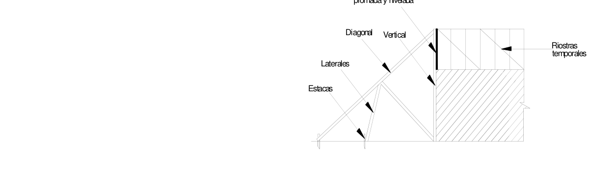
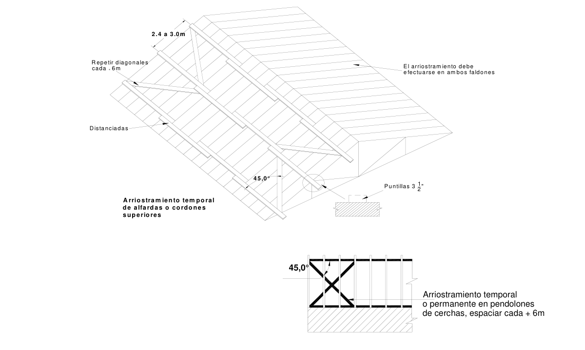

# G.11 — Preparación, fabricación, construcción, montaje y mantenimiento

### G.11.1 — GENERALIDADES

**G.11.1.1** — Todas las labores relativas a la preparación del material, fabricación, transporte e instalación de los elementos de madera, incluyendo sus uniones, deberá regirse por prácticas normalmente aceptadas por la Ingeniería y la Arquitectura y por los requerimientos de este Reglamento.

### G.11.2 — PROCESOS DE PREPARACIÓN

#### G.11.2.1 — SECADO DE LA MADERA

Toda madera destinada a la construcción deberá secarse hasta un $CH$% lo más próximo posible al contenido de humedad de equilibrio con el medio ambiente en el cual va a quedar instalada.

(a) Para usos específicos en contacto permanente con el suelo o bajo agua, no habrá necesidad de secar la madera, a menos que deba ser previamente inmunizada. De la misma manera, madera estructural para vigas de sección transversal superior a 0.04 m² podrá instalarse en estado verde o simplemente semiseca.

(b) Aquellas maderas destinadas a productos machihembrados, moldurados, pisos de parqué, puertas, ventanas y similares deberán secarse con 1% a 2% por debajo de la humedad de equilibrio del lugar de uso.

(c) Las demás maderas para uso estructural o aplicaciones interiores en la construcción, deberán secarse hasta un CH% próximo a la humedad de equilibrio del medio ambiente de su destino final. Como regla general, las maderas para uso estructural deberán estar secas al momento de fabricación por debajo del 19% CH. Las maderas empleadas en los procesos de laminado o deberán secarse hasta un CH del 12%.

(d) Las maderas destinadas a la construcción podrán secarse por dos sistemas comunes en la industria:

secado natural y secado por medios artificiales.

(e) El secado al aire se desarrollará mediante la exposición de la madera a la acción del medio ambiente.

Este proceso se deberá realizar en patios cubiertos con buena ventilación, con prácticas de apilado apropiadas y bajo medidas de seguridad que eviten el deterioro por la acción del clima, agentes biológicos u otras causas.

(f) Cuando el contenido de humedad deseado sea inferior al contenido de humedad de equilibrio con el medio ambiente del lugar o cuando se requiera madera seca en el menor tiempo posible, se deberán utilizar métodos artificiales de secado.

(g) El método artificial más aconsejable será en hornos o cámaras de secado mediante la aplicación de temperatura, humedad y ventilación diferentes a las naturales.

(h) En general, los procesos de secado deberán ajustarse a las especificaciones y recomendaciones del Manual de Secado publicado por la Junta del Acuerdo de Cartagena (Referencia RG.4)

(i) En el secado artificial en hornos se deberán tener en cuenta las siguientes recomendaciones de carácter general:

(1) Los secamientos se deberán efectuar mediante un horario o programa de secado, según lo determine quien lleve a cabo el proceso, aplicable a cada especie y espesor de madera.

(2) Durante el proceso de secado y al final del mismo, se deberán llevar a cabo pruebas de control de secado y defectos por tensiones. Dichas pruebas consistirán en el "contenido de humedad estratificado" y la "prueba de tenedor". Mediante tales pruebas se podrá garantizar un secado libre de defectos y tensiones que puedan afectar la madera durante procesos ulteriores o en uso.

(3) Debe dejarse un registro escrito del proceso de secado en donde se identifique el sistema de secado, las fechas y el lote de secado con las especies, las cantidades, las secciones y la disminución del contenido de humedad obtenido.

(j) Otro método de secado aplicable será el secado por deshumectadores, que utiliza recintos cerrados pero temperaturas no tan altas como el secado en hornos.

(k) En circunstancias especiales se podrán utilizar otros métodos de secado artificial tales como secado al vacío, por alta frecuencia o secado en solventes orgánicos.

(l) La comprobación del contenido de humedad en el comercio de madera para construcción se podrá hacer mediante el uso del xilohigómetro o medidor eléctrico de humedad.

(m) En el Manual de Diseño para maderas del Grupo Andino de la Junta del Acuerdo de Cartagena (Referencia RG.1) se encuentra a manera de información una tabla con datos sobre el comportamiento del secado de maderas aptas para construcción, así como una descripción gráfica de los defectos de secado más comunes (tabla 2.3 y figura 2.7 de la publicación citada).

#### G.11.2.2 — PRESERVACION DE LA MADERA

Se entiende por preservación o inmunización de la madera el proceso mediante el cual se aplica un producto químico capaz de protegerla contra el ataque de hongos, insectos o taladradores marinos.

(a) Los productos químicos que se podrán utilizar son los especificados en las normas NTC 1764, NTC 1767, NTC 1854 y NTC 2247, consistentes en productos inorgánicos oleosolubles. Al utilizar los productos mencionados se deberán cumplir los requisitos establecidos en las normas ICONTEC correspondientes.

(b) Toda madera antes de someterse a un proceso de inmunización deberá prepararse apropiadamente.

Dicha preparación consistirá en una o varias de las siguientes acciones:

(1) Descortezado — Especialmente de madera que se va a utilizar en forma rolliza como postes, pilotes, etc.

(2) Secado — Según el proceso de inmunización el contenido de humedad es distinto pero en cada caso deberá ajustarse a las especificaciones técnicas del proceso.

(3) Incisionado — Maderas aserradas o rollizas de alta densidad o muy impermeables deberán incisionarse para asegurar una penetración más profunda y homogénea de la sustancia inmunizante.

(4) El dimensionamiento final y las operaciones de cajeado, perforaciones o trabajos similares deberán realizarse antes del proceso de preservación. Si por fuerza mayor debiera hacerse algún corte o taladrado posteriormente al tratamiento se deberá preestablecer la capa protectora mediante pastas preservadoras o similares.

(c) Según los requerimientos de protección, el uso de la madera y las características de ella, se aceptarán dos métodos de preservación: tratamiento sin presión y tratamiento a presión.

(d) Los tratamientos sin presión más aceptables son: aplicación con brocha, pulverización o aspersión, inmersión, baño caliente y frío, difusión y doble difusión.

(e) Los tratamientos a presión aceptables son: a célula llena y a célula vacía.

(f) Las maderas preservadas mediante procesos a presión deberán cumplir con la norma NTC 2083, en cuanto a los requisitos de penetración y retención neta de acuerdo con las condiciones de uso.

(g) Los ensayos para determinar la penetración y retención de la sustancia inmunizante deberán ajustarse a las especificaciones de las normas NTC 1093 y NTC 1157 respectivamente.

(h) La toma de muestras para los ensayos mencionados deberá seguir los procedimientos de la norma NTC 1822.

(i) La evaluación del valor fungicida de los preservativos para madera se hará según la norma NTC 1128 (ASTM D 1413).

(j) La efectividad de los preservativos en condiciones normales de uso de la madera inmunizada se podrá evaluar mediante la norma NTC 794.

(k) La terminología más usual relacionada con los materiales y procedimientos de preservación será aquella establecida en la norma NTC 1149.

(l) Algunas maderas no requerirán tratamientos inmunizantes debido a las condiciones de uso o a su propia durabilidad natural. La durabilidad natural o resistencia natural de las maderas a la pudrición podrá evaluarse en forma acelerada mediante el método descrito en la Norma NTC 1127.

(m) En los tratamientos de vacío-presión las inmunizadoras deberán dejar registros escritos y suministrar al cliente la siguiente información mínima:

(1) Tipo de tratamiento utilizado.

(2) Tipo de inmunizante.

(3) Penetración.

(4) Retención.

(5) Garantía otorgada según uso.

(6) Precauciones y recomendaciones de uso.

(n) En los procedimientos de aplicación manual deberán suministrarse al cliente el catálogo u hoja técnica del producto inmunizante. Durante la inmunización se debieran observar todas las normas de seguridad suministradas por el fabricante.

### G.11.3 — FABRICACION

#### G.11.3.1 — MATERIALES

Desde el punto de vista de requisitos físicos, la madera utilizada debe cumplir con lo establecido en la tabla de clasificación G.1.3-1

(a) Toda madera que no sea naturalmente durable deberá ser preservada de acuerdo con las normas establecidas en este Reglamento.

(b) En estructuras se deberá usar madera seca con un contenido de humedad máxima del 19% o del 12% si se trata de madera laminada

(c) Las maderas contrachapadas y las láminas de madera aglomerada deben cumplir con las características especificadas en el diseño.

(d) Los elementos metálicos de las uniones deberán llevar pintura anticorrosiva o en su defecto protección de zincado, si así se especifica en el diseño.

#### G.11.3.2 — DIMENSIONES

Las piezas de madera deben tener las secciones y longitudes especificadas en los planos de taller.

(a) Las maderas precortadas, las partes prefabricadas o de los elementos que se corten en obra, deben tener las dimensiones y escuadrías especificadas en el diseño.

(b) Las perforaciones y cajas que se ejecuten en las piezas de madera no deben menoscabar su resistencia estructural. Véase el capitulo G.3.

#### G.11.3.3 — TOLERANCIAS

Las imprecisiones en el corte y ensamblaje de elementos prefabricados coplanares, se limitará a dos uniones por elemento estructural con una abertura promedio máxima de 1.6 mm en el centro del área de contacto. Las máximas tolerancias en las demás juntas del mismo elemento serán la mitad de este valor. La apertura de todas las uniones en elementos estructurales en servicio se limitará a 3.2 mm.

#### G.11.3.4 — IDENTIFICACIÓN

Todo elemento estructural deberá llevar una identificación visible y permanente que coincida con la señalada en los planos de taller y de montaje.

#### G.11.3.5 — TRANSPORTE

Para el transporte de elementos estructurales de madera se emplearán vehículos de la capacidad y dimensiones apropiadas a cada caso. Tales vehículos deberán estar preferiblemente carpados y dispondrán de carrocería y estacas de fijación que garanticen la inmovilidad de la carga durante el viaje.

Se evitará que los elementos estructurales sobresalgan de la carrocería, pero si tal es el caso, deberán zuncharse de una manera adecuada. Adicionalmente se deberán cumplir las normas establecidas por la autoridad competente.

### G.11.4 — CONSTRUCCIÓN

#### G.11.4.1 — OBJETIVOS

En esta sección se dan recomendaciones de construcción para las edificaciones de madera y se fijan requisitos de diseño que aseguren el buen comportamiento de las mismas. Se sugiere seguir las recomendaciones del Capítulo “Protección por Diseño” del Manual de Diseño del Pacto Andino (Referencia RG.11).

#### G.11.4.2 — LIMPIEZA DEL TERRENO

En el terreno debe limpiarse de todo material vegetal y deben realizarse los drenajes necesarios para asegurar una mínima incidencia de la humedad. En los casos de construcciones con entrepiso elevado sobre el terreno deben tomarse las medidas que impiden el crecimiento de vegetación y anidamiento de animales debajo del piso.

#### G.11.4.3 — CIMENTACIÓN

Las obras de cimentación deben realizarse de acuerdo con las pautas estructurales y según las características de resistencia del suelo que deberán estar establecidas en el estudio de suelos.

#### G.11.4.4 — PROTECCIÓN CONTRA LA HUMEDAD

Por ser higroscópica y porosa, la madera absorbe agua en forma líquida o de vapor. Si la humedad se acumula en la madera afecta sus propiedades mecánicas, se convierte en conductora de electricidad y sobre todo, queda propensa a la putrefacción y al ataque de hongos. La madera puede humedecerse por acción capilar, por lluvia o por condensación.

(a) La madera en contacto con el suelo o con alto riesgo de humedad debe ser preservada según lo establecido en G.11.2.2.

(b) Toda la madera, estructural o no, expuesta a la acción directa de la lluvia debe protegerse con sustancias hidrófugas o con superficies impermeables.

(c) Todo elemento estructural expuesto a la intemperie debe apoyarse sobre zócalos o pedestales de cemento o metálicos de tal forma que no permanezcan en contacto con el agua apozada y debe ser protegido, lo mismo que los elementos de madera de recubrimiento de muros exteriores, por medio de aleros y deflectores.

(d) Para prevenir la condensación es necesario evitar los espacios sin ventilación, especialmente en climas húmedos. En aquellos ambientes que por su uso estén expuestos al vapor, como baños y cocinas, además de suficiente ventilación, deben protegerse las superficies expuestas con recubrimientos impermeables.

#### G.11.4.5 — PROTECCIÓN CONTRA LOS HONGOS

Los hongos que atacan la madera son organismos parásitos de origen vegetal que se alimentan de las células que la componen desintegrándola. Se producen sobre la madera húmeda bajo ciertas condiciones de temperatura, por esporas traídas a través del aire o por el contacto directo con otros hongos. La protección de la madera debe comenzar, por lo tanto, desde que se corta. Las maderas con baja durabilidad natural y la madera de albura de todas las especies deben tratarse con sustancias preservantes.

(a) Debe especificarse madera que haya sido almacenada en condiciones de mínima humedad y que haya sido tratada con fumigantes durante el apilado.

(b) Debe desecharse la utilización de madera con muestras de putrefacción y hongos.

(c) La degradación de la madera causada por los hongos podrá evitarse si se utiliza con contenidos de humedad (CH%) menores a 18%. Se deberán tratar con sustancias preservantes, especialmente aquellas maderas con una baja durabilidad natural y la madera de albura de todas las especies.

(d) Debe evitarse el uso de clavos y otros elementos metálicos que atraviesen la madera en las caras expuestas a la lluvia, salvo que se sellen las aberturas. Se recomienda el uso de clavos galvanizados.

#### G.11.4.6 — PROTECCIÓN CONTRA INSECTOS

La madera puede ser atacada, especialmente en climas húmedos y cálidos, por insectos que perforan su estructura en busca de nutrientes. Entre estos insectos están las termitas subterráneas, los gorgojos y los comejenes.

(a) En zonas donde existan termitas subterráneas deben eliminarse los restos orgánicos alrededor de la construcción y establecerse barreras de tierra tratada con insecticidas hasta la profundidad de la cimentación.

(b) Donde existan termitas subterráneas y aladas deben colocarse barreras o escudos metálicos sobre las superficies de la cimentación en forma completamente continua.

(c) Donde el riesgo de ataque de insectos sea alto debe tratarse la madera de la construcción con los métodos descritos en G.11.2.2.

#### G.11.4.7 — PROTECCIÓN CONTRA EL FUEGO

Para el diseño debe tenerse en cuenta que la madera es un elemento combustible que se inflama a una temperatura aproximada de 270°C, aunque algunas sustancias impregnantes o de recubrimiento pueden acelerar o retardar el proceso ver capitulo J del presente reglamento. Las siguientes medidas contribuyen a proteger las edificaciones de madera contra el fuego.

(a) No deben utilizarse elementos de calefacción que aumenten peligrosamente la temperatura de los ambientes.

(b) Las paredes próximas a fuentes de calor deben aislarse con materiales incombustibles.

(c) Las edificaciones adyacentes construidas con madera deben separarse como mínimo 1.20 m entre sus partes salientes. Si la distancia es menor, los muros no deben tener aberturas y su superficie estará recubierta de materiales incombustibles con una resistencia mínima de 1 hora de exposición. Si están unidas, el paramento común debe separarse con un muro cortafuego de material incombustible. Este muro debe sobresalir en la parte superior por lo menos 0.50 m y en los extremos por lo menos un metro medidos a partir de los sitios que más sobresalgan de las construcciones colindantes. La estabilidad de este muro no debe sufrir con el colapso de la construcción incendiada.

(d) Las piezas estructurales básicas deben sobredimensionarse 3 mm en su espesor, en la cara más expuesta.

(e) Deben evitarse acabados que aceleren el desarrollo del fuego, tales como lacas y barnices oleosolubles.

(f) En el diseño de las instalaciones eléctricas debe tenerse en cuenta, además de las recomendaciones de G.11.4.9, un claro y fácil acceso a los tableros de cortacircuitos y de control.

(g) En edificaciones de uso comunitario: escuelas, centros de salud, oficinas, locales y centros comerciales, etc., por su tamaño y dada la gran velocidad de propagación del fuego en las edificaciones de madera, se deben considerar las siguientes recomendaciones:

(1) Acceso rápido y señalizado a las fuentes más probables de incendio.

(2) Distribución de extinguidores según las recomendaciones de expertos en combatir incendios.

(3) Salidas de escape suficientes, de fácil acceso y claramente señalizadas.

(4) En las edificaciones de varios pisos deben proveerse escaleras exteriores de escape.

(5) Sistemas automáticos de detección, ya sea por humo o calor.

(h) Los depósitos para el combustible de estufas y calentadores deben localizarse fuera de las edificaciones y deben rodearse de materiales incombustibles o retardadores del fuego.

#### G.11.4.8 — PROTECCIÓN CONTRA SISMOS

Para lograr que las construcciones de madera tengan una adecuada protección contra sismos es preciso que:

(a) Las estructuras de madera cumplan los requisitos establecidos en los títulos pertinentes de este Reglamento.

(b) El diseño arquitectónico cumpla los siguientes requisitos de carácter estructural:

(1) Que todos los elementos de la construcción estén debidamente unidos entre sí y la estructura anclada a la cimentación.

(2) Que la distribución de los muros en planta sea tal que la longitud de éstos en cada dirección permita resistir los esfuerzos producidos por el sismo.

(3) Que la cubierta no sea muy pesada con relación al resto de la estructura.

(c) Los elementos de las instalaciones de agua y desagüe se fijen a la construcción con soportes que eviten la rotura de los mismos durante los movimientos sísmicos.

(d) Las uniones de conexión a las redes públicas se hagan por medio de empalmes que permitan movimiento sin romperse.

(e) Las edificaciones de dos o más volúmenes se comporten independientemente en caso de sismo.

#### G.11.4.9 — INSTALACIONES ELÉCTRICAS

La instalación eléctrica de una construcción de madera debe cumplir con los requisitos generales exigidos por las empresas locales de suministro de energía y con lo establecido en el Código Eléctrico Nacional . Las instalación eléctrica deberá tener capacidad para entregar sin sobrecarga la energía eléctrica necesaria para el alumbrado y otros equipos instalados en la construcción.

**G.11.4.9.1** — Conductores, cajas, tomacorrientes, interruptores y puntos de iluminación - Todos los cables y alambres eléctricos deben conducirse por entre tuberías metálicas o de plástico, flexibles o rígidas, unidas por cajas metálicas o plásticas.

(a) El diseño y ejecución de la instalación eléctrica deberá tener en cuenta el sistema constructivo con el fin de permitir una correcta fijación de tuberías, cajas y aparatos.

(b) Las perforaciones y cajas que sean necesarias practicar en los elementos estructurales no deben comprometer su resistencia y deberán regirse por G.3.4.3.1-Especificaciones de cajas en elementos a flexión madera aserrada.

(c) Debe tenerse especial cuidado de que la instalación eléctrica no sea perforada o interrumpida por clavos que atraviesen los paneles y entramados.

(d) En caso de utilizarse a la vista, éstas deben fijarse a los elementos estructurales.

(e) Toda instalación eléctrica, interna o a la vista, debe quedar protegida de la lluvia y la humedad.

**G.11.4.9.2** — Circuitos - Los circuitos eléctricos deben llevar alambres y cables con capacidad de conducción suficiente para no sufrir sobrecargas.

(a) Cada circuito debe tener un interruptor de protección automático y además debe existir un interruptor general para todos los circuitos.

(b) Las cocinas, los calentadores y todos aquellos equipos que consuman gran cantidad de energía deben tener un circuito independiente cada uno, con cableado y cortacircuito de capacidad apropiada.

(c) En las instalaciones eléctricas de construcciones en madera es indispensable mantener continuidad en la masa, ya sea utilizando tubería o cajas metálicas o un cable desnudo a través de toda la instalación. Esta masa debe llevarse a tierra por medio de una barra metálica enterrada.

#### G.11.4.10 — INSTALACIONES HIDRÁULICAS Y SANITARIAS

Las instalaciones hidráulicas y sanitarias, deberán cumplir los reglamentos de construcción vigentes. El diseño de las redes de agua potable fría y caliente, aguas lluvias y redes de aguas negras y ventilación deberá tener en cuenta el sistema constructivo y estructural. Se tendrá cuidado de no debilitar las secciones de madera estructural para lo cual se deberán ceñir estrictamente a G.3.4.3.1, referente a, especificaciones de cajas en elementos a flexión madera aserrada. Las tuberías de aguas negras en las baterías sanitarias deberán ser instaladas a lo largo de las vigas para no abrir cajas ni perforaciones en ellas, pero si ello no es posible, las tuberías deberán ser instaladas o por encima de las vigas, viguetas y piso, construyendo un sobre piso, con terminado en madera o baldosa. El diseño arquitectónico deberá contemplar ductos para bajantes de tuberías sanitarias, de ventilación y de lluvias. También se podrá contemplar la posibilidad de colocar las tuberías de las baterías sanitarias, por debajo de los elementos de entrepiso, para luego colocar un falso techo de acuerdo con la figura G.11-1. Se recomienda revestir la tubería sanitaria con lana de vidrio, para evitar ruidos por el escurrimiento del agua. El diseño arquitectónico contemplará la coincidencia de baños en pisos diferentes, para la utilización de la menor cantidad de bajantes, y en un mismo piso la ubicación de baños y cocinas con el mismo objetivo. El diseño hidráulico y sanitario deberá contemplar que en el recorrido de las tuberías no se afecte la estabilidad estructural de la edificación, con cajas y perforaciones innecesarias.

**G.11.4.10.1** — Tuberías, aparatos y desagües - Pueden emplearse tuberías para el caso de agua potable fría P.V.C. plásticas y éstas serán de la calidad señalada en la tabla G.11.4-1 tanto para agua fría como para agua caliente. En el caso de agua caliente también se podrán utilizar tuberías de cobre, cuidando de utilizar abrazaderas y tornillos del mismo material, pues si se utilizan de material metálico diferente, se produce un proceso electroquímico altamente corrosivo. Las tuberías deberán fijarse convenientemente a la edificación, para evitar vibraciones que puedan romperlas o producir ruidos molestos. Antes de efectuar los revestimientos, en las tuberías de agua potable, se deberá hacer una prueba de presión, en tiempo de temperatura constante, para verificar que no existan filtraciones de agua y lo anterior de acuerdo con el código nacional de instalaciones sanitarias en edificios. Los aparatos sanitarios deben ser apropiados para ser fijados a las paredes de madera. Será necesario proveer en las estructuras y en los entramados los sitios de fijación de los aparatos, reforzándolos para el efecto. Las tuberías para suministro de agua y desagüe no deben servir de apoyo. Para los desagües podrán utilizarse tubería, plásticas tipo A. N. con mínimo una unión flexible cada 2 pisos en las bajantes, para que resistan las vibraciones y los cambios dimensionales naturales en las construcciones con madera y deben fijarse a la estructura en forma tal que las vibraciones y dilataciones no las deterioren. El mismo tratamiento deberán tener las bajantes de Ventilación y de Aguas Lluvias. Los puntos de empate a las redes externas de los elementos de agua y desagüe deben estar protegidos contra el efecto de los sismos cuando así lo requiere el Título A del Reglamento.

**Tabla G.11.4-1**

Especificaciones de tuberías Hidráulicas y red de incendio

|  |  | 1/2” | 3/4” | 1” | 1‐1/4” | 2” |
|---|---|---|---|---|---|---|
| AGUA FRIA | PVC | RDE‐9 | RDE‐11 | RDE‐13.5 | RDE‐21 | RDE‐21 |
| A. CALIENTE | CPVC | 82 o C 100 psi |  |  |  |  |
| A. CALIENTE | COBRE |  |  |  |  |  |
| R. INCENDIO | H.G. | SCHDULE 40 |  |  |  |  |

**Tabla G.11.4-2**

Especificaciones de tuberías Sanitaria, Ventilación y Lluvias

| AGUA SANITARIA | PVC | TUBERIA SANITARIA |
|---|---|---|
| VENTILACION | PVC | VENTILACION |
| AGUAS LLUVIAS | PVC | TUBERIA SANITARIA‐TUB.VENTILACION |

### G.11.5 — TRANSPORTE Y MONTAJE

#### G.11.5.1 — GENERALIDADES

Las recomendaciones aquí incluidas deben considerarse como mínimas para el transporte y montaje de estructuras de madera. Adicionalmente el constructor o el montador de las estructuras aplicarán las normas de la buena práctica constructiva para evitar accidentes y daños.

#### G.11.5.2 — PERSONAL

La entidad responsable del montaje se asegurará que los carpinteros armadores tengan suficiente experiencia, sean dirigidos por un capataz responsable e idóneo y disponga del equipo y herramientas adecuadas. Todo personal que participe en la operación de montaje deberá estar amparado por una ARP y una EPS.

#### G.11.5.3 — PLANOS DE MONTAJE

Los carpinteros armadores dispondrán de planos que contengan las indicaciones sobre izaje y ubicación de elementos estructurales, secuencia del armado, arriostramiento definitivo y precauciones especiales.

#### G.11.5.4 — SUMINISTRO POR LA OBRA

El constructor suministrará al armador de la estructura los ejes y niveles para adelantar el montaje. Igualmente entregará las bases, muros y vigas de apoyo niveladas y plomadas con mortero, hará los resanes y suministrará fuerza eléctrica de 110v a máximo 6 m del sitio de montaje, andamios y planchones completos, espacio de almacenamiento, campamento, vigilancia y vías de acceso.

#### G.11.5.5 — TRANSPORTE, CARGUE Y DESCARGUE

Las operaciones de transporte, cargue y descargue de elementos estructurales deberá hacerse de tal manera que no se introduzcan esfuerzos indeseables o daños en las superficies y aristas de los mismos. En lo posible se tratará de manipular las cerchas en forma vertical, esto es, como fueron diseñadas. Las operaciones de izado de elementos estructurales que se efectúan con grúas se deberá disponer de aparejos, estrobos y manilas apropiadas. El diseñador indicará en los planos de montaje los puntos de agarre.

#### G.11.5.6 — ALMACENAMIENTO

Las piezas de madera, vigas, cerchas, paneles prefabricados, etc., deben apilarse durante el transporte, y almacenarse en forma tal que no estén sometidos a esfuerzos para los que no hayan sido diseñados, los cuales pueden producir roturas y/o deformaciones permanentes.

(a) Las piezas y las estructuras de madera deben mantenerse cubiertas de la lluvia, bien ventiladas y protegidas de la humedad y del sol.

(b) Se recomienda almacenar los elementos estructurales sobre superficies niveladas, provistas de maderas separadas por distancias cortas de tal manera que la humedad del suelo no los afecte. Las pilas deben tener una estabilidad adecuada.

(c) Los patios de almacenamiento deberán quedar lo mas cerca posible al sitio de montaje y en la obra deberán tener área e iluminación suficientes para permitir el manipuleo cómodo y seguro de los elementos estructurales.

#### G.11.5.7 — ANCLAJES, ARRIOSTRAMIENTOS Y EMPALMES

Todos los miembros y elementos estructurales deberán estar anclados, arriostrados, empalmados e instalados de tal forma que garanticen la resistencia y rigidez necesarias para cumplir con los propósitos del diseño. Los carpinteros armadores deberán poseer la preparación y experiencia necesarias, de acuerdo con la calificación establecida por el constructor responsable de la obra.

**G.11.5.7.1** — Anclajes — El diseñador deberá especificar en los planos el tipo de anclaje, sus dimensiones y separaciones. Los anclajes a los muros o a la estructura de concreto deben ejecutarse de acuerdo con el diseño estructural.

Primera cercha alineada, plomada y nivelada

Figura G.11.5-1 — Apuntalamiento y arriostramiento temporales de cerchas

**G.11.5.7.2** — Arriostramiento temporal — El objetivo del arriostramiento temporal es el de garantizar un adecuado soporte a los elementos en el plano perpendicular, con el fin de mantenerlos en la posición señalada en los planos y que puedan resistir las fuerzas sísmicas y de viento durante la construcción. El arriostramiento temporal es responsabilidad del armador de la estructura.

(a) El apuntalado y arriostramiento temporales deben hacerse con puntales y listones de suficiente calidad estructural y no deben removerse hasta que la estructura esté aplomada, nivelada, asegurada y arriostrada definitivamente en el lugar que le corresponde.

(b) Como es práctica normal amarrar todas las estructuras entre sí, es muy importante asegurarse de que el primer elemento este bien soportado y aplomado.

(c) En el caso de cerchas y pórticos no se recomienda el uso de espaciadores cortos entre los elementos estructurales; en su lugar deben emplearse piezas de madera largas, colocadas diagonalmente y clavadas a varios elementos con la separación definitiva.

(d) Debe prestarse atención especial al arriostramiento temporal de las cerchas, pórticos, arcos y vigas de cordones paralelos en el plano vertical.

(e) El arriostramiento temporal debe colocarse de tal manera que no impida la instalación del arriostramiento definitivo.

(f) El arriostramiento temporal deberá mantenerse hasta que se instale el arriostramiento definitivo.

**G.11.5.7.3** — Arriostramiento definitivo — El diseñador deberá especificar en los planos la clase de arriostramiento definitivo, sus dimensiones y ubicación. Estos contravientos, riostras y separadores deberán garantizar la estabilidad vertical y horizontal de los elementos estructurales, así como prevenir el pandeo de los mismos. El montador de la estructura deberá consultar con el diseñador cualquier modificación hechas a los planos.

Figura G.11.5-2 — Arriostramiento Definitivo

**G.11.5.7.4** — Cortes y cajas — El montador de las estructuras de madera no deberá efectuar cajas, disminuciones de la sección o cortes no autorizados por el diseñador de la misma.

**G.11.5.7.5** — Empalmes y uniones — Para requisitos de instalación de pernos, tornillos golosos, tornillos tirafondos y clavos. Véase capitulo G.7.

**G.11.5.7.6** — Rehabilitación de elementos defectuosos — La Norma NTC 2500 (Ref. RG.6) define en 3.1 la madera como un material heterogéneo poroso, de origen vegetal, constituido por células muertas, biodegradable, combustible, e higroscópico y anisotrópico. Como ser vivo que fue, el material de construcción “madera “presenta gran variedad físicas y mecánicas, y adicionalmente, cada pieza es un reflejo de todos los factores que afectaron su crecimiento. (Anillos de crecimiento, densidad, sentido de la fibra, nudos, depósitos, ataques de hongos e insectos.

**G.11.5.7.7** — Por su mismo origen y debido a los procesos de apeo, aserrado, transporte, secado, inmunización y maquinado las piezas de madera pueden presentar diversos defectos que no afectan su resistencia. Si tales defectos no sobrepasan las tolerancias establecidas en la tabla G.3.3-1, se deben corregir durante el montaje por medios mecánicos (clavos, tirafondos, separadores) o por remoción y reemplazo de pequeñas áreas y el resane de fisuras y grietas con posterior aplicación del inmunizante y la pintura.

#### G.11.5.8 — NORMAS DE SEGURIDAD

Si algunas partes de la estructura que se está montando se utilizan como base para andamios se deben apoyar en sitios suficientemente resistentes.

(a) No debe dejarse ningún tornillo sin tuerca y arandela, ningún tornillo goloso debe sobresalir y a todo clavo que sobresalga se le debe doblar la punta.

(b) Durante el montaje deben respetarse las normas de seguridad del personal y emplearse los equipos de protección necesarios.

### G.11.6 — MANTENIMIENTO

#### G.11.6.1 — GENERALIDADES

Toda edificación de madera aunque esté bien construida requerirá revisiones, ajustes y reparaciones para prolongar su vida útil. Al poco tiempo de construida probablemente será necesario arreglar fisuras en las uniones de las maderas y desajustes en puertas y ventanas debidos al asentamiento en el terreno y al acomodo de la madera a la humedad del ambiente. Posteriormente será necesario efectuar revisiones periódicas y ejecutar los arreglos necesarios, por ejemplo:

(a) Reclavar o apretar tuercas de los elementos que por la contracción de la madera debido a vibraciones o por cualquier otra razón se hayan desajustado.

(b) Si se encuentran roturas, deformaciones o podredumbres en las piezas estructurales dar aviso al constructor.

(c) Repintar las superficies deterioradas por efectos del viento y del sol.

(d) Si la madera ha sido tratada con inmunizantes colocados con brocha, aplicar un nuevo tratamiento con la periodicidad y las precauciones que recomienda el fabricante del producto que se use.

(e) Revisar los sistemas utilizados para evitar las termitas aéreas y subterráneas (véase G.11.4.6).

(f) Fumigar por lo menos una vez al año para evitar la presencia de insectos domésticos y ratas.

(g) Mantener las ventilaciones de áticos y sobrecimientos sin obstrucciones.

(h) Inspeccionar posibles humedades que puedan propiciar la formación de hongos y eliminar sus causas.

(i) Limpiar y si es necesario, arreglar canales y desagües de los techos.

(j) Verificar la integridad de la instalación eléctrica.

(k) Los sistemas especiales de protección contra incendios deberán ser verificados en forma periódica y se deberán dejar informes de la intervención efectuada.

(l) En caso de construcciones sobre pilotes, revisar el apoyo homogéneo de la estructura, su nivelación y estado.

█
