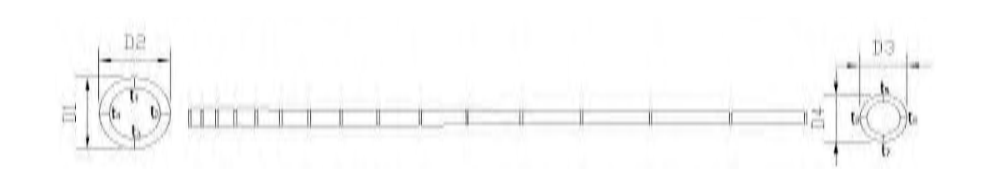
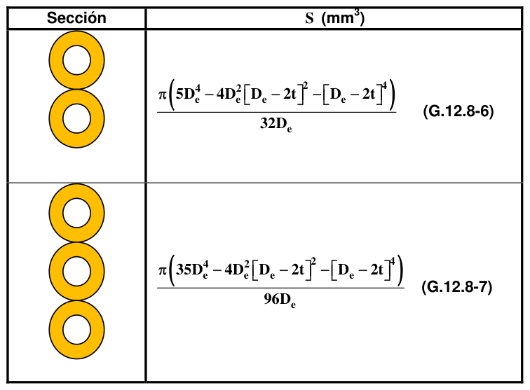

# G.12 — Estructuras de guadua

### G.12.1 — ALCANCE

**G.12.1.1** — El presente capitulo establece los requisitos para el diseño estructural y sismo resistente de estructuras cuyo elemento resistente principal es el bambú Guadua angustifolia Kunth. Una estructura de guadua diseñada de acuerdo con los requisitos de este Reglamento, tendrá un nivel de seguridad equivalente al de estructuras diseñadas con otros materiales.

**G.12.1.2** — Los requisitos de este capítulo pueden ser utilizados para el diseño de elementos de estructuras construidas totalmente con guadua, o para estructuras mixtas de guadua y otros materiales.

**G.12.1.3** — El diseño de construcciones para vivienda estará limitado a dos pisos, no se permitirán muros de mampostería o concreto en el nivel superior de las edificaciones. Esta norma no se podrá utilizar para el diseño de ningún tipo de puente o estructuras diferentes de edificaciones, limitándose a aquellas cuyo uso sea vivienda, comercio, industria y educación.

**G.12.1.4** — Cuando se construyan estructuras con un área superior a 2000 m2, se recomienda realizar una prueba de carga antes de darla en funcionamiento.

#### G.12.1.5 — Este Capítulo se puede complementar con el capítulo E.7

“Bahareque encementado”, capitulo E.8 — “Entrepisos y uniones en bahareque encementado”, y capitulo E.9 — “Cubiertas para construcción en bahareque encementado” del Titulo E — “Casas de uno y dos pisos” del presente Reglamento. Además se podrá complementar con las normas técnicas colombianas NTC-5300 Cosecha y postcosecha del culmo de guadua angustifolia kunth, NTC 5301 Preservación y secado del culmo de guadua angustifolia kunth, NTC 5407 Uniones de estructuras de guadua angustifolia kunth, NTC 5525 Métodos de ensayo para determinar las propiedades físicas y mecánicas de la guadua angustifolia kunth, publicadas por el Instituto Colombiano de Normas Técnicas y Certificación ICONTEC.

Además, en su redacción, se utilizó como material base las guías de diseño para estructuras de guadua angustifolia kunth, de la Universidad Nacional de Colombia, Sede Bogotá. Se recomienda el uso complementario de las normas citadas, pero en todo caso siempre primará lo expuesto en el presente capitulo.

### G.12.2 — TÉRMINOS Y DEFINICIONES

**G.12.2.1** — A continuación se definirán los términos más utilizados en este capítulo: Acción conjunta — Participación de tres o más elementos estructurales con una separación entre ellos no mayor de 600 mm, para soportar una carga o un sistema de cargas, y que están unidas entre sí de manera continua.

Alfarda — Par o cuchillo de una armadura de cubierta que se coloca perpendicular a la fachada.

Anisotropía — Propiedad de ciertos materiales que, como la guadua, presentan propiedades diferentes según la dirección que se considere.

Arandela — Pieza metálica en forma de corona, utilizada en uniones empernadas para repartir la fuerza en área mayor.

Armadura — Conjunto de elementos de guadua que ensamblados en configuraciones triangulares planas o espaciales conforman un sistema o sub-sistema estructural que resiste y transfiere carga en todas las direcciones, hacia la cimentación o los elementos de soporte.

Basa — Segundo segmento del culmo de guadua, a continuación de la cepa, con longitud entre 4 y 6 m.

Capacidad, de un elemento o componente estructural — Es la máxima fuerza axial, fuerza cortante y momento flector que es capaz de resistir un elemento o componente estructural.

Capacidad modificada para diseño — Es la capacidad de un elemento o componente estructural afectada por los coeficientes de modificación.

Carga de servicio — Cargas estipuladas en el Titulo B del presente Reglamento.

Cargar — Aplicar fuerzas a una estructura o elemento estructural.

Celosía — Viga de cordones paralelos con pendolones y diagonales que forman triángulos continuos.

Cepa — Primer segmento basal del culmo de guadua con longitudes que fluctúan entre 3 a 4 m; es la parte de la guadua que presenta el mayor diámetro y el mayor espesor de pared.

Cercha — Elemento estructural triangulado que recibe las cargas de la cubierta Coeficiente de modificación — Son los coeficientes por los cuales se afecta a los esfuerzos admisibles y a los módulos admisibles de elasticidad, para tener en cuenta las condiciones de uso particular de un elemento o componente estructural y así obtener los valores modificados que pueden ser usados en el diseño estructural.

Columna — Pieza cuyo trabajo principal es a compresión.

Columna armada — Columna formada por varias piezas ensambladas.

Columna espaciada — Columna formada a partir de dos o más piezas individuales de guadua, empernadas entre sí para funcionar como una sola.

Condición de uso — Se refiere a la condición de exposición al medio ambiente, a la forma de uso y al tipo de cargas que solicitaran al elemento durante su etapa de servicio.

Conicidad — Se define como la diferencia de los promedios de los diámetros en los extremos, dividida por la longitud entre ellos. Para la Guadua angustifolia la conicidad del culmo no debe ser mayor que 0.006.

Contracción — Reducción de las dimensiones de una pieza de madera causada por la disminución del contenido de humedad por debajo de la zona de saturación de las fibras, que se presenta en los sentidos radial, tangencial y longitudinal.

Cordones — Miembro superior o inferior de una armadura o cercha.

Cuchillo — Alfarda o par de una armadura de cubierta o vértices.

Culmo — Eje aéreo segmentado de los bambúes, formado por nudos y entrenudos, que emerge del rizoma; es el equivalente al tallo de un árbol.

Cumbrera o Caballete — Parte más alta del tejado en donde se unen los faldones.

Deformación inicial del eje — Es la deformación que puede experimentar una pieza de guadua por la curvatura del eje de la pieza, entendiéndose por curvatura la desviación del eje de la pieza respecto a la línea recta que une los centróides de sus secciones extremas.

Descargar — Remover fuerzas de una estructura o de un elemento estructural.

Densidad básica (DB) — se define como el cociente entre la masa en estado anhidro (guadua seca al horno) y el volumen de la guadua en estado verde (VV).

Diafragma — Subsistema estructural encargado de la transmisión y resistencia de las fuerzas horizontales principalmente por acción en su plano. Los diafragmas pueden ser horizontales (entrepisos y cubiertas), verticales (muros de corto) ó inclinados (cubiertas).

Distancia al extremo — Distancia del centro de un elemento de unión (conector) a la punta de la pieza de guadua.

Distancia centro a centro — Distancia del centro de un elemento de guadua al centro de otro elemento de guadua adyacente o distancia del centro de un elemento de unión al centro del elemento de unión adyacente.

Ductilidad por desplazamiento — Relación entre el desplazamiento correspondiente al esfuerzo de rotura del material y el desplazamiento correspondiente al esfuerzo de fluencia del material.

Elemento principal — En el diseño de uniones sometidas a cortante simple, es el elemento de guadua de mayor diámetro.

Elemento lateral o secundario — en conexiones sometidas a cortante simple o múltiple, son los elementos de guadua o platinas de acero no cubiertos por la definición anterior.

Entramado — Conjunto de elementos estructurales como vigas y viguetas en entrepisos y cubiertas o como pies derechos en muros, que se encargan de dar soporte al material de revestimiento.

Entrenudo — Porción del culmo comprendida entre dos nudos; también se le conoce como canuto o cañuto, su longitud varia a lo largo del culmo.

Esfuerzos admisibles — Son los esfuerzos de compresión paralela, compresión perpendicular, corte paralelo, flexión, tracción paralela y tracción perpendicular, que resisten los elementos estructurales de guadua.

Esfuerzos admisibles modificados para diseño — Es el esfuerzo resultante de multiplicar el esfuerzo admisible de referencia por los coeficientes de modificación aplicables. Es el esfuerzo que debe ser usado para realizar el diseño estructural y para revisar los criterios de aceptación.

Esfuerzo calculado — Es el esfuerzo resultante de las solicitudes de servicio.

Esterilla — Estera que se forma después de realizar incisiones longitudinales al culmo de guadua en estado verde y de abrirla en forma plana.

Faldón — Vertiente o cada uno de los planos o aguas que forma una cubierta.

Fibra — Célula alargada con extremos puntiagudos y casi siempre con paredes gruesas.

Modulo de elasticidad longitudinal admisible — Modulo de elasticidad de un elemento de madera medido en la dirección paralela a la fibra, multiplicado por los coeficientes de modificación aplicables.

Modulo de elasticidad mínimo longitudinal admisible — Es el modulo anterior, llevado al percentil 5, obtenido de el ensayo de flexión pura y afectado por un factor de seguridad.

Montante o pendolón — Pieza de guadua, normalmente en posición vertical en el plano de trabajo, que forma parte de una armadura.

Mortero — Mezcla de arena, cemento y agua, que para efectos de este Capítulo es utilizada para llenar los entrenudos en conexiones empernadas, también se utiliza para pegar ladrillos y pañetar muros o techos.

Muro de corte — Elemento vertical del sistema de resistencia a cargas laterales de la estructura.

Perno — Elemento de acero para unión de guaduas, provisto de cabeza hexagonal en un extremo y rosca en el otro.

Pie derecho — elemento vertical que trabaja a compresión. Piezas verticales de los entramados o muros de corte.

Preservación — Tratamiento que consiste en aplicar substancias capaces de prevenir o contrarrestar la acción de alguno o varios tipos de organismos que destruyen o afectan la integridad de la guadua.

Preservante — sustancia que se aplica para prevenir o contrarrestar por un periodo de tiempo, la acción de alguno o varios tipos de organismos capaces de destruir o afectar la guadua.

Pudrición — Este tipo de defecto corresponde a la descomposición de los culmos de guadua por ataque de agentes biológicos o humedad, que producen cambios en su apariencia, color y propiedades físicas y mecánicas.

Revestimiento estructural — Material que recubre la superficie de un muro de corte o de un diafragma horizontal.

Revoque o Pañete — Capa de mortero sobre muro.

Rigidizador — Pieza de guadua cuyo objeto es disminuir el pandeo de elemento sometidos a compresión paralela.

Riostra o Contraviento — elemento estructural empleado para estabilizar una cubierta en su plano. Pieza que puesta de forma oblicua o transversal asegura la invariabilidad de forma de un entramado.

Secado — Proceso natural o mecánico mediante el cual se reduce el contenido de humedad de la guadua.

Sección — Perfil o figura que resulta de cortar una pieza o cuerpo cualquiera por un plano.

Sección compuesta — Sección formada por la unión de dos o más guaduas.

Sección transversal — es aquella sección que resulta de cortar una guadua en sentido perpendicular a las fibras.

Sistema estructural — Es el conjunto de elementos o componentes estructurales o de subsistemas estructurales diseñados, detallados y ensamblados para resistir la totalidad o una porción de las cargas (verticales, horizontales o ambas) que actúan en una edificación, y para transferirlas a un punto final de aplicación (cimentación) a través de una o varias trayectorias continuas de carga.

Sobrebasa — Tercer segmento del culmo de guadua, localizado a continuación de la basa con longitudes hasta de 4 m.

Solera — Elemento superior o inferior del entramado de muros.

Solicitación — Fuerza interna (axial, cortante, momento flector o tracción) que actúa en una sección determinada de un elemento o componente estructural. También se entenderá, como los esfuerzos asociados a cada una de las fuerzas internas que actúen en una sección determinada de un elemento o componente estructural y que se calculan a partir de la teoría de la elasticidad.

Tirante — Elemento de un sistema estructural que trabaja a tracción bajo cargas de servicio.

Tuerca — Complemento metálico, generalmente hexagonal, provisto de cabeza y rosca helicoidal incorporada.

Varilla roscada — Elemento cilíndrico de acero con rosca helicoidal en toda su longitud para unión entre guaduas.

Varillón — Segmento terminal del culmo de guadua, localizado a continuación de la sobrebasa, con longitudes hasta de 4 m. Se utiliza tradicionalmente en cubiertas como soporte de tejas de barro.

Viga — Pieza cuyo trabajo principal es la flexión.

Viga de sección compuesta — Viga conformada por dos o más guaduas conectadas de tal forma que se garantice el trabajo en conjunto.

Vigueta — Pieza cuyo trabajo principal es la flexión, pero que hace parte de un conjunto de elementos que trabajan juntos.

Zuncho — Abrazadera metálica que envuelve la circunferencia de la guadua

#### G.12.2.2 — NOMENCLATURA

Los símbolos aplicados en este capítulo se describen a continuación:

$D_{e}$ = diámetro exterior de la guadua

$f0.05i$ = esfuerzo del percentil 5 en la solicitación $i$

$f_{ki}$= valor característico en la solicitación $i$

$m$ = promedio de una muestra estadística

$n$ = numero de probetas de una muestra estadística

$s$ = desviación estándar de una muestra estadística

$t$ = espesor de la pared de la guadua El resto de la nomenclatura utilizado en este capítulo coincide con la utilizada en los capítulos de estructuras de madera del presente Titulo.

### G.12.3 — MATERIALES

#### G.12.3.1 — REQUISITOS DE CALIDAD PARA GUADUA ESTRUCTURAL

La guadua rolliza utilizada como elemento de soporte estructural en forma de columna, viga, vigueta, pie derecho, entramados, entrepisos etc., debe cumplir con los siguientes requisitos:

(a) La guadua debe ser de la especie Guadua angustifolia Kunth. El presente capitulo no contempla la posibilidad de utilizar otras especies de bambúes como elemento estructural.

(b) La edad de cosecha para guadua estructural debe estar entre los 4 y los 6 años.

(c) El contenido de humedad de la guadua debe corresponder con el contenido de humedad de equilibrio del lugar. Cuando las edificaciones se construyan con guadua en estado verde se deben tener en cuenta todas las precauciones posibles para garantizar que las piezas al secarse tengan el dimensionamiento previsto en el diseño.

(d) La guadua estructural debe tener una buena durabilidad natural o estar adecuadamente preservada.

Además se deben aplicar todos los recursos para protegerla mediante el diseño del contacto con la humedad, la radiación solar, los insectos y los hongos.

#### G.12.3.2 — CLASIFICACIÓN VISUAL POR DEFECTOS

**G.12.3.2.1** — Las piezas de guadua estructural no pueden presentar una deformación inicial del eje mayor al 0.33% de la longitud del elemento. Esta deformación se reconoce al colocar la pieza sobre una superficie plana y observar si existe separación entre la superficie de apoyo y la pieza.

**G.12.4.2.2** — Las piezas de guadua estructural no deben presentar una conicidad superior al 1.0%

**G.12.3.2.3** — Las piezas de guadua estructural no pueden presentar fisuras perimetrales en los nudos ni fisuras longitudinales a lo largo del eje neutro del elemento. En caso de tener elementos con fisuras, estas deben estar ubicadas en la fibra externa superior o en la fibra externa inferior.

**G.12.3.2.4** — Piezas de guadua con agrietamientos superiores o iguales al 20% de la longitud del culmo no serán consideradas como aptas para uso estructural.

**G.12.3.2.5** — Las piezas de guadua estructural no deben presentar perforaciones causadas por ataque de insectos xilófagos antes de ser utilizadas.

**G.12.3.2.6** — No se aceptan guaduas que presenten algún grado de pudrición.

**G.12.3.2.7** — Todo proceso de preservación y secado de piezas de guadua rolliza debe seguir lo estipulado en la norma NTC 5301.

#### G.12.3.4 — CLASIFICACIÓN MECÁNICA

La clasificación mecánica de la guadua se ha realizado según lo estipulado en la norma NTC 5525, en relación con su capacidad a resistir cargas de compresión paralela, corte paralelo, flexión y tracción, así como, en su modulo de elasticidad. Las propiedades de la guadua se relacionan en la tabla G.12.7-1 y G.12.7-2

**G.12.3.4.1** — Para calcular el peso propio de la estructura se recomienda usar un masa específica 800 kg/m3 para la guadua angustifolia kunth. Esta masa específica también se puede calcular siguiendo los procedimientos de la norma NTC 5525. Véase B.3.2.

### G.12.4 — OBTENCIÓN Y COMERCIALIZACIÓN

La obtención y comercialización de la guadua estructural debe cumplir con las disposiciones emanadas por el Ministerio de Ambiente, Vivienda y Desarrollo Territorial y por la autoridad ambiental local.

### G.12.5 — MATERIALES COMPLEMENTARIOS

El diseño de estructuras de guadua debe tener en cuenta las características de los materiales complementarios tales como clavos, pernos, conectores, adhesivos, soportes y tableros, según las recomendaciones de los fabricantes. Se deben tomar todas las medidas apropiadas de protección de estos materiales contra la humedad, la corrosión o cualquier agente que degrade su integridad estructural.

### G.12.6 — BASES PARA EL DISEÑO ESTRUCTURAL

#### G.12.6.1 — REQUISITOS DE DISEÑO

Una estructura en guadua debe ser diseñada y construida teniendo en cuenta los siguientes requisitos

**G.12.6.1.1** — Todos los elementos de guadua de una estructura deben ser diseñados, construidos y empalmados para resistir los esfuerzos producidos por las combinaciones de de las cargas de servicio consignadas en B.2.3.1 del presente reglamento y las limitaciones de deflexión estipuladas en G.12.8.9

**G.12.6.1.2** — Toda construcción de guadua debe tener un sistema estructural que se ajuste a uno de los tipos definidos en A.3.2 del presente Reglamento.

**G.12.6.1.3** — El diseño estructural debe reflejar todas las posibles cargas actuantes sobre la estructura durante las etapas de construcción y servicio; además de las condiciones ambientales que puedan genera cambios en las suposiciones de diseño o que pueden afectar la integridad de otros componentes estructurales.

**G.12.6.1.4** — El análisis y diseño de estructuras de guadua debe basarse en los principios de la mecánica estructural, los requisitos básicos descritos en A.3.1 del presente reglamento y los requisitos particulares que se encuentran relacionados en el presente capitulo G.12

**G.12.6.1.5** — Los elementos se consideraran homogéneos y lineales para el cálculo de los esfuerzos producidos por las cargas aplicadas.

**G.12.6.1.6** — El Coeficiente de capacidad de disipación de energía básico para estructuras de guadua, cuyo sistema de resistencia sísmica sea el de pórticos con diagonales será de $R_{0}=2.0$. En el caso, en que el sistema de resistencia sísmica sea proporcionado por muros de madera laminada o muros de bahareque encementado, se debe tomar el valor correspondiente de $R_{0}$ , para el sistema elegido.

#### G.12.6.2 — REQUISITOS DE CALIDAD PARA LAS ESTRUCTURAS EN GUADUA

Para garantizar el correcto funcionamiento de la estructura en guadua durante toda su vida útil se debe tener en cuenta lo siguiente.

**G.12.6.2.1** — Las estructuras sean diseñadas por un profesional que cumpla los requisitos al respecto de la Ley 400 de 1997.

**G.12.6.2.2** — La construcción de la edificación debe realizarse por personal debidamente entrenado para tal fin y bajo la dirección de un profesional según lo prescrito por la Ley 400 de 1997, la Ley 1229 de 2008 y sus decretos reglamentarios.

**G.12.6.2.3** — Los materiales y productos que sean usados en la construcción deben emplearse como se especifica en este Reglamento y siguiendo las especificaciones de uso dadas por el fabricante.

**G.12.6.2.4** — Las estructuras de guadua por estar fabricadas con un material de origen natural deben tener un adecuado mantenimiento preventivo, que garantice, que los elementos no sean atacados por insectos u hongos durante su vida útil.

**G.12.6.2.5** — La estructura debe tener durante toda su vida útil el mismo uso para el cual fue diseñada.

**G.12.6.2.6** — Cuando la estructura de guadua se utilice como cubierta de piscinas de natación en donde se utiliza cloro, debe establecerse en el diseño y construcción que no se producirá ataque del cloro a la guadua y que se han tomado todas las precauciones para evitar un deterioro de la guadua y una disminución de su resistencia estructural por esta causa.

**G.12.6.6** — Para la determinación del diámetro y del espesor real de la pared del culmo se debe seguir los siguientes procedimientos:

(a) Diámetro — Medir en cada segmento del culmo el diámetro en ambos extremos y en dos direcciones perpendiculares entre sí. El diámetro real corresponde al promedio de las cuatro (4) mediciones.

(b) Espesor — Tomar cuatro (4) mediciones en cada sección transversal del culmo, y medir además, el espesor en los mismos sitios en que se midió el diámetro. El espesor real corresponde al promedio de las ocho (8) mediciones, véase figura G.12.6-1

Figura G.12.6-1

**G.12.6.7** — En ningún caso de debe utilizar estructuras de guadua cuando la temperatura a la cual van a estar sometidas exceda 65º C.

### G.12.7 — MÉTODO DE DISEÑO ESTRUCTURAL

**G.12.7.1** — Todos los elementos deben ser diseñados por el método de los esfuerzos admisibles como se define el Título B del presente Reglamento.

**G.12.7.2** — Todas las uniones de la estructura se consideran articuladas y no habrá transmisión de momentos entre los diferentes elementos que conformen una unión, salvo si uno de los elementos es continuo, en este caso habrá transmisión solo en el elemento continuo.

#### G.12.7.3 — ESFUERZOS ADMISIBLES Y MÓDULOS DE ELASTICIDAD

Toda guadua que cumpla con los requisitos de calidad establecidos en los numerales G.12.3.1 y G.12.3.2, debe utilizar para efectos de cálculo los valores de esfuerzos admisibles y módulos de elasticidad consignados en las tablas G.12.7-1 y G.12.7-2 respectivamente, y que fueron obtenidos según lo estipulado en G.12.7.4 del presente Capitulo.

**Tabla G.12.7-1**

Esfuerzos admisibles $F_{i}$ (MPa), CH=12%

| $F_{b}$ Flexión | $F_{t}$ Tracción | $F_{c}$ Compresión ║ | $F_{p*}$ Compresión ┴ | $F_{v}$ Corte |
|---|---|---|---|---|
| 15 | 18 | 14 | 1.4 | 1.2 |

║ = compresión paralela al eje longitudinal.

┴ = compresión perpendicular al eje longitudinal.

*La resistencia a la compresión perpendicular está calculada para entrenudos rellenos con mortero de cemento.

**Tabla G.12.7-2**

Módulos de elasticidad, $E_{i}$ (MPa), CH=12%

| Módulo promedio $E_{0.5}$ | Módulo percentil 5 $E_{0.05}$ | Módulo mínimo $E_{min}$ |
|---|---|---|
| 9.500 | 7.500 | 4.000 |

Para el análisis de elementos estructurales se debe utilizar $E_{0.5}$, como modulo de elasticidad del material. El $E_{min}$ se debe utilizar para calcular los coeficientes de estabilidad de vigas $(C_{L})$ y de Columnas $(C_{p})$. El $E_{0.05}$ se debe utilizar para calcular las deflexiones cuando las condiciones de servicio sean críticas o requieran un nivel de seguridad superior al promedio. En todo caso, la escogencia del módulo de elasticidad indicado dependerá del criterio del ingeniero calculista.

#### G.12.7.4 — Esfuerzos Admisibles

Los valores de esfuerzos admisibles se determinan a partir del valor característico, el cual se obtiene con la siguiente ecuación:

$$ f_{ki} = f_{0.05i} \left[1 - \dfrac{2.7\,\dfrac{s}{m}}{\sqrt{n}}\right] \tag{G.12.7-1} $$

Donde:

$f_{ki}$= valor característico en la solicitación $i$

$f0.05i$= valor correspondiente al percentil 5 de los datos de las pruebas de laboratorio en la solicitación $i$

$m$ = valor promedio de los datos de las pruebas de laboratorio

$s$ = desviación estándar de los datos de las pruebas de laboratorio

$n$ = numero de ensayos (por lo menos 20)

$i$ = subíndice que depende del tipo de solicitación ($b$ para flexión, $t$ para tracción paralela a las fibras, $c$ para compresión paralela a las fibras, $p$ para compresión perpendicular a las fibras, $v$ para cortante paralelo a las fibras) Los valores experimentales utilizados en el diseño deben estar apropiadamente relacionados en la memoria de cálculo estructural que se radique para solicitar la licencia de construcción, indicando el nombre del laboratorio, fecha de realización de los ensayos, descripción de los equipos utilizados en las pruebas, número de pruebas realizadas y profesional que dirigió los ensayos.

Una vez determinado el valor característico para cada solicitación, se procede con el cálculo de los esfuerzos admisibles con la siguiente formula.

$$ F_i = \dfrac{FC}{F_s \cdot FDC}\,f_{ki} \tag{G.12.7-2} $$

Donde:

$F_{i}$ = esfuerzo admisible en la solicitación $i$

$f_{ki}$= valor característico del esfuerzo en la solicitación $i$

$FC$ = factor de reducción por diferencias entre las condiciones de los ensayos en el laboratorio y las condiciones reales de aplicación de las cargas en la estructura (véase tabla G.12.7-3)

$F_{s}$ = factor de Seguridad (véase tabla G.12.7-3)

$FDC$ = factor de duración de carga (véase tabla G.12.7-3)

$i$ = subíndice que depende del tipo de solicitación ($b$ para flexión, $t$ para tracción paralela a las fibras, $c$ para compresión paralela a las fibras, $p$ para compresión perpendicular a las fibras, $v$ para cortante paralelo a las fibras)

**Tabla G.12.7-3**

Factores de reducción

| Factor | Flexión | Tracción | Compresión ║ | Compresión ┴ | Corte |
|---|---|---|---|---|---|
| $FC$ | - | 0.5 | - | - | 0.6 |
| $F_{s}$ | 2.0 | 2.0 | 1.5 | 1.8 | 1.8 |
| $FDC$ | 1.5 | 1.5 | 1.2 | 1.2 | 1.1 |

#### G.12.7.5 — COEFICIENTES DE MODIFICACIÓN

Con base en los valores de esfuerzos admisibles de la tabla G.12.7-1 y los módulos de elasticidad de la tabla G.12.7-2, afectados por los coeficientes de modificación a que haya lugar por razón del tamaño, nudos, grietas, contenido de humedad, duración de carga, esbeltez y cualquier otra condición modificatoria, se determinan las solicitaciones admisibles de todo miembro estructural, según las prescripciones de los numerales siguientes, con los esfuerzos admisibles modificados de acuerdo con la formula general:

$$ F'_i = F_i C_D C_m C_t C_L C_F C_r C_p C_c \tag{G.12.7-3} $$

Donde

$i$ = tiene el mismo significado que en el numeral anterior

$C_{D}$ = coeficiente de modificación por duración de carga

$C_{m}$ = coeficiente de modificación por contenido de humedad

$C_{t}$ = coeficiente de modificación por temperatura

$C_{L}$ = coeficiente de modificación por estabilidad lateral de vigas

$C_{F}$= coeficiente de modificación por forma

$C_{r}$ = coeficiente de modificación por redistribución de cargas, acción conjunta

$C_{p}$ = coeficiente de modificación por estabilidad de columnas

$C_{c}$ = coeficiente de modificación por cortante

$F_{i}$ = esfuerzo admisible en la solicitación $i$

$F_{i}'$ = esfuerzo admisible modificado para la solicitación $i$ Los coeficientes de modificación de aplicación general se indican en los numerales siguientes; los que dependen de la clase de solicitación se estipulan en las secciones del Capítulo G.12 correspondientes.

#### G.12.7.6 — POR DURACIÓN DE LA CARGA $(CD)$

Se considera que la duración normal de una carga son 10 años, cuando un elemento estructural está sometido a duraciones de carga diferentes, se debe multiplicar los valores de la tabla G12.7-1 por los valores de la tabla G.12.7-4

**Tabla G.12.7-4**

Coeficientes de modificación por duración de carga

| Duración de carga | Flexión | Tracción | Compresión ║ | Compresión ┴ | Corte | Carga de diseño |
|---|---|---|---|---|---|---|
| Permanente | 0.90 | 0.90 | 0.9 | 0.9 | 0.90 | Muerta |
| Diez años | 1.00 | 1.00 | 1.0 | 0.9 | 1.00 | Viva |
| Dos meses | 1.15 | 1.15 | 1.15 | 0.9 | 1.15 | Construcción |
| 7 días | 1.25 | 1.25 | 1.25 | 0.9 | 1.25 |  |
| Diez minutos | 1.60 | 1.60 | 1.6 | 0.9 | 1.60 | Viento y Sismo |
| impacto | 2.00 | 2.00 | 2.0 | 0.9 | 2.00 | Impacto |

Los incrementos anteriores no son acumulables. Cuando hay combinación de cargas, el dimensionamiento de los elementos debe hacerse para la condición más desfavorable.

#### G.12.7.7 — POR CONTENIDO DE HUMEDAD $(C_{m})$

La guadua al igual que la madera pierde resistencia y rigidez, a medida que aumenta su contenido de humedad. Los valores de esfuerzos admisibles y módulos de elasticidad reportados en las tablas G.12.7-1 y G.12.7-2 fueron calculados para un contenido de humedad de la guadua de CH=12%. Si las condiciones medioambientales en el sitio de construcción hacen variar el contenido de humedad de la guadua por encima del 12%, se deben ajustar los valores de las tablas G.12.7-1 y G.12.7-2, multiplicándolos por los valores de la tabla G.12.7-5

**Tabla G.12.7-5**

Coeficientes de modificación por contenido de humedad $(C_{m})$

| Esfuerzos |  | $CH≤12\%$ | $CH=13\%$ | $CH=14\%$ | $CH=15\%$ | $CH=16\%$ | $CH=17\%$ | $CH=18\%$ | $CH≥19\%$ |
|---|---|---|---|---|---|---|---|---|---|
| Flexión | $F_{b}$ | 1.0 | 0.96 | 0.91 | 0.87 | 0.83 | 0.79 | 0.74 | 0.70 |
| Tracción | $F_{t}$ | 1.0 | 0.97 | 0.94 | 0.91 | 0.89 | 0.86 | 0.83 | 0.80 |
| Compresión paralela | $F_{c}$ | 1.0 | 0.96 | 0.91 | 0.87 | 0.83 | 0.79 | 0.74 | 0.70 |
| Compresión perpendicular | $F_{p}$ | 1.0 | 0.97 | 0.94 | 0.91 | 0.89 | 0.86 | 0.83 | 0.80 |
| Corte | $F_{y}$ | 1.0 | 0.97 | 0.94 | 0.91 | 0.89 | 0.86 | 0.83 | 0.80 |
| Modulo de elasticidad | $E_{0.5}$ | 1.0 | 0.99 | 0.97 | 0.96 | 0.94 | 0.93 | 0.91 | 0.90 |
|  | $E_{0.05}$ |  |  |  |  |  |  |  |  |
|  | $E_{min}$ |  |  |  |  |  |  |  |  |

La guadua una vez ha sido cosechada tiende a secarse hasta alcanzar un contenido de humedad de equilibrio con el sitio en donde se encuentra. Si el secado es mecánico y se logra bajar el contenido de humedad de la guadua por debajo del 12%, esta podrá ganar humedad si el sitio final de la edificación tiene una humedad relativa del ambiente muy alta acompañada de una temperatura baja.

En la tabla G-D.1 del apéndice G-D del presente Titulo se muestran los contenidos de humedad de equilibrio para algunas de las principales ciudades de Colombia.

#### G.12.7.8 — POR TEMPERATURA $(C_{t})$

Cuando los elementos estructurales de guadua estén sometidos a altas temperaturas, los valores de esfuerzos admisibles y módulos de elasticidad de las tablas G.12.7-1 y G.12.7-2 respectivamente, deben ser multiplicados por los valores de la tabla G.12.7-6, para la condición de temperatura a la cual estén expuestos.

**Tabla G.12.7-6** — .

Coeficientes de modificación por temperatura $(C_{t})$

| Esfuerzos |  | Condiciones de servicio | $(C_{t})$ |  |  |
|---|---|---|---|---|---|
|  |  |  | $T≤37^{\circ} C$ | $37^{\circ} C≤T≤52^{\circ} C$ | $52^{\circ} C≤T≤65^{\circ} C$ |
| Flexión | $F_{b}$ | Húmedo | 1.0 | 0.60 | 0.40 |
|  |  | Seco |  | 0.85 | 0.60 |
| Tracción | $F_{t}$ | Húmedo |  | 0.85 | 0.80 |
|  |  | Seco |  | 0.90 |  |
| Compresión paralela | $F_{c}$ | Húmedo |  | 0.65 | 0.40 |
|  |  | Seco |  | 0.80 | 0.60 |
| Compresión perpendicular | $F_{p}$ | Húmedo |  | 0.80 | 0.50 |
|  |  | Seco |  | 0.90 | 0.70 |
| Corte | $F_{y}$ | Húmedo |  | 0.65 | 0.40 |
|  |  | Seco |  | 0.80 | 0.60 |
| Modulo de elasticidad | $E$ | Húmedo |  | 0.80 | 0.80 |
|  |  | Seco |  | 0.90 |  |

#### G.12.7.9 — POR ACCIÓN CONJUNTA $(C_{r})$

Los esfuerzos admisibles podrán incrementarse en un 10% cuando exista una acción de conjunto garantizada de cuatro o más elementos de igual rigidez, como en el caso de viguetas y pies derechos en entramados $(C_{r}=1.1)$, siempre y cuando la separación entre elementos no sea superior a 0.6 m

### G.12.8 — DISEÑO DE ELEMENTO SOMETIDOS A FLEXIÓN

**G.12.8.1** — El diseño de elementos a flexión en guadua rolliza seguirá los mismos procedimientos básicos usados en el diseño de vigas de otros materiales estructurales. Debido a que la guadua angustifolia kunth presenta una relación $MOR /MOE$ muy alta, lo que la convierte en un material muy flexible, el análisis a flexión estará regido por el control de las deflexiones admisibles, salvo en algunas excepciones, no obstante, siempre se debe comprobar la resistencia a la flexión, corte y aplastamiento.

**G.12.8.2** — En el diseño de miembros o elementos de guadua sometidos a flexión se deben verificar los siguientes efectos y en ningún caso pueden sobrepasar los esfuerzos admisibles modificados para cada solicitación.

(a) Deflexiones

(b) Flexión, incluyendo estabilidad lateral en vigas compuestas.

(c) Cortante paralelo a la fibra.

(d) Aplastamiento (compresión perpendicular a la fibra)

**G.12.8.3** — Se debe garantizar que los apoyos de un elemento de guadua rolliza sometido a flexión no fallen por aplastamiento (compresión perpendicular), en la medida de lo posible estos deben terminar en nudos, si esto no ocurre o los nudos no proveen la suficiente resistencia, se deben rellenar los entrenudos (cañutos) de los apoyos con mortero de cemento.

**G.12.8.4** — Cuando exista una carga concentrada sobre un elemento, ésta debe estar aplicada sobre un nudo; en todo caso se deben tomar las medidas necesarias para evitar una falla por corte paralelo a la fibra, y/o aplastamiento en el punto de aplicación. En estos casos se recomienda rellenar los entrenudos adyacentes a la carga con mortero de cemento.

**G.12.8.5** — Cuando en la construcción de vigas se utiliza más de un culmo (vigas de sección compuesta), estos deben estar unidos entre sí con pernos o varilla roscada y cintas metálicas (zunchos), que garanticen el trabajo en conjunto. Estos conectores deben diseñarse para resistir las fuerzas que se generan en la unión.

#### G.12.8.6 — PERFORACIONES

Debe evitarse practicar perforaciones en las vigas; de requerirse, deben encontrarse consignadas en los planos y cumplir con las siguientes limitaciones:

**G.12.8.6.1** — No son permitidas perforaciones a la altura del eje neutro en secciones donde se tengan cargas puntuales o cerca de los apoyos.

**G.12.8.6.2** — En casos diferentes al anterior, las perforaciones deben localizarse a la altura del eje neutro y en ningún caso serán permitidas en la zona de tensión de los elementos.

**G.12.8.6.3** — El tamaño máximo de la perforación será de 3.81 mm.

**G.12.8.6.4** — En los apoyos y los puntos de aplicación de cargas puntuales se permiten las perforaciones, siempre y cuando estas sean para poder rellenar los entrenudos con mortero de cemento.

#### G.12.8.7 — ÁREA NETA

El área de la sección transversal constituida por un (1) solo culmo será calculada con la siguiente ecuación:

$$ A = \dfrac{\pi}{4} \left(D_e^2 - \left(D_e - 2t\right)^2\right) \tag{G.12.8-1} $$

Donde:

$A$ = área neta de la sección transversal de guadua, mm2

$D_{e}$ = diámetro exterior de la guadua, mm

$t$ = espesor de la pared de la guadua, mm En el proceso de construcción de la estructura se deben respetar los parámetros de diseño en especial los referentes al diámetro exterior y el espesor mínimo de pared, los elementos utilizado en obra debe tener mínimo las mismas medidas del diseño en su parte superior (parte más estrecha de la guadua)

#### G.12.8.8 — LUZ DE DISEÑO

La luz de diseño considerada para vigas con apoyo simple, o en voladizo, será la luz libre entre caras de soporte más la mitad de la longitud del apoyo en cada extremo. En el caso de vigas continuas la luz de diseño considerada será la distancia centro a centro de apoyos.

#### G.12.8.9 — DEFLEXIONES

**G.12.8.9.1** — La guadua angustifolia kunth presenta una relación $MOR /MOE$ muy alta, lo que obliga a que el diseño de elementos a flexión este regido por las deflexiones admisibles. En este subcapítulo se establecen los requisitos y limitaciones de las deflexiones admisibles, obtención de la sección requerida y deflexiones inmediatas y diferidas.

**G.12.8.9.2** — Las deflexiones en elementos de guadua se deben calcular de acuerdo a las formulas de la teoría elástica tradicional, se debe considerar la deflexión producida por la flexión y si el caso de análisis lo amerita se debe realizar una corrección del modulo de elasticidad $E_{0.5}'$ por cortante $(G )$.

<!-- mod:3-decreto-945-2017-74 -->
> *Texto vigente según el Decreto 945 de 2017 (anexo, p. 35).*

**G.12.8.9.3** — Para el cálculo de la deflexión en vigas simplemente apoyadas se utilizarán las formulas de la Tabla G.12.8-1

**Tabla G.12.8-1**

Fórmulas para el cálculo de deflexiones

| Condición de carga | Deflexión |
|---|---|
| Carga Puntual en el centro de la luz | $\Delta = \dfrac{P l^{3}}{48 E I}$ (G.12.8-2) |
| Carga distribuida | $\Delta = \dfrac{5}{384}\,\dfrac{\omega l^{4}}{E I}$ (G.12.8-3) |

Para otras condiciones de carga se deben utilizar las formulas de la teoría de la elasticidad.

**G.12.8.9.4** — Las deflexiones admisibles estarán limitadas a los valores de la tabla G.12.8-2

**Tabla G.12.8-2**

Deflexiones admisibles $δ$ (mm), nota3

| Condición de servicio | Cargas vivas $(l /k)$ | Viento o Granizo $(l /k)$ | Cargas totales $(l /k)$ Nota 2 |
|---|---|---|---|
| Elementos de techo / Cubiertas |  |  |  |
| Cubiertas inclinadas |  |  |  |
| Cielo rasos de pañete o yeso | l/360 | l/360 | l/240 |
| Otros cielo rasos | l/240 | l/240 | l/180 |
| Sin cielo raso | l/240 | l/240 | l/180 |
| Techos planos | Nota 1 | Nota 1 | l/300 |
| Techos industriales | - | - | l/200 |
| Entrepisos |  |  |  |
| Elementos de entrepiso | l/360 | - | l/240 |
| Entrepisos rígidos | - | - | l/360 |
| Muros exteriores |  |  |  |
| Con acabados frágiles | - | l/240 | - |
| Con acabados flexibles | - | l/120 | - |

Notas:

1. Dependiendo del tipo de cielo raso

2. Por evaluación de cargas totales, a largo plazo estas no deben invertir pendientes de drenaje en techos.

3. Considerando únicamente la deflexión inicial G.12.8.9.7

**G.12.8.9.5** — Las deflexiones de vigas, viguetas, entablados, pies derechos, se calcularán con el módulo de elasticidad promedio $E_{0.5}'$, no obstante, si las condiciones de servicio son severas o el nivel de seguridad requerido es muy alto, se podrá utilizar el módulo de elasticidad del percentil 0.05, $E_{0.05}'$, o el modulo de elasticidad mínimo, $E_{mn}$, en todo caso la escogencia del modulo dependerá del criterio del ingeniero diseñador estructural.

**G.12.8.9.6** — EFECTO DEL CORTANTE — Para los elementos con relación de $l /D_{e}≤15$, se debe realizar una corrección por cortante $(C_{c})$, en la tabla G.12.8-3 se relacionan los valores de $C_{c}$ para el modulo de elasticidad promedio $E_{0.5}$.

**Tabla G.12.8-3**

Valores de $C_{c}$

| $l /D_{e}$ | $C_{c}$ |
|---|---|
| 5 | 0.70 |
| 7 | 0.75 |
| 9 | 0.81 |
| 11 | 0.86 |
| 13 | 0.91 |
| 15 | 0.93 |

Nota: La guadua angustifolia kunth tiene una relación de $E /G=28$

**G.12.8.9.7** — CARGAS PARA CÁLCULO DE SECCIÓN Y DEFLEXIONES — Para efecto de calcular la sección transversal mínima requerida y solo para ese caso, se debe igualar la deflexión calculada con las cargas de la tabla G.12.8-4, con la deflexión admisible de la tabla G.12.8-2 y determinar el momento de inercia I requerido. Igualmente en la tabla G.12.8-4 se presentan las combinaciones de carga para el cálculo de las deflexiones inmediatas y diferidas a 30 años

**Tabla G.12.8-4**

Cargas w para cálculo de sección y deflexiones

| Condición | $CH≤19\% t≤37^{\circ} C$ Clima constante | $CH≥19\% t≤37^{\circ} C$ Clima variable |
|---|---|---|
| Calculo de sección $( w)$ | 2.0 D + L | 2.0 D + L |
| Deflexiones inmediatas $(W_{i}−)$ | D + L | D + L |
| Deflexiones diferidas $(W_{f}−)$ | 2.8 D + 1.3 L | 3.8 D + 1.4 L |

#### G.12.8.10 — FLEXIÓN

**G.12.8.10.1** — Los esfuerzos máximos de tensión y compresión producidos por flexión serán calculados para la sección de máximo momento. Estos esfuerzos no deben exceder al máximo esfuerzo admisible por flexión $F_{b}$ de la tabla G.12.7-1, establecida para los culmos de guadua rolliza, modificado por los coeficientes de duración de carga y redistribución de carga, según el caso.

**G.12.8.10.2** — Los coeficientes de modificación particulares para flexión son los que se indican a continuación.

**G.12.8.10.3** — ESTABILIDAD LATERAL Y COEFICIENTE DE MODIFICACIÓN $(C_{L})$ — En vigas o viguetas conformadas por una sola guadua el coeficiente modificación será $C_{L}=1$. Cuando una viga está conformada por dos o más guaduas (viga de sección compuesta), se debe verificar si esta requiere o no de soporte lateral en la zona comprimida. El coeficiente de modificación por estabilidad lateral $(C_{L})$, tiene en cuenta la reducción de la capacidad de carga de un elemento sometido a flexión por causa de la inestabilidad lateral o pandeo, que sucede cuando la zona a compresión de una viga se comporta como una columna.

**G.12.8.10.4** — Cuando una viga de sección compuesta esta soportada en toda la longitud de la zona a compresión y además está restringida en los apoyos a la rotación el coeficiente de modificación por estabilidad lateral será $C_{L}=1$.

**G.12.8.10.5** — En el caso de vigas de sección compuesta (dos o más guaduas), cuya relación alto $( d)$ ancho $( b)$ sea mayor que $1 (d /b>1)$, deben incluirse soportes laterales para prevenir el pandeo o la rotación $b$

Figura G.12.8-1 — Ejemplo de sección compuesta

**G.12.8.10.6** — ESTABILIDAD LATERAL DE VIGAS COMPUESTAS — Para vigas de sección compuesta por dos o más guaduas se debe reducir el esfuerzo admisible a flexión $(F_{b})$, por el valor de $C_{L}$ de la tabla G.12.8-5

**Tabla G.12.8-5**

Coeficientes $C_{L}$ para diferentes relaciones $d /b$

| $d /b$ | $C_{L}$ |
|---|---|
| 1 | 1.00 |
| 2 | 0.98 |
| 3 | 0.95 |
| 4 | 0.91 |
| 5 | 0.87 |

**G.12.8.10.7** — ESTABILIDAD LATERAL — En vigas compuestas por más de una guadua y cuya altura sea mayor que su ancho debe investigarse la necesidad de proveer soporte lateral a la zona comprimida del elemento, según las siguientes recomendaciones:

(a) Si $d /b=2$ no se requerirá soporte lateral

(b) Si $d /b=3$ se debe restringir el desplazamiento lateral de los apoyos.

(c) Si $d /b=4$ se debe restringir el desplazamiento lateral de los apoyos y del borde en compresión mediante correas o viguetas.

(d) Si $d /b=5$ se debe restringir el desplazamiento lateral de los apoyos y proveer soporte continuo del borde en compresión mediante un entablado.

**G.12.8.10.8** — MOMENTO RESISTENTE — El esfuerzo a flexión actuante $(f_{b})$ sobre cualquier sección de guadua rolliza, no debe exceder el valor del esfuerzo a flexión admisible $(F_{b}')$ modificado por los coeficientes correspondientes, de acuerdo a la formula G.12.8-4

$$ f_b = \dfrac{M}{S} \le F'_b \tag{G.12.8-4} $$

En donde:

$f_{b}$ = esfuerzo a flexión actuante, en MPa

$M$ = momento actuante sobre el elemento en N.mm

$F_{b}'$ = esfuerzo admisible modificado, en MPa

$S$ = modulo de sección en mm3 El modulo de sección $S$ , para una guadua se expresa con la siguiente ecuación:

$$ S = \dfrac{\pi \left(D_e^4 - \left[D_e - 2t\right]^4\right)}{32\,D_e} \tag{G.12.8-5} $$

En donde:

$S$ = modulo de sección en mm3

$D_{e}$ = diámetro promedio exterior del culmo en mm

$t$ = espesor promedio de la pared del culmo en mm

**G.12.8.10.9** — Para verificar la resistencia a la flexión de secciones compuestas de 2 o más culmos de guadua, se debe calcular el modulo de sección para cada condición particular. En la tabla G.12.8-6 se presentan algunos módulos de sección para secciones compuestas.

**Tabla G.12.8-6**

Módulos de sección para algunas vigas compuestas

**G.12.8.10.10** — Cuando se empleen varios culmos para conformar un elemento a flexión, la inercia del conjunto se calcula como la suma las inercias individuales de cada uno de los culmos $(I= ∑I_{i})$. Si el constructor garantiza un trabajo en conjunto la inercia podrá ser calculada con el teorema de los ejes paralelos:

$$ I = \sum \left(A_i d_i^2\right) + \sum I_i \tag{G.12.8-8} $$

Donde:

$I =$ inercia de la sección compuesta, en mm4

$A_{i} =$ área para el i-esimo culmo, en mm2

$d_{i} =$ distancia entre el centroide del conjunto de culmos y el centroide del i-esimo culmo, en mm

$I_{i} =$ la inercia individual de cada culmo referida a su propio centroide, en mm4.

#### G.12.8.11 — CORTANTE

**G.12.8.11.1** — Los esfuerzos máximos de corte serán calculados a una distancia del apoyo igual a la altura $( h)$ del elemento. Para vigas conformadas por una sola guadua dicha altura será igual al diámetro exterior $(D_{e})$ de la misma, exceptuando en voladizos donde el esfuerzo máximo de corte será calculado en la cara del apoyo. Para vigas conformadas por 2 la altura $( h)$ corresponde a la altura real del elemento. El máximo esfuerzo cortante debe ser determinado teniendo en cuenta la distribución no uniforme de los esfuerzos en la sección y debe ser inferior al máximo esfuerzo admisible para corte paralelo a las fibras $F_{v}'$ establecido para los culmos de guadua rolliza tabla G.12.7-1, modificado por los coeficientes a que haya lugar.

**G.12.8.11.2** — Esfuerzo cortante paralelo a las fibras – El esfuerzo cortante paralelo a las fibras actuante $(f_{v}')$ sobre cualquier sección de guadua rolliza, no debe exceder el valor del esfuerzo cortante paralelo a las fibras admisible $(F_{v}' )$, modificado por los coeficientes correspondientes, de acuerdo a la formula G.12-.8-9.

$$ f_v = \dfrac{2V}{3A} \left(\dfrac{3D_e^2 - 4D_e t + 4t^2}{D_e^2 - 2D_e t + 2t^2}\right) \le F'_v \tag{G.12.8-9} $$

Donde:

$f_{v}$ = esfuerzo cortante paralelo a las fibras actuante, en MPa

$A$ = área de la sección transversal del elemento de guadua rolliza, en mm2

$D_{e}$ = diámetro externo promedio de la sección de guadua rolliza, en mm

$t$ = espesor promedio de la sección de guadua rolliza, en mm

$F_{v}'$ = esfuerzo admisible para corte paralelo a las fibras, modificado por los coeficientes a que haya lugar, en MPa

$v$ = fuerza cortante en la sección considerada, en N

**G.12.8.11.3** — DISTRIBUCIÓN DE CONECTORES EN VIGAS DE SECCIÓN COMPUESTA — Cuando se construyen vigas con dos o más culmos de guadua se debe garantizar su estabilidad por medio de conectores transversales de acero, que garanticen el trabajo en conjunto. El máximo espaciamiento de los conectores no puede exceder el menor valor de 3 veces el alto de la viga $(3h )$, un cuarto de la luz $(l /4)$ o el resultado de la formula G.12.8-10

$$ j = \dfrac{7 \cdot \ell}{V} \tag{G.12.8-10} $$

Donde:

$j =$ espaciamiento entre conectores de vigas compuestas en mm

$ℓ =$ luz de la viga en mm

$V =$ máximo cortante en la viga en kN

**G.12.8.11.4** — Todos los cañutos por los que atraviese un conector en vigas de sección compuesta, deben estar rellenos de mortero de cemento véase la figura G.12.8-2. El primer conector se debe ubicar a una distancia igual a 50mm, medidos desde la cara del apoyo.

Figura G.12.8-2 - Detalle conectores secciones compuestas

#### G.12.8.12 — APLASTAMIENTO

**G.12.8.12.1** — Los esfuerzos de compresión perpendicular a las fibras $( f_{p})$, deben verificarse especialmente en los apoyos y lugares en los que haya cargas concentradas en áreas pequeñas. El esfuerzo de compresión perpendicular a las fibras actuante no debe exceder al esfuerzo admisible de compresión perpendicular modificado por los coeficientes a que haya lugar.

**G.12.8.12.2** — El esfuerzo a compresión perpendicular a la fibra actuante se calcula con la formula G.12.8-11

$$ f_p = \dfrac{3RD_e}{2t^2 l} \le F'_p \tag{G.12.8-11} $$

En donde:

$F_{p}'$ = esfuerzo admisible en compresión perpendicular a la fibra, modificado por los coeficientes a que haya lugar, en MPa

$f_{p}$ = esfuerzo actuante en compresión perpendicular a la fibra, en MPa

$D_{e}$ = diámetro externo promedio de la sección de guadua rolliza, en mm

$t$ = espesor promedio de la sección de guadua rolliza, en mm

$l$ = longitud de apoyo, en mm

$R$ = Fuerza aplicada en el sentido perpendicular a las fibras, en N

**G.12.8.12.3** — Todos los cañutos que estén sometidos a esfuerzos de compresión perpendicular a la fibra, deben estar rellenos de mortero de cemento, en el caso en que esto no se cumpla el valor del esfuerzo admisible $F_{p}'$ se debe reducir a la 4 parte $(F_{p}'/4).$

### G.12.9 — DISEÑO DE ELEMENTOS SOLICITADOS POR FUERZA AXIAL

#### G.12.9.1 — GENERAL

Los elementos que serán diseñados por fuerza axial son aquellos solicitados en la misma dirección que el eje longitudinal que pasa por el centroide de su sección transversal.

**G.12.9.1.1** — Elementos solicitados a tensión axial — El esfuerzo de tensión axial actuante $( f_{t})$ para cualquier sección de guadua rolliza, no debe exceder el valor del esfuerzo admisible a tensión axial $(F_{t}')$ modificado por los coeficientes de modificación correspondientes, de acuerdo a la formula G.12.9-1

$$ f_t = \dfrac{T}{A_n} \le F'_t \tag{G.12.9-1} $$

En donde:

$f_{t}$ = esfuerzo a tensión actuante, en MPa

$T$ = fuerza de tensión axial aplicada, en N

$F_{t}'$ = esfuerzo de tensión admisible, modificado por los coeficientes a que haya lugar, en MPa

$A_{n}$ = área neta del elemento, en mm2

**G.12.9.1.2** — Todos los elementos que están solicitados por tensión axial y momento flector deben ser diseñados de acuerdo con lo estipulado en G.12.10.

**G.12.9.1.3** — Tensión perpendicular a la fibra — En lo posible se deben evitar los diseños, en los cuales los elementos estructurales de guadua angustifolia estén sometidos a esfuerzos de tensión perpendicular a la fibra debido a su baja resistencia en esta solicitación, no obstante, si se presentan estos esfuerzos se debe garantizar la resistencia del elemento proporcionando refuerzo en la zona comprometida, a través de zunchos metálicos o platinas.

#### G.12.9.2 — ELEMENTOS SOLICITADOS A COMPRESIÓN AXIAL

**G.12.9.2.1** — Longitud efectiva — La longitud efectiva es la longitud teórica de una columna equivalente con articulaciones en sus extremos. La longitud efectiva de una columna puede calcularse con la formula G.12.9-2.

$$ \ell_e = \ell_u k \tag{G.12.9-2} $$

Donde:

$ℓ_{u}$ = longitud no soportada lateralmente del elemento, en mm

$k$ = coeficiente de longitud efectiva, según las restricciones en los apoyos tabla G.12.9-1

$ℓ_{e}$= longitud efectiva, en mm Tabla G. 12.9-1 Coeficiente de longitud efectiva (*)

| Condición de los apoyos | $k$ |
|---|---|
| Ambos extremos articulados (Ambos extremos del elemento deben estar restringidos al desplazamiento perpendicular a su eje longitudinal) | 1.0 |
| Un extremo con restricción a la rotación y al desplazamiento y el otro libre | 2.1 |

* Cuando se justifique apropiadamente, se pueden utilizar valores de $k$ de la tabla G.4.3-1

**G.12.9.2.2** — Esbeltez — En columnas constituidas por un culmo de guadua, la medida de esbeltez está dada por la formula G.12-9-3

$$ \lambda = \dfrac{l_e}{r} \tag{G.12.9-3} $$

En donde:

$λ$ = relación esbeltez del elemento

$l_{e}$ = longitud efectiva del elemento, en mm

$r$ = radio de giro de la sección, en mm

**G.12.9.2.3** — El radio de giro de la sección constituido por un (1) solo culmo será calculado con la siguiente ecuación:

$$ r = \dfrac{\sqrt{\left(D_e^2 + \left(D_e - 2t\right)^2\right)}}{4} \tag{G.12.9-4} $$

En donde:

$D_{e}$ = diámetro externo promedio de la sección de guadua rolliza, en mm

$t$ = espesor promedio de la sección de guadua rolliza, en mm

$r$ = radio de giro de la sección

**G.12.9.2.4** — Elementos constituidos por dos (2) o más culmos — En el diseño de elementos solicitados a compresión constituidos por dos (2) o más culmos la medida de esbeltez será calculada usando la ecuación G.12-9-3, con el radio de giro r calculado con la siguiente expresión:

$$ r = \sqrt{\dfrac{I}{A}} \tag{G.12.9-5} $$

En donde:

$I$ = inercia de la sección calculada de acuerdo con el numeral G.12.9.2.5, en mm4

$A$ = área de la sección transversal, en mm2

$r$ = Radio de giro de la sección

**G.12.9.2.5** — Cuando se empleen varios culmos para conformar un elemento a compresión, la inercia del conjunto se calcula como la suma las inercias individuales de cada uno de los culmos $(I= ∑I_{i})$. Si el constructor garantiza un trabajo en conjunto la inercia podrá ser calculada con las siguientes expresiones:

(a) Para elementos en compresión tipo celosía, la inercia será calculada como $I= ∑(A_{i} d_{i}^{2})$, siendo $A_{i}$ el área para el i-esimo culmo y $d_{i}$ la distancia entre el centroide del conjunto de culmos y el centroide del i-esimo culmo.

(b) Para elementos en compresión unidos en toda su longitud, la inercia será calculada como

$I=∑(A_{i} d_{i}^{2})+∑I_{i}$, siendo $I_{i}$ la inercia individual de cada culmo referida a su propio centroide.

**G.12.9.2.6** — Clasificación de columnas — Según su relación de esbeltez, las columnas de guadua rolliza se clasifican en cortas, intermedias o largas.

**Tabla G.12.9-2**

Clasificación de Columnas por esbeltez

| Columna | Esbeltez |
|---|---|
| Corta | $λ <30$ |
| Intermedia | $30< λ <C_{k}$ |
| Larga | $C_{k}< λ <150$ |

La esbeltez $C_{k}$ es el límite entre las columnas intermedias y las columnas largas y esta dado por la siguiente formula.

$$ C_k = 2.565 \sqrt{\dfrac{E_{0.05}}{F'_c}} \tag{G.12.9-6} $$

Donde

$F_{c}'$ = esfuerzo admisible en compresión paralela a las fibras, modificado, en MPa

$E_{0.05}$ = módulo de elasticidad percentil 5, en MPa Bajo ninguna circunstancia es aceptable trabajar con elementos de columna que tengan esbeltez mayor de 150.

**G.12.9.2.7** — Esfuerzos máximos

**G.12.9.2.7.1** — Columnas cortas $(λ <30)$ — El esfuerzo máximo de compresión paralela a la fibra actuante $( f_{c})$ sobre cualquier sección de guadua rolliza en columnas cortas, no debe exceder el valor del esfuerzo de compresión paralela a las fibras admisibles $(F_{c}')$ modificado por los factores correspondientes, de acuerdo a la ecuación G.12.9-7

$$ f_c = \dfrac{N}{A_n} \le F'_c \tag{G.12.9-7} $$

Donde

$f_{c}$ = esfuerzo de compresión paralela a la fibra actuante, en MPa

$N$ = fuerza de compresión paralela a la fibra actuante, en N

$A_{n}$ = área neta de la sección transversal, en mm2

$F_{c}'$ = esfuerzo de compresión paralela al fibra admisible, modificado, en MPa

**G.12.9.2.7.2** — Columnas intermedias $(30< λ <C_{k})$ — El esfuerzo máximo de compresión paralela a la fibra actuante $( f_{c})$ sobre cualquier sección de guadua rolliza en columnas intermedias, no debe exceder el valor del esfuerzo de compresión paralela a las fibras admisibles $(F_{c}')$ modificado por los factores correspondientes, de acuerdo a la ecuación G.12.9-8

$$ f_c = \dfrac{N}{A_n \left(1 - \dfrac{2}{5} \left[\dfrac{\lambda}{C_K}\right]^3\right)} \le F'_c \tag{G.12.9-8} $$

Donde:

$f_{c}$ = esfuerzo de compresión paralela a la fibra actuante, en MPa

$N$ = fuerza de compresión paralela a la fibra actuante, en N

$A_{n}$ = área neta de la sección transversal, en mm2

$F'$ = esfuerzo de compresión paralela al fibra admisible, modificado, en MPa

$λ^{c}$ = esbeltez, formula G.12.9-3

$C_{k}$ = esbeltez que marca el límite entre columnas intermedias y largas, formula G.12.9-6

**G.12.9.2.7.3** — Columnas largas $(C_{k}< λ <150)$ — El esfuerzo máximo de compresión paralela a la fibra actuante $( f_{c})$ sobre cualquier sección de guadua rolliza en columnas largas, no debe exceder el valor del esfuerzo de compresión paralela a las fibras admisibles $(F_{c}')$ modificado por los factores correspondientes, de acuerdo a la ecuación G.12.9-9

$$ f_c = 3.3\,\dfrac{E_{0.05}}{\lambda^2} \le F'_c \tag{G.12.9-9} $$

Donde:

$f_{c}$ = esfuerzo de compresión paralela a la fibra actuante, en MPa

$F'$ = esfuerzo de compresión paralela al fibra admisible, modificado, en MPa

$λ^{c}$ = esbeltez, formula G.12.9-3

$E_{0.05}$ = módulo de elasticidad del percentil 5, en MPa No se permiten columnas con esbeltez superior a 150

**G.12.9.2.8** — Todos los elementos que además de estar solicitados por compresión axial se encuentran solicitados por momento flector deben ser diseñados de acuerdo a lo estipulados en G.12.10

### G.12.10 — DISEÑO DE ELEMENTOS SOLICITADOS POR FLEXIÓN Y CARGA AXIAL

#### G.12.10.1 — ELEMENTOS SOLICITADOS A FLEXIÓN CON TENSIÓN AXIAL

Los elementos de la estructura que se encuentren sometidos simultáneamente a fuerzas de tensión axial y flexión deben ser diseñados para cumplir la siguiente ecuación:

$$ \dfrac{f_t}{F'_t} + \dfrac{f_b}{F'_b} \le 1.0 \tag{G.12.10-1} $$

Donde:

$f_{t}$ = esfuerzo a tensión actuante, en MPa

$F_{t}'$ = esfuerzo de tensión admisible, modificado por los coeficientes a que haya lugar, en MPa

$F_{b}$ = esfuerzo a flexión actuante, en MPa

$F_{b}'$ = esfuerzo a flexión admisible modificado, en MPa

#### G.12.10.2 — ELEMENTOS SOLICITADOS A FLEXO-COMPRESIÓN

Los elementos de la estructura que se encuentren sometidos simultáneamente a fuerzas de compresión y flexión deben ser diseñados para cumplir la siguiente ecuación:

$$ \dfrac{f_c}{F'_c} + \dfrac{k_m f_b}{F'_b} \le 1.0 \tag{G.12.10-2} $$

Donde:

$f_{c}$ = esfuerzo de compresión paralela a la fibra actuante, en MPa

$F_{c}'$ = esfuerzo de compresión paralela al fibra admisible, modificado, en MPa

$f_{b}$ = esfuerzo a flexión actuante, en MPa

$F_{b}'$ = esfuerzo a flexión admisible modificado, en MPa

$K_{m}$ = coeficiente de magnificación de momentos, calculado con la formula G.12.10-3:

$$ k_m = \dfrac{1}{1 - 1.5 \left(N_a/N_{cr}\right)} \tag{G.12.10-3} $$

Donde:

$K_{m}$ = coeficiente de magnificación de momentos

$N_{a}$ = carga de compresión actuante, en N

$N_{cr}$ = carga critica de Euler, calculada con la formula G.12.10-4

$$ N_{cr} = \dfrac{\pi^2 E_{0.05} I}{\ell_e^2} \tag{G.12.10-4} $$

Donde:

$N_{cr}$ = carga critica de Euler, en N

$E_{0.05}$ = módulo de elasticidad del percentil 5, en MPa

$I$ = momento de inercia de la sección, en mm4

$ℓ_{e}$ = longitud efectiva del elemento, en mm

### G.12.11 — UNIONES

#### G.12.11.1 — GENERALIDADES

Estas disposiciones son aplicables a las uniones contenidas en la NTC 5407 “Uniones de estructuras con Guadua Angustifolia Kunth”. Todo elemento constituyente de una unión debe diseñarse para que no falle por tensión perpendicular a la fibra y corte paralelo a la fibra. En el caso de usar cortes especiales en la guadua se deben tomar las medidas necesarias para evitar que estos induzcan la falla de la unión.

**G.12.11.1.1** — En ningún caso se permitirán uniones clavadas, ya que los clavos inducen grietas longitudinales debido a la disposición de las fibras de la guadua.

#### G.12.11.2 — TIPOS DE CORTES

Los tres tipos de cortes más utilizados para la fabricación de uniones con elementos de guadua, son: corte recto, corte boca de pescado y corte pico de flauta.

**G.12.11.2.1** — Corte recto — Corte plano perpendicular al eje de la guadua

Figura G.12.11-1 - Corte Recto

**G.12.11.2.2** — Corte boca de pescado — Corte cóncavo transversal al eje de la guadua, generalmente se utiliza para acoplar dos elementos de guadua.

Figura G.12.11-2 - Corte Boca de pescado

**G.12.11.2.3** — Corte pico de flauta — Este corte se utiliza para acoplar guaduas que llegan en ángulos diferentes a 0° y 90°, se puede hacer como una boca de pescado inclinado o con dos cortes rectos.

Figura G.12.11-3 - Corte Pico de flauta

#### G.12.11.3 — UNIONES EMPERNADAS

Estas disposiciones son aplicables a uniones empernadas de dos o más elementos de guadua o a uniones de elementos de guadua con platinas metálicas o para la fijación de guadua a elementos de concreto por medio de platinas y anclas. Las uniones empernadas se utilizan generalmente cuando las solicitudes sobre una conexión son relativamente grandes, requiriendo por lo tanto el uso de pernos, normalmente acompañados de platinas de acero.

**G.12.11.3.1** — Los pernos y platinas usados en las conexiones empernadas deben ser de acero estructural con esfuerzo de fluencia no menor de 240 MPa; el diámetro mínimo permitido para los pernos es de 9.5 mm (#3) y el espesor mínimo de las pletinas será de 4.8 mm. (3/16”), Todos los elementos metálicos de las uniones deben ser diseñados según lo estipulado por el Titulo F de la presente norma.

**G.12.11.3.2** — Las perforaciones hechas para la colocación de un perno deben estar bien alineadas respecto al eje del mismo y tener un diámetro mayor al diámetro del perno de 1.5mm. (1/16”). Las perforaciones hechas para el relleno de los entrenudos deben tener un diámetro máximo de 26mm, y deben ser debidamente tapadas con el mismo mortero de relleno, para que se garantice la continuidad estructural del elemento. En caso de una unión empernada longitudinalmente respecto al eje de la guadua, se debe garantizar que no se presente la falla de los tabiques involucrados en la conexión.

**G.12.11.3.3** — Todos los pernos y demás elementos metálicos de la unión deben estar diseñados de acuerdo a los requisitos estipulados en el Titulo F de la presente norma y en el caso en que la unión sea entre un elemento de guadua y otro de concreto, la longitud e anclaje debe ser tal que cumpla con las exigencias del Titulo C de la misma norma. Todos los elementos metálicos usados en uniones empernadas que estarán expuestas a condiciones ambientales desfavorables deben tener algún tipo de tratamiento anticorrosivo.

**G.12.11.3.4** — Es permitido el uso de abrazaderas o zunchos metálicos dentro del diseño de las conexiones, siempre y cuando se tomen las precauciones pertinentes para evitar el aplastamiento y la falla por compresión perpendicular a la fibra en elementos individuales, así como la separación y el deslizamiento entre elementos conectados.

Figura G.12.11-4 - Zunchos

**G.12.11.3.5** — En el caso de uniones en las cuales los culmos de guadua estén sometidos a cargas de aplastamiento, se hace necesario rellenar los entrenudos adyacentes a la unión y por donde pasen pernos con una mezcla de mortero de cemento en relación 1 a 3, preferiblemente con un aditivo plastificante que garantice la fluidez de la mezcla. El mortero usado para relleno de entrenudos debe ser tipo M o S, de acuerdo a la clasificación de morteros estipulada en el Titulo D de la presente Norma.

**G.12.11.3.6** — En toda unión empernada que carezca de platinas, se deben utilizar arandelas metálicas entre la tuerca y la guadua o entre la cabeza del perno y la guadua, de acuerdo con la tabla G.12.11-1.

**Tabla G.12.11-1**

Dimensiones mínimas de arandelas para uniones empernadas

| Diámetro del perno (mm) | 9.5 | 12.7 | 15.9 |
|---|---|---|---|
| Espesor de la arandela (mm) | 4 | 5 | 6 |
| Diámetro externo arandelas (mm) | 45 | 50 | 65 |

**G.12.11.3.7** — Todos los elementos metálicos utilizados en uniones empernadas, construidas con elementos de guadua húmeda $(CH>30\%)$, o sometidos a ambientes húmedos o con alto contenido de salinidad deben tener un tratamiento anticorrosivo.

**G.12.11.3.8** — Las cargas admisibles para uniones empernadas sometidas a cizallamiento doble se determinarán a partir de los valores $P$ , $Q$ y $T$ dados en la tabla G.12.11-2, en función del diámetro exterior de la guadua $(D_{e})$ y del diámetro del perno $( d )$.

Los valores de $P$ indicados serán utilizados cuando la fuerza en la unión sea paralela a las fibras, tanto del elemento central como de los elementos laterales si los hubiese.

$P/2$ $P$ $P/2$ Figura G.12.11-5 Carga P Las cargas admisibles cuando la fuerza es paralela a las fibras del elemento central pero perpendicular a las fibras de los elementos laterales, o viceversa, se indican como $Q$ , siempre y cuando el elemento central y los elementos laterales se encuentren en planos paralelos.

$Q/2$ $Q/2$ Figura 12.11-6 - Carga $Q$ Las cargas admisibles cuando la fuerza es perpendicular a las fibras de uno de los elementos y paralela a las fibras en el otro se indican como $T$ , siempre y cuando los elementos de guadua estén en el mismo plano.

Figura G.12.11-7 - Carga T Las cargas admisibles $P$ y $Q$ corresponden a dos situaciones límites. Si la fuerza en la unión sigue la dirección del elemento central pero forma un ángulo a con la dirección de las fibras de los elementos laterales, o viceversa, la carga admisible se determinará mediante la ecuación de Hankison:

$$ N = \dfrac{PQ}{P \operatorname{sen}^2 \alpha + Q \cos^2 \alpha} \tag{G.12.11-1} $$

<!-- mod:3-decreto-945-2017-75 -->
> *Texto vigente según el Decreto 945 de 2017 (anexo, p. 35).*

**G.12.11.3.9** — Los valores de la Tabla G.12.11-2, corresponden a uniones con un solo entrenudo entre el perno y el extremo del elemento. Si hay dos o más entrenudos entre el perno y el extremo del elemento, los valores de la Tabla G.12.11-2 se podrán incrementar en un 30%, es decir el coeficiente de modificación por este concepto es de 1.3. Los valores de $Q$ y $T$ no se pueden modifican.

**G.12.11.3.10** — Las cargas admisibles dadas en la tabla G.12.11-2 son representativas de guaduas con un contenido de humedad inferior al 19% y que se mantendrán secas durante su tiempo de servicio. En conexiones de 4 o más miembros cada plano de corte será evaluado como una conexión de cizallamiento simple. El valor de la conexión se calculará con el valor nominal más bajo así obtenido, multiplicado por el número de planos de corte.

**Tabla G.12.11-2**

Cargas admisibles para uniones empernadas con doble cizallamiento

| Perno | De | P | Q | T |
|---|---|---|---|---|
|  | (mm) | (N) | (N) | (N) |
| #3 | 80 | 7212 | 2885 | 2000 |
|  | 90 | 8008 | 3203 | 2100 |
|  | 100 | 8804 | 3522 | 2200 |
|  | 110 | 9601 | 3840 | 2300 |
|  | 115 | 10041 | 4016 | 2400 |
|  | 120 | 10481 | 4193 | 2500 |
|  | 125 | 10922 | 4369 | 2600 |
|  | 130 | 11362 | 4545 | 2700 |
|  | 135 | 11802 | 4721 | 2800 |
|  | 140 | 12242 | 4897 | 2900 |
|  | 150 | 13039 | 5216 | 3000 |
| #4 | 80 | 9710 | 3884 | 2000 |
|  | 90 | 9916 | 3966 | 2100 |
|  | 100 | 10943 | 4377 | 2200 |
|  | 110 | 11970 | 4788 | 2300 |
|  | 115 | 12521 | 5009 | 2400 |
|  | 120 | 13072 | 5229 | 2500 |
|  | 125 | 13623 | 5449 | 2600 |
|  | 130 | 14174 | 5670 | 2700 |
|  | 135 | 14725 | 5890 | 2800 |
|  | 140 | 15276 | 6110 | 2900 |
|  | 150 | 16303 | 6521 | 3000 |
| #5 | 80 | 11540 | 4616 | 2000 |
|  | 90 | 12806 | 5122 | 2100 |
|  | 100 | 13250 | 5300 | 2200 |
|  | 110 | 14515 | 5806 | 2300 |
|  | 115 | 15185 | 6074 | 2400 |
|  | 120 | 15855 | 6342 | 2500 |
|  | 125 | 16525 | 6610 | 2600 |
|  | 130 | 17195 | 6878 | 2700 |
|  | 135 | 17865 | 7146 | 2800 |
|  | 140 | 18535 | 7414 | 2900 |
|  | 150 | 19800 | 7920 | 3000 |

**G.12.11.3.11** — Las cargas admisibles de la tabla G.12.11-2 corresponden a uniones con un solo perno. Cuando una unión requiera más de dos pernos en línea paralela a la dirección de la carga, la carga admisible de la unión se obtendrá multiplicando los valores admisibles por perno obtenidos de dicha tabla, por el número de pernos y por un coeficiente de reducción por grupo, $C_{g}$ , de acuerdo a la tabla G.12.11-3

**Tabla G.12.11-3**

Coeficiente de reducción por grupo $C_{g}$

| Clase de unión | Numero de pernos |  |  |  |  |
|---|---|---|---|---|---|
|  | 2 | 3 | 4 | 5 | 6 |
| Uniones con elementos de guadua | 1.0 | 0.97 | 0.93 | 0.89 | 0.82 |
| Uniones con elementos de acero | 1.0 | 0.98 | 0.95 | 0.92 | 0.90 |

El coeficiente de reducción por grupo solo puede aplicarse a la carga $P$ , la carga $Q$ y $T$ no se pueden modificar.

**G.12.11.3.12** — Si se utilizan arandelas de forma cóncava que permitan una mejor distribución de la carga en las paredes de la guadua y siempre y cando los cañutos donde estas estén ubicadas estén rellenos de mortero de cemento se podrán incrementar las cargas de la tabla G.12.16 en un 25%, los valores de $Q$ no se pueden incrementar.

**G.12.11.3.13** — El espaciamiento entre los pernos no debe ser inferior a 150 mm ni superior a 250 mm, en todo caso debe existir un entrenudo entre cada perno. La distancia desde el perno hasta el extremo libre del elemento debe ser superior a 150 mm en uniones sometidas a tracción y 100 mm en uniones sometidas a compresión.

#### G.12.11.4 — OTRAS UNIONES

Se permitirán otros tipos de uniones, siempre y cuando estas sean verificadas por un estudio científico con no menos de 30 ensayos, que permita verificar que la capacidad de la unión propuesta es equivalente o superior a las expuestas en la presente norma.

### G.12.12 — PREPARACIÓN, FABRICACIÓN, CONSTRUCCIÓN, MONTAJE Y

MANTENIMIENTO

#### G.12.12.1 — GENERALIDADES

Todas las labores relativas a la preparación del material, fabricación, construcción, montaje y mantenimiento de estructuras de guadua, debe regirse por las practicas normalmente aceptadas por la ingeniería y la arquitectura y por loe requerimientos de este reglamento.

#### G.12.12.2 — PROCESO DE PREPARACIÓN

**G.12.12.2.1** — Secado de la guadua — Toda guadua destinada a la construcción de estructuras debe ser secada hasta un contenido de humedad (CH%), lo más cercano posible al contenido de humedad de equilibrio (CHE) con el medio ambiente de la zona en donde va a quedar instalada.

(a) Como regla general, las guaduas para uso estructural deben estar secas al momento de fabricación por debajo del 19% CH.

(b) El secado natural o al aire se realizara mediante la exposición de la guadua al medio ambiente.

Este proceso se debe realizar en patios cubiertos con circulación de aire. Se recomienda que las guaduas se acomoden en tasajeras verticales, de no ser posible se pueden apilar de forma horizontal, pero garantizando que no se presenten curvaturas exageradas en el proceso de secado. Durante el proceso se debe evitar el deterioro del material por la acción del clima, agentes biológicos u otras causas.

(c) Cuando el contenido de humedad requerido es inferior al contenido de humedad de equilibrio del medio ambiente del lugar o cuando se desee guadua seca en el menor tiempo posible, se podrán utilizar métodos artificiales de secado.

(d) Durante el proceso de secado artificial debe garantizarse la integridad de la pieza de guadua, previniendo rajaduras excesivas o aplastamientos.

**G.12.12.2.2** — Preservación de la guadua — Es el proceso mediante al cual se aplica a la guadua un producto químico capaz de protegerla contra el ataque de hongos u insectos.

(a) Cualquier guadua que vaya a ser usada como elemento estructural debe tener como mínimo un tipo tratamiento de los estipulados en la norma NTC 5301.

(b) Si el proceso de preservación se va a realizar por inmersión, se debe garantizar que las perforaciones de los tabique longitudinales no sobre pase 130 mm.

(c) En los procedimientos de aplicación manual debe suministrarse al cliente el catalogo u hoja técnica del producto inmunizante. Durante el proceso de aplicación del persevante se deben seguir todas las normas de seguridad industrial suministradas por el fabricante del producto.

(d) En ningún caso se deben instalar elementos de guadua sin inmunizar.

#### G.12.12.3 — FABRICACIÓN

**G.12.12.3.1** — Materiales — Las guaduas que serán utilizadas como elementos estructurales deben estar libres de insectos y hongos. De igual forma no deben presentar rajaduras que puedan llegar a disminuir su resistencia.

(a) Los culmos usados en la construcción de estructuras deben corresponder a guaduas maduras, es decir que no deben tener una edad inferior de 4 años ni superior a 6 años.

(b) El contenido de humedad de las guaduas usadas para construcción de estructuras no debe sobrepasar el 19%CH ni estar por debajo del 10% CH. Su valor debe ser cercano a la humedad de equilibrio ambiental de la zona donde será instalada (CHE).

(c) Para el lavado de la guadua deben usarse materiales poco abrasivos y procesos adecuados que no deterioren la superficie del material.

(d) Los elementos metálicos usados en uniones que estarán expuestos acondiciones ambientales desfavorables deben ser resistentes a la corrosión o tener algún tipo de tratamiento anticorrosivo.

**G.12.12.3.2** — Dimensiones — Todas las piezas de guadua deben cumplir con las especificaciones de longitudes y secciones mínimas de los planos de diseño.

**G.12.12.3.3** — Tolerancias — Las imperfecciones en el corte, ensamblaje y secciones transversales de piezas de guadua no deben ser mayores al 2% del valor especificado en los planos de los diseños.

**G.12.12.3.4** — Identificación — Todo elemento estructural debe llevar una identificación visible y permanente que coincida con la señalada en los planos de los diseños.

**G.12.12.3.5** — Transporte y almacenamiento — Para el transporte de las guaduas deben emplearse vehículos con la capacidad y dimensiones apropiadas, estos deben estar carpados, garantizando la protección contra la acción directa de la lluvia y los rayos solares. Además, dispondrán de carrocería y estacas de fijación que impidan el movimiento de la carga durante el viaje.

(a) Debe evitarse sobrecargar los miembros estructurales durante el transporte y almacenamiento. El número máximo de culmos apilados uno sobre el otro será de siete (7).

(b) La guadua es un material higroscópico y poroso que absorbe el agua presente en el ambiente en forma de vapor o de líquido. Si la humedad de la guadua se incrementa se hará más vulnerable al ataque biológico, por lo tanto, el almacenamiento de las piezas de guadua debe hacerse en un lugar seco, bajo cubierta, con buena ventilación, y buen drenaje. Preferiblemente deben ser almacenados en posición vertical, aislados del piso sin estar en contacto con material orgánico.

(c) Se evitara que los elementos de guadua sobre salgan de la carrocería del vehículo, de no ser posible, lo elementos deben ser zunchados de manera adecuada. Adicionalmente se deben cumplir con todos los requisitos establecidos para el transporte de carga de la Ley 769 de 2002, Código Nacional de Tránsito Terrestre y sus decretos reglamentarios.

#### G.12.12.4 — CONSTRUCCIÓN

**G.12.12.4.1** — Objetivos — Esta sección tiene como objetivo dar recomendaciones de construcciones en guadua y fijar requisitos para garantizar el buen comportamiento de las estructuras.

**G.12.12.4.2** — Limpieza del terreno — El terreno debe limpiarse de todo material vegetal y deben realizarse todas las obras de drenaje necesarias para asegurar la menor incidencia de la humedad. Cuando se construyan edificaciones con entrepiso elevado, se deben tomar las medidas necesarias que impidan el crecimiento de vegetación y anidamiento de animales bajo el piso.

**G.12.12.4.3** — Cimentación — Las obras de cimentación deben realizarse de acuerdo con las pautas estructurales y según las características de resistencia del suelo que deben estar establecidas en el estudio de suelos.

**G.12.12.4.4** — Protección contra la humedad — La guadua es un material higroscópico y poroso que absorbe el agua presente en el ambiente en forma de vapor o de líquido. Si la humedad de la guadua se incrementa sus propiedades mecánicas se disminuirán, comenzará a hincharse, trasmitirá con mayor facilidad el calor, la electricidad y se hará más vulnerable al ataque biológico.

(a) Se recomienda que los elementos de guadua nunca estén en contacto directo con el suelo, se deben construir zócalos o pedestales que alejen la guadua del suelo.

(b) No se permiten elementos de guadua expuestos a la intemperie.

(c) Para prevenir el fenómeno de condensación del agua, deben evitarse los espacios poco ventilados. En ambientes que por su uso estén expuestos a vapor, como cocinas y baños, además de buena ventilación, deben protegerse las superficies expuestas con recubrimientos impermeables.

**G.12.12.4.5** — Protección contra hongos e insectos — La guadua en general es susceptible al ataque de hongos e insectos; los primeros atacan guaduas con altos contenidos de humedad, comenzando su acción desde el interior del culmo debido al alto contenido de parénquima, y los insectos, especialmente las termitas, gorgojos y comejenes atacan guaduas desde el momento del corte en el guadual, en busca de nutrientes contenidos en el material. La protección del material contra el ataque de hongos e insectos debe comenzar desde el momento del aprovechamiento en el guadual.

(a) Debe garantizarse que la guadua se almacene en condiciones de humedad mínima y que ha sido tratado con fumigantes durante el apilado.

(b) Bajo ningún motivo deben ser usadas guaduas que presenten muestras de áreas atacadas por hongos ni insectos.

(c) Para evitar el ataque de hongos, el contenido máximo de humedad de las guaduas usadas como elementos estructurales debe ser de 20%.

**G.12.12.4.6** — PROTECCIÓN CONTRA EL FUEGO — Para el diseño debe tenerse en cuenta que la guadua es un material combustible y que se inflama con facilidad., aunque algunas substancias impregnantes o de recubrimiento pueden acelerar o retardar el proceso, véase Titulo J del presente Reglamento. Las siguientes medidas contribuyen a proteger las estructuras de guadua contra el fuego:

(a) Deben evitarse elementos de calefacción que aumenten peligrosamente la temperatura de los ambientes.

(b) Las paredes y elementos estructurales próximos a fuentes de calor como chimeneas, hornos, estufas, etc. Deben aislarse con materiales incombustibles.

(c) En ningún caso se debe utilizar estructuras en guadua cuando la temperatura a la que estarán sometidas durante toda su vida útil exceda los $65^{\circ} C$.

(d) Los depósitos destinados para el almacenamiento de combustibles deben localizarse fuera de las edificaciones de guadua y estar rodeados de materiales incombustibles.

(e) Es recomendable limitar el uso de acabados como barnices, lacas, pinturas oleosolubles y cualquier otra sustancia que acelere el desarrollo del fuego.

(f) Las estructuras adyacentes de guadua deben estar separadas como mínimo 1.20 m; caso contrario los elementos deben contar con coberturas de materiales incombustibles con resistencia mínima de 1 hora de exposición. En el caso que dos estructuras estén unidas, el paramento común debe estar separado con un muro cortafuego que debe sobresalir en la parte superior como mínimo 0.50 m y en los extremos 1.00 m, medidos a partir de la parte más sobresaliente de las estructuras colindantes. Este muro debe estar diseñado para continuar estable aun con el colapso de la estructura incendiada.

(g) En las edificaciones de uso comunitario como escuelas, centros de salud, comercio, etc., se deben considerar las siguientes recomendaciones:

• Debe existir un acceso rápido y señalizado a las fuentes más probables de incendio.

• La distribución de extintores, aspersores y mangueras contra incendios debe seguir las recomendaciones dadas por expertos.

• La estructura debe contar con suficientes salidas de emergencia de fácil acceso y claramente señalizadas.

• Deben existir mecanismos automáticos de detección de humo y/o calor.

**G.12.12.4.7** — Protección contra sismos — Con el fin de garantizar que una estructura de guadua tenga un adecuado desempeño ante eventos sísmicos se deben seguir las siguientes recomendaciones:

(a) Las estructuras de guadua deben cumplir con los requisitos establecidos en la presente norma.

(b) El diseño arquitectónico cumpla con los siguientes requisitos de carácter estructural:

• Que todos los elementos de la construcción estén debidamente unidos entre sí la estructura anclada a la cimentación.

• Que la distribución de los muros en planta sea tal que la longitud de estos encada dirección permita resistir los esfuerzos producidos por el sismo.

• Que la cubierta no sea muy pesada con respecto al resto de la estructura.

(c) Las tuberías usadas para las instalaciones de agua y desagües deben estar fijas a la construcción con soportes que eviten la rotura de estos durante los movimientos sísmicos.

(d) Construcciones de uno o más volúmenes deben tener un comportamiento independiente entre ellas

(e) La edificación debe ser lo más regular en planta posible, si se presentan planta irregulares estas se deben dividir en varias plantas regulares, separadas por juntas de dilatación.

**G.12.12.4.8** — Protección contra viento — Todas las estructuras de guadua deben estar diseñadas para resistir solicitaciones provenientes de cargas de viento. Este diseño debe cumplir los requisitos y parámetros establecidos en el Titulo B de la presente norma.

**G.12.12.4.9** — Montaje

**G.12.12.4.9.1** — Objetivo — Las recomendaciones dadas en el presente documento para el montaje de estructuras en guadua deben considerarse como mínimas y es permitido que el constructor aplique técnicas derivadas de su experiencia.

**G.12.12.4.9.2** — Personal — La entidad encargada del montaje de la estructura de guadua debe garantizar que los armadores tengan la suficiente experiencia y preparación en construcción de edificaciones con este tipo de material. Estos deben contar con las herramientas y equipamiento de seguridad adecuados.

**G.12.12.4.9.3** — Planos de montaje — Los carpinteros armadores contarán con planos que contengan las indicaciones de ensamblaje y ubicación de los elementos estructurales, arriostramiento definitivo y precauciones especiales.

**G.12.12.4.9.4** — Suministro por la obra — El constructor dará al armador de la estructura los ejes y cotas para el montaje. También debe entregar lista la cimentación y anclajes en la estructura de concreto, suministrará energía eléctrica, andamios, espacio de almacenamiento, campamento, vigilancia y vías de acceso.

**G.12.12.4.9.5** — Transporte cargue y descargue — Las operaciones de cargue y descargue de los elementos de guadua deben evitar daños en los culmos tales como aplastamientos, rajaduras y perforaciones. De igual forma deben evitar sobrecargas que puedan comprometer la resistencia del material.

**G.12.12.4.9.6** — Almacenamiento — Los patios de almacenamiento del material deben estar lo más cerca posible al sitio de montaje y la obra debe contar con un área que permita la manipulación cómoda y segura de los elementos estructurales. Estos patios deben estar protegidos contra la lluvia y humedad.

**G.12.12.4.9.7** — Anclajes, arriostramiento y empalmes — Todos los elementos estructurales deben estar anclados, arriostrados, empalmados e instalados de tal forma que garanticen la resistencia y rigidez necesarias para cumplir con los propósitos de diseño. Los carpinteros armadores deben tener la experiencia suficiente de acuerdo con la calificación establecida por el constructor responsable de la obra.

**G.12.12.4.9.7.1** — Anclajes — El diseñador debe especificar en los planos el tipo de anclaje, sus dimensiones y espaciamiento. Los anclajes a los muros, cimentación o a la estructura de concreto deben construirse de acuerdo con el diseño estructural.

**G.12.12.4.9.7.2** — Arriostramiento temporal — El objetivo del arriostramiento temporal es el de garantizar un adecuado soporte a los elementos estructurales en plano perpendicular, con el fin de mantenerlos en la posición señalada en los planos y que puedan resistir las cargas de viento y sismo durante la construcción. El arriostramiento temporal es responsabilidad del armador de la estructura.

**G.12.12.4.9.7.3** — Arriostramiento definitivo — El diseñador debe especificar en los planos la clase de arriostramiento definitivo, sus dimensiones y ubicación. Estos elementos deben garantizar la estabilidad vertical y horizontal de la estructura. Así como prevenir el pandeo en elementos esbeltos.

**G.12.12.4.10** — Mantenimiento — Toda edificación construida en guadua necesitará revisiones ajustes y reparaciones a lo largo de su vida útil. Estas reparaciones se deben muchas veces a las dilataciones que sufre el material por acomodo a la humedad y temperatura del sitio. Además, se deben ejecutar revisiones periódicas y realizar los arreglos necesarios para garantizar el correcto funcionamiento estructural.

(a) Todos los elementos de guadua que se hayan desajustado por contracciones del material, deben ser reajustados.

(b) Si algún elemento de la estructura presenta rotura, aplastamiento, deformación excesiva o podredumbre se debe dar aviso inmediato al constructor, para que éste haga el reemplazo de la pieza.

(c) Se deben hacer revisiones periódicas para verificar si el material está siendo atacado por algún agente biológico.

(d) Verificar la integridad de las instalaciones eléctricas, de suministro de agua y sanitarias.

De igual forma en las estructuras donde existan sistemas especiales de protección contra incendios, se debe realizar una revisión periódica para verificar su correcto funcionamiento.

█ Notas
