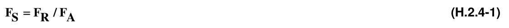
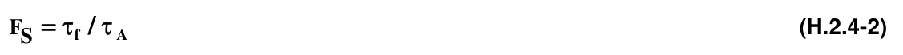
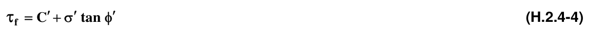
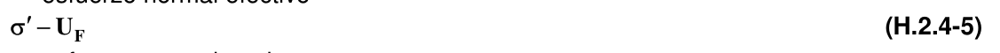
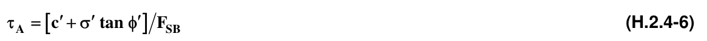
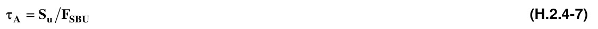

# H.2 — Definiciones

### H.2.0 — NOMENCLATURA

$c_{c'}$ = intercepto de cohesión total = intercepto de cohesión efectiva

$F_{a}$ = fuerzas actuantes

$F_{r}$ = fuerzas resistentes

$F_{s}$ = factor de seguridad

$F_{SB}=$ Factor de seguridad básico

$F_{SBM}$= factores de seguridad básicos mínimos directos

$S_{u}$ = resistencia no drenada

$U_{a}$ = presión de gas (aire) para materiales secos

$U_{F}$ = presión de fluidos o presión de poros

$U_{w}$ = presión de líquido (agua) para materiales saturados

$φ$ = ángulo de fricción total

$'φ$ = ángulo de fricción efectivo

$σ'$ = esfuerzo normal efectivo

$σ$ = esfuerzo normal total

$τ_{R}$ = esfuerzo resistente

$τ_{A}$ = esfuerzo actuante

$τ_{F}$ = esfuerzo cortante a la falla

### H.2.1 — ESTUDIO GEOTÉCNICO

#### H.2.1.1 — DEFINICIÓN

Conjunto de actividades que comprenden el reconocimiento de campo, la investigación del subsuelo, los análisis y recomendaciones de ingeniería necesarios para el diseño y construcción de las obras en contacto con el suelo, de tal forma que se garantice un comportamiento adecuado de la edificación, protegiendo ante todo la integridad de las personas ante cualquier fenómeno externo, además de proteger vías, instalaciones de servicios públicos, predios y construcciones vecinas.

**H.2.1.1.1** — Investigación del Subsuelo — Comprende el estudio y el conocimiento del origen geológico, la exploración del subsuelo (apiques, trincheras, perforación y sondeo y otros) y los ensayos y pruebas de campo y laboratorio necesarios para identificar y clasificar los diferentes suelos y rocas y cuantificar las características físico-mecánicas e hidráulicas del subsuelo.

**H.2.1.1.2** — Análisis y Recomendaciones — Consiste en la interpretación técnica conducente a la caracterización del subsuelo y la evaluación de posibles mecanismos de falla y de deformación para suministrar los parámetros y las recomendaciones necesarias para el diseño y la construcción de los sistemas de cimentación y contención y de otras obras en el terreno influenciadas por factores geotécnicos.

### H.2.2 — TIPOS DE ESTUDIOS

#### H.2.2.1 — ESTUDIO GEOTÉCNICO PRELIMINAR

Conjunto de actividades necesarias para aproximarse a las características geotécnicas de un terreno, con el fin de establecer las condiciones que limitan su aprovechamiento, los problemas potenciales que puedan presentarse, los criterios geotécnicos y parámetros generales para la elaboración de un proyecto.

El estudio debe presentar en forma general el entorno geológico y geomorfológico, características del subsuelo y recomendaciones geotécnicas para la elaboración del proyecto incluyendo la zonificación del área, amenazas de origen geológico, criterios generales de cimentación y obras de adecuación del terreno. Este estudio no es de presentación obligatoria, pero es recomendable para proyectos especiales o de magnitud considerable, en los que pueda orientar el proceso de planeamiento. Su realización no puede reemplazar, bajo ninguna circunstancia, al estudio geotécnico definitivo.

#### H.2.2.2 — ESTUDIO GEOTÉCNICO DEFINITIVO

Trabajo realizado para un proyecto específico, en el cual el ingeniero geotecnista debe precisar todo lo relativo a las condiciones físico-mecánicas del subsuelo y las recomendaciones particulares para el diseño y construcción de todas las obras relacionadas, conforme a este Reglamento y en especial los Títulos A y H. Su presentación es obligatoria ya que en este se definen el tipo de suelo, el diseño y las recomendaciones de la cimentación y del proceso constructivo.

**H.2.2.2.1** — Contenido — El estudio geotécnico definitivo debe contener como mínimo los siguientes aspectos:

(a) Del proyecto — Nombre, plano de localización, objetivo del estudio, descripción general del proyecto, sistema estructural y evaluación de cargas. No se podrán considerar como ESTUDIO GEOTÉCNICO DEFINITIVO aquellos estudios realizados con cargas preliminares ni donde sólo se hayan tenido en cuenta las cargas de gravedad.

(b) Del subsuelo — Resumen del reconocimiento de campo, de la investigación adelantada en el sitio específico de la obra, la morfología del terreno, el origen geológico, las características físico- mecánicas y la descripción de los niveles freáticos o aguas subterráneas con una interpretación de su significado para el comportamiento del proyecto estudiado.

(c) De cada unidad geológica o de suelo, se dará su identificación, su espesor, su distribución y los parámetros obtenidos en las pruebas y ensayos de campo y en los de laboratorio, siguiendo los lineamientos del Capítulo H.3. Para el análisis de efectos locales, la definición de tipo de suelo se debe hacer siguiendo los lineamientos del numeral A.2.4. Se debe estudiar el efecto o descartar la presencia de suelos con características especiales como suelos expansivos, dispersivos, colapsables, y los efectos de la presencia de vegetación ó de cuerpos de agua cercanos.

(d) De los análisis geotécnicos — Resumen de los análisis y justificación de los criterios geotécnicos adoptados que incluyan los aspectos contemplados especialmente en el Título H y en el numeral A.2.4. También, el análisis de los problemas constructivos de las alternativas de cimentación y contención, la evaluación de la estabilidad de taludes temporales de corte, la necesidad y planteamiento de alternativas de excavaciones soportadas con sistemas temporales de contención en voladizo, apuntalados o anclados. Se deben incluir los análisis de estabilidad y deformación de las alternativas de excavación y construcción, teniendo en cuenta, además de las características de resistencia y deformabilidad de los suelos, la influencia de los factores hidráulicos.

(e) De las recomendaciones para diseño — Los parámetros geotécnicos para el diseño estructural del proyecto como: tipo de cimentación, profundidad de apoyo, presiones admisibles, asentamientos calculados incluyendo los diferenciales, tipos de estructuras de contención y parámetros para su diseño, perfil del suelo para el diseño sismo resistente y parámetros para análisis de interacción suelo-estructura junto con una evaluación del comportamiento del depósito de suelo o del macizo rocoso bajo la acción de cargas sísmicas así como los límites esperados de variación de los parámetros medidos y el plan de contingencia en caso de que se excedan los valores previstos. Se debe incluir también la evaluación de la estabilidad de las excavaciones, laderas y rellenos, diseño geotécnico de filtros y los demás aspectos contemplados en este Título.

(f) De las recomendaciones para la protección de edificaciones y predios vecinos — Cuando las condiciones del terreno y el ingeniero encargado del estudio geotécnico lo estime necesario, se hará un capítulo que contenga: estimar los asentamientos ocasionales originados en descenso del nivel freático, así como sus efectos sobre las edificaciones vecinas, diseñar un sistema de soportes que garantice la estabilidad de las edificaciones o predios vecinos, estimar los asentamientos inducidos por el peso de la nueva edificación sobre las construcciones vecinas, calcular los asentamientos y deformaciones laterales producidos en obras vecinas a causa de las excavaciones, y cuando las deformaciones o asentamientos producidos por la excavación o por el descenso del nivel freático superen los límites permisibles deben tomarse las medidas preventivas adecuadas.

(g) De las recomendaciones para construcción. Sistema Constructivo — Es un documento complementario o integrado al estudio geotécnico definitivo, de obligatoria elaboración por parte del ingeniero geotecnista responsable, de acuerdo con lo establecido en el numeral H.8.1. La entrega de este documento o su inclusión como un numeral del informe, deberá ser igualmente verificada por las autoridades que expidan las licencias de construcción. En el sistema constructivo se deben establecer las alternativas técnicamente factibles para solucionar los problemas geotécnicos de excavación y construcción. Para proyectos de categoría Alta o Especial (véase el numeral H.3.1.1) se debe cumplir lo indicado en el numeral H.2.2.3.

(h) Anexos — En el informe de suelos se deben incluir planos de localización regional y local del proyecto, ubicación de los trabajos de campo, registros de perforación y resultado de pruebas y ensayos de campo y laboratorio. Se debe incluir la memoria de cálculo con el resumen de la metodología seguida, una muestra de cálculo de cada tipo de problema analizado y el resumen de los resultados en forma de gráficos y tablas. Además, planos, esquemas, dibujos, gráficas, fotografías, y todos los aspectos que se requieran para ilustrar y justificar adecuadamente el estudio y sus recomendaciones.

#### H.2.2.3 — ASESORÍA GEOTÉCNICA EN LAS ETAPAS DE DISEÑO Y CONSTRUCCIÓN

Para proyectos clasificados como categoría Media, Alta o Espacial (véase numeral H.3.1.1), se debe realizar la asesoría en la etapa de diseño como una etapa posterior al estudio geotécnico por parte de un ingeniero civil especialista en geotecnia, con la experiencia estipulada en el Título VI de la Ley 400 de 1997. En todos los casos de clasificación de las unidades, los planos de diseño deben guardar relación con el estudio geotécnico.

Así mismo, los proyectos clasificados como categoría Media, Alta o Especial, deberán contar con el acompañamiento de un Ingeniero Geotecnista, (Título VI de la Ley 400 de 1997, artículo 28) quien aprobará durante la ejecución de la obra los niveles y estratos de cimentación, los procedimientos y el comportamiento durante la ejecución de las excavaciones, rellenos, obras de estabilización de laderas y actividades especiales de adecuación y/o mejoramiento del terreno. Para esto, deberá dejar memoria escrita del desarrollo de dichas actividades y los resultados obtenidos.

Especial atención se deberá dar a preservar la estabilidad y evitar asentamientos de las construcciones aledañas o adyacentes al proyecto, para lo cual se deberá implementar las recomendaciones que el diseñador geotécnico del proyecto entregue para tal fin. Se deberá suscribir un acta de vecindad de forma previa al inicio del proyecto que deje constancia del estado de las edificaciones y terrenos adyacentes al proyecto. En caso de que se detecten efectos adversos en las edificaciones vecinas por efecto del desarrollo del proyecto, se deberá implementar una instrumentación adecuada y adoptar las medidas necesarias para evitar la propagación de dichos efectos, sin perjuicio de otro tipo de acciones que se deriven de estos hechos.

#### H.2.2.4 — ESTUDIO DE ESTABILIDAD DE LADERAS Y TALUDES

Deberá estar incluido en el estudio geotécnico preliminar o en el definitivo; se debe hacer de acuerdo con lo exigido en el capitulo H.5, y debe considerar las características geológicas, hidráulicas y de pendiente del terreno local y regionalmente, por lo cual deberán analizarse los efectos de procesos de inestabilidad aledaños o regionales que puedan tener incidencia en el terreno objeto de estudio.

### H.2.3 — AGUA SUBTERRÁNEA

En las cimentaciones el problema más frecuente encontrado durante el proceso de excavación y construcción, es la existencia del agua subterránea libre o confinada. La presencia de agua, en relación a los esfuerzos, produce una disminución de las propiedades, tal como se indica en H.2.4.1 para la resistencia, además de flujo y erosión interna.

Los estudios geotécnicos deberán analizar la existencia de agua libre, flujos potenciales de agua subterránea y la presencia de paleo cauces.

### H.2.4 — FACTORES DE SEGURIDAD

#### H.2.4.1 — DEFINICIÓN

En Ingeniería Civil en general el Factor de Seguridad FS se define como la relación entre fuerzas resistentes FR y actuantes FA y también pueden usarse esfuerzos y se usa para evaluar el Estado Límite de Falla:

En Ingeniería Geotécnica el Factor de Seguridad Básico o directo, $FSB$ , se define como la relación entre esfuerzo cortante último resistente o esfuerzo cortante a la falla $τ_{f}$ y esfuerzo cortante actuante $τ_{A}$

Usualmente en Ingeniería Geotécnica el esfuerzo cortante a la falla $τ_{f}$ se expresa con el Criterio de Mohr-Coulomb:

en la cual

$τ_{f}$ = esfuerzo cortante a la falla

$c'$ = intercepto de cohesión efectiva

$'φ$ = ángulo de fricción efectivo

$σ'$ = esfuerzo normal efectivo

$σ$ = esfuerzo normal total

$U_{F}$ = presión de fluidos o presión de poros

$U_{w}$ = presión de líquido (agua) para materiales saturados

$U_{a}$ = presión de gas (aire) para materiales secos Se advierte que los esfuerzos normales empleados son valores relativos a la presión atmosférica $P_{A}$ y que cualquier otra definición de esfuerzo cortante a la falla debe ir en término de esfuerzos efectivos, salvo lo expresado en H.2.4.3.

También se define el esfuerzo cortante actuante $τ$A como esfuerzo cortante de trabajo o de diseño $τ$D y entonces:

#### H.2.4.2 — COMPORTAMIENTO APARENTE

Para el caso especial de materiales cohesivos saturados y sin fisuración, se presenta un comportamiento aparente del Criterio de Mohr-Coulomb en términos de esfuerzos totales, en el cual

$c$ = intercepto de cohesión total $=S_{U}$

$φ$ = ángulo de fricción total $= φ =0.0$ y entonces $τ_{F} = S_{u}$ = resistencia no drenada

en la cual, generalmente, $F_{SBU}>F_{SB}$ Se permite emplear la resistencia no drenada SU para casos de análisis en materiales cohesivos saturados y no fisurados:

(a) Estáticos de cimentaciones superficiales

(b) Estáticos de cimentaciones profundas

(c) Estáticos de taludes temporales o de falla de fondo temporal Pero NO SE PERMITE emplearlo en casos de análisis:

(a) Estáticos de empujes de tierras

(b) Problemas geotécnicos que impliquen relajación de esfuerzos

(c) Estabilidad de taludes permanentes

(d) De materiales no saturados

(e) De materiales fisurados

(f) Seudo estáticos

(g) Dinámicos

#### H.2.4.3 — VALORES DEL FACTOR DE SEGURIDAD GEOTÉCNICO BÁSICO $F_{SB}$

La selección de los factores de seguridad debe justificarse plenamente teniendo en cuenta:

(a) La magnitud de la obra.

(b) Las consecuencias de una posible falla en la edificación o sus cimentaciones.

(c) La calidad de la información disponible en materia de suelos.

En cualquier caso los Factores de Seguridad Básicos $F_{SB}$ aplicados al material térreo (suelo, roca o material intermedio) no deben ser inferiores a los Factores de Seguridad Básicos Mínimos $F_{SBM}$ o $F_{SBUM}$ de la tabla H.2.4-1, en la cual las cargas se refieren a valores nominales sin coeficientes de mayoración, tal como se indica en el aparte B.2.3 de este Reglamento, en el cual, para los cimientos y el material térreo de cimentación se emplearán las fuerzas sísmicas reducidas determinadas en el Paso 11 de A.1.3.4 y de acuerdo con A.1.3.5. En ningún caso el factor de seguridad básico mínimo $F_{SBM}$ podrá ser inferior a 1.00

<!-- mod:3-decreto-945-2017-76 -->
> **Modificación — Decreto 945 de 2017** · anexo, p. 35
>
> Donde dice «… para los cimientos y el material térreo de cimentación se empleará para las fuerzas sísmicas $E$ un factor $R = 1.0$.», se corrige para que diga: «… para los cimientos y el material térreo de cimentación se emplearán las fuerzas sísmicas reducidas determinadas en el Paso 11 de A.1.3.4 y de acuerdo con A.1.3.5.»

**Tabla H.2.4-1**

Factores de Seguridad Básicos Mínimos Directos

| Condición | $F_{SBM}$ |  | $F_{SBUM}$ |  |
|---|---|---|---|---|
|  | Diseño | Construcción | Diseño | Construcción |
| Carga Muerta + Carga Viva Normal | 1.50 | 1.25 | 1.80 | 1.40 |
| Carga Muerta + Carga Viva Máxima | 1.25 | 1.10 | 1.40 | 1.15 |
| Carga Muerta + Carga Viva Normal + Sismo de Diseño Seudo estático | 1.10 | 1.00 (*) |  | No se permite No se permite |
| Taludes – Condición Estática y Agua Subterránea Normal | 1.50 | 1.25 | 1.80 | 1.40 |
| Taludes – Condición Seudo-estática con Agua Subterránea Normal y Coeficiente Sísmico de Diseño | 1.05 | 1.00 (*) |  | No se permite No se permite |

(*) Nota: Los parámetros sísmicos seudo estáticos de Construcción serán el 50% de los de Diseño

#### H.2.4.4 — FACTORES DE SEGURIDAD INDIRECTOS

El Factor de Seguridad Básico o directo $F_{SB}$definido en H.2.4.1 es el factor de seguridad geotécnico real, pero de él se derivan Factores de Seguridad Indirectos que tienen valores diferentes y los cuales se especifican en los diferentes capítulos de este Titulo H, pero en todo caso se debe demostrar que el empleo de éstos $F_{S}$ indirectos implica Factores de Seguridad Básicos $F_{SB}$iguales o superiores a los valores mínimos $F_{SBM}$.

### H.2.5 — SUELOS NO COHESIVOS O GRANULARES Y SUELOS COHESIVOS

Para efectos de la clasificación de suelos del Artículo A.2.4.3 y de este Título H:

#### H.2.5.1 — SUELOS NO COHESIVOS O GRANULARES

Se consideran como suelos no cohesivos o granulares los que cumplen las siguientes condiciones, de acuerdo al Sistema de Clasificación Unificada de Suelos (SCUS), con algunas modificaciones:

(a) Todos los materiales clasificados como GW, GP, GW-GM, GP-GM, GW-GC, GP-GC, SW, SP, SW-SM, SP-SM, SW-SC, SP-SC.

(b) Todos los materiales clasificados como GM, GC, GM-GC, SM, SC, SM-SC, en los cuales 30% o menos del peso pase por tamiz No 200 y que tengan límite líquido wL $≤$ 30% e índice plástico IP $≤$ 10%.

#### H.2.5.2 — SUELOS COHESIVOS

Se consideran como suelos cohesivos todos aquellos que no cumplan con las condiciones de suelos no cohesivos o granulares.

### H.2.6 — NORMAS TÉCNICAS

**H.2.6.1** — Las siguientes normas NTC del Instituto Colombiano de Normas Técnicas y Certificación, ICONTEC, y de la Sociedad Americana para Ensayos y Materiales, ASTM, forman parte integrante del Reglamento NSR-10.

Normas NTC promulgadas por el ICONTEC:

NTC 1493 — Suelos. Ensayo para determinar el límite plástico y el índice de plasticidad. (ASTM D 4318) NTC 1494 — Suelos. Ensayo para determinar el límite líquido. (ASTM D 4318) NTC 1495 — Suelos. Ensayo para determinar el contenido de agua. (ASTM D 2216) NTC 1503 — Suelos. Ensayo para determinar los factores de contracción. ASTM D 427) NTC 1504 — Suelos. Clasificación para propósitos de ingeniería. (ASTM D 2487) NTC 1522 — Suelos. Ensayo para determinar la granulometría por tamizado NTC 1527.

NTC 1528 — Suelos. Ensayo para determinar la masa unitaria en el terreno. Método del balón de caucho. (ASTM D2167) NTC 1667 — Determinación de la masa unitaria en el terreno por el método del cono de arena. (ASTM D 1556) NTC 1886 — Suelos. Determinación de la humedad, ceniza y materia orgánica. (ASTM D2974) NTC 1917 — Suelos. Determinación de la resistencia al corte. Método de corte directo (CD). (ASTM D 3080) NTC 1936 — Suelos. Determinación de la resistencia en rocas. Método de la compresión triaxial. (ASTM D2664) NTC 1967 — Suelos. Determinación de las propiedades de consolidación unidimensional. (ASTM D 2435) NTC 1974 — Suelos. Determinación de la densidad relativa de los sólidos (ASTM D854) NTC 2041 — Suelos cohesivos. Determinación de la resistencia. Método de compresión triaxial. (ASTM D 2850) NTC 2121 — Suelos. Obtención de muestras para probetas de ensayo. Método para tubos de pared delgada. (ASTM D1587) NTC 2122 — Suelos. Ensayo de la relación de soporte. Suelos compactados. (ASTM D1833) NTC 4630 — Método de ensayo para la determinación del límite liquido, del límite plástico y del índice de plasticidad de los suelos cohesivos.

Normas ASTM:

ASTM D 2166-06 — Suelos. Ensayo para determinar la resistencia a la compresión inconfinada.

.

ASTM D 6066 – 96 (2004) — Práctica estándar para determinar la resistencia de arenas a la penetración normalizada, para evaluación del potencial de licuación.

ASTM D1143/D1143M-07 — Ensayo para pilotes bajo carga axial estática de compresión.

ASTM D 3689-07 — Ensayo para pilotes individuales bajo carga axial estática de tracción.

ASTM D 3966-07 — Ensayo para pilotes bajo carga lateral.

ASTM D4945-08 — Ensayo para pilotes bajo altas deformaciones en cargas dinámicas.

ASTM D 5882-07 — Ensayo a bajas deformaciones para la integridad de pilotes █
