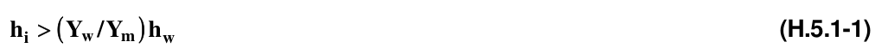
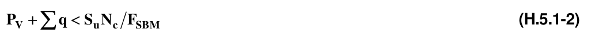

# H.5 — Excavaciones y estabilidad de taludes

### H.5.0 — NOMENCLATURA

$h_{w}$ = altura piezométrica en el lecho inferior de la capa impermeable;

$γ_{w}$= peso unitario del agua

$γ_{t}$ = peso unitario total del suelo entre el fondo de la excavación y el estrato permeable

$S_{u}$ = resistencia no drenada (cohesión aparente) del material bajo el fondo de la excavación, en condiciones no-consolidadas no-drenadas (UU)

$N_{c}$ = coeficiente de capacidad de carga que depende de la geometría de la excavación y puede ser afectado por el procedimiento constructivo;

$P_{v}$ = presión vertical total actuante en el suelo, a la profundidad de excavación;

$∑q$= sobrecargas superficiales

$F_{SBM}$= factores de seguridad mínimos

### H.5.1 — EXCAVACIONES

#### H.5.1.1 — GENERALIDADES

En el diseño de las excavaciones se considerarán los siguientes estados límite:

(a) De falla — colapso de los taludes o de las paredes de la excavación o del sistema de entibado de las mismas, falla de los cimientos de las construcciones adyacentes y falla de fondo de la excavación por corte o por sub presión en estratos subyacentes, y colapso del techo de cavernas o galerías;

(b) De servicio — movimientos verticales y horizontales inmediatos y diferidos por descarga en el área de excavación y en los alrededores. Los valores esperados de tales movimientos deberán calculados para no causar daños a las construcciones e instalaciones adyacentes ni a los servicios públicos. Además, la recuperación por recarga no deberá ocasionar movimientos totales o diferenciales intolerables para las estructuras que se construyan en el sitio.

Para realizar la excavación, se podrán usar pozos de bombeo con objeto de reducir las filtraciones y mejorar la estabilidad. Sin embargo, la duración del bombeo deberá ser tan corta como sea posible y se tomarán las precauciones necesarias para que sus efectos queden prácticamente circunscritos al área de trabajo. En este caso, para la evaluación de los estados límite de servicio a considerar en el diseño de la excavación, se tomarán en cuenta los movimientos del terreno debidos al bombeo.

Los análisis de estabilidad se realizarán con base en las acciones aplicables señaladas en estas Normas, considerándose las sobrecargas que puedan actuar en la vía pública y otras zonas próximas a la excavación.

<!-- mod:2-decreto-340-2012-41 -->
> **Modificación — Decreto 340 de 2012** · anexo, p. 9
>
> El literal (b) de H.5.1.1 debe quedar así:
>
> (b) De servicio — movimientos verticales y horizontales inmediatos y diferidos por descarga en el área de excavación y en los alrededores. Los valores esperados de tales movimientos deberán ser calculados para no causar daños a las construcciones e instalaciones adyacentes ni a los servicios públicos. Además, la recuperación por recarga no deberá ocasionar movimientos totales o diferenciales intolerables para las estructuras que se construyan en el sitio.

#### H.5.1.2 — ESTADOS LÍMITE DE FALLA

La verificación de la seguridad respecto a los estados límite de falla incluirá la revisión de la estabilidad de los taludes o paredes de la excavación con o sin entibado y del fondo de la misma. La sobrecarga uniforme mínima a considerar en la vía pública y zonas libres próximas a excavaciones temporales será de 15 kPa (1.5 t/m²).

**H.5.1.2.1** — Estabilidad de taludes de excavación para edificaciones — La seguridad y estabilidad de excavaciones sin soporte se revisará tomando en cuenta la influencia de las condiciones de presión del agua en el subsuelo así como la profundidad de excavación, la inclinación de los taludes, el riesgo de agrietamiento en la proximidad de la corona y la presencia de grietas u otras discontinuidades. Se tomará en cuenta que la cohesión de los materiales arcillosos tiende a disminuir con el tiempo, en una proporción que puede alcanzar 30 por ciento en un plazo de un mes.

Para el análisis de estabilidad de taludes se usará un método de equilibrio límite considerando superficies de falla cinemáticamente posibles tomando en cuenta en su caso las discontinuidades del suelo. Se incluirá la presencia de sobrecargas en la orilla de la excavación. También se considerarán mecanismos de extrusión de estratos blandos confinados verticalmente por capas más resistentes. Al evaluar estos últimos mecanismos se tomará en cuenta que la resistencia de la arcilla puede alcanzar su valor residual correspondiente a grandes deformaciones.

Se prestará especial atención a la estabilidad a largo plazo de excavaciones o cortes permanentes que se realicen en el predio de interés. Se tomarán las precauciones necesarias para que estos cortes no limiten las posibilidades de construcción en los predios vecinos, no presenten peligro de falla local o general ni puedan sufrir alteraciones en su geometría por intemperización y erosión, que puedan afectar a la propia construcción, a las construcciones vecinas o a los servicios públicos. Además del análisis de estabilidad, el estudio geotécnico deberá incluir en su caso una justificación detallada de las técnicas de estabilización y protección de los cortes propuestas y del procedimiento constructivo especificado (Véase el capitulo H-8).

En los casos que se requiera el uso de entibados, los empujes a los que se encuentran sometidos los anclajes o puntales se estimarán a partir de una envolvente de distribución de presiones determinada por modelaciones analíticas o numéricas y de la experiencia local debidamente sustentada. En arcillas, la distribución de presiones se definirá en función del tipo de arcilla, de su grado de fisuramiento y de su reducción de resistencia con el tiempo. Cuando el nivel freático exista a poca profundidad, los empujes considerados sobre los entibados serán por lo menos iguales a los producidos por el agua. El diseño de los entibados también deberá tomar en cuenta el efecto de las sobrecargas debidas al tráfico en la vía pública, al equipo de construcción, a las estructuras adyacentes y a cualquier otra carga que deban soportar las paredes de la excavación durante el período de construcción. En el caso de anclajes precargados, se tomará en cuenta que la precarga aplicada inicialmente puede variar considerablemente con el tiempo por relajación y por efecto de variaciones de temperatura.

Los elementos de soporte deberán diseñarse estructuralmente para resistir las acciones de los empujes y las reacciones de los anclajes o puntales y de su apoyo en el suelo bajo el fondo de la excavación.

<!-- mod:2-decreto-340-2012-42 -->
> **Modificación — Decreto 340 de 2012** · anexo, p. 9
>
> En el final del tercer parágrafo de H.5.1.2.1 debe quedar así:
>
> “…de los cortes propuestos y del procedimiento constructivo especificado (Véase el Capítulo H-8).”

**H.5.1.2.2** — Falla de fondo — En el caso de excavaciones en suelos en especial aquellos sin cohesión, se analizará la estabilidad del fondo de la excavación por flujo del agua o por erosión interna. Para reducir el peligro de fallas de este tipo, el agua freática deberá controlarse y extraerse de la excavación por bombeo desde cárcamos, pozos punta o pozos de alivio con nivel dinámico sustancialmente inferior al fondo de la excavación.

.

Cuando una excavación se realice en una capa impermeable, la cual a su vez descanse sobre un estrato permeable, deberá considerarse que la presión del agua en este estrato puede levantar el fondo de la excavación, no obstante el bombeo superficial. El espesor mínimo (hi) del estrato impermeable que debe tenerse para evitar inestabilidad de fondo se considerará igual a:

donde $h_{w}$ es la altura piezométrica en el lecho inferior de la capa impermeable; $γ_{w}$ es el peso unitario del agua; y $γ_{Y}$ es el peso unitario total del suelo entre el fondo de la excavación y el estrato permeable.

Cuando el espesor $h_{i}$ resulte insuficiente para asegurar la estabilidad con un amplio margen de seguridad, será necesario reducir la carga hidráulica del estrato permeable por medio de bombeo.

En caso de usar elementos estructurales como tablestacas o muros colados en el lugar para soportar las paredes de la excavación, se revisará la estabilidad de estos elementos por deslizamiento general de una masa de suelo que incluirá el elemento, por falla de fondo, y por falla estructural de los troqueles o de los elementos que éstos soportan.

La revisión de la estabilidad general se realizará por un método de análisis límite. Se evaluará el empotramiento y el momento resistente mínimo de los elementos estructurales requeridos para garantizar la estabilidad de acuerdo con las condiciones previstas. La posibilidad de falla de fondo por cortante en arcillas blandas a firmes se analizará verificando que:

donde $S_{u}$ resistencia no drenada (cohesión aparente) del material bajo el fondo de la excavación, en condiciones no–consolidadas no– drenadas (UU); $N_{c}$ coeficiente de capacidad de carga que depende de la geometría de la excavación. Se tomará en cuenta además que este coeficiente puede ser afectado por el procedimiento constructivo; $P_{V}$ presión vertical total actuante en el suelo, a la profundidad de excavación; $∑q$ sobrecargas superficiales $F_{SBM}$ factores de seguridad mínimos de la tabla H.2.4-1

<!-- mod:2-decreto-340-2012-43 -->
> **Modificación — Decreto 340 de 2012** · anexo, p. 9
>
> El inicio de H.5.1.2.2 debe quedar así:
>
> **H.5.1.2.2** — Falla de fondo — En el caso de excavaciones, especialmente en suelos sin cohesión, se analizará la estabilidad del fondo…

**H.5.1.2.3** — Estabilidad de estructuras vecinas — De ser necesario, las estructuras adyacentes a las excavaciones deberán reforzarse o recimentarse. El soporte requerido dependerá del tipo de suelo y de la magnitud y localización de las cargas con respecto a la excavación.

En caso de usar anclajes temporales para el soporte de entibados deberá demostrarse que éstas no afectarán la estabilidad ni inducirán deformaciones significativas en las cimentaciones vecinas y/o servicios públicos. El sistema estructural del anclaje deberá analizarse con el objetivo de asegurar su funcionamiento como elemento de anclaje. El análisis de los anclajes deberá considerar la posibilidad de falla por resistencia del elemento tensor, de la adherencia elemento tensor–lechada, de la adherencia lechada–terreno y de la capacidad de carga del terreno en la perforación del anclaje. La instalación de anclajes deberá realizarse con un control de calidad estricto que incluya un número suficiente de pruebas de los mismos, de acuerdo con las prácticas aceptadas al respecto. Los anclajes temporales instalados en terrenos agresivos podrán requerir una protección especial contra corrosión.

#### H.5.1.3 — ESTADOS LÍMITE DE SERVICIO

Los valores esperados de los movimientos verticales y horizontales en el área de excavación y sus alrededores deberán ser suficientemente pequeños para que no causen daños a las construcciones e instalaciones adyacentes ni a los servicios públicos. Además, la recuperación por recarga no deberá ocasionar movimientos totales o diferenciales intolerables en el edificio que se proyecta construir.

**H.5.1.3.1** — Expansiones instantáneas y diferidas por descarga — Para estimar la magnitud de los movimientos verticales inmediatos por descarga en el área de excavación y en los alrededores, se recurrirá a la teoría de la elasticidad. Los movimientos diferidos se estimarán a partir de los decrementos de esfuerzo vertical calculados aplicando también la teoría de la elasticidad.

Para reducir los movimientos inmediatos, la excavación y la construcción de la cimentación se podrán realizar por partes. En el caso de excavaciones entibadas, se buscará reducir la magnitud de los movimientos instantáneos acortando la altura no soportada entre anclajes o puntales.

**H.5.1.3.2** — Asentamiento del terreno natural adyacente a las excavaciones — En el caso de cortes entibados en arcillas blandas o firmes, se tomará en cuenta que los asentamientos superficiales asociados a estas excavaciones dependen del grado de cedencia lateral que se permita en los elementos de soporte.

Para la estimación de los movimientos horizontales y verticales inducidos por excavaciones entibadas en las áreas vecinas, deberá recurrirse a una modelación analítica o numérica que tome en cuenta explícitamente el procedimiento constructivo. Estos movimientos deberán medirse en forma continua durante la construcción para poder tomar oportunamente medidas de seguridad adicionales en caso necesario.

### H.5.2 — ESTABILIDAD DE TALUDES EN LADERAS NATURALES Ó INTERVENIDAS

#### H.5.2.1 — RECONOCIMIENTO

Sin detrimento de lo que establezca la normatividad local que aplique, en edificaciones cuya implantación se proyecte realizar total o parcialmente sobre una ladera, o que se encuentren al borde o al pie de una de ellas, el ingeniero geotecnista junto con la asesoría de un geólogo o ingeniero geólogo, debe realizar un análisis de estabilidad de los taludes que representen una amenaza para la edificación y diseñar las obras y medidas necesarias para lograr un nivel de estabilidad aceptable en términos de los factores de seguridad que se establecen en H.5.2.6. . Para el caso particular de laderas naturales, se debe realizar el inventario de los procesos que reflejen inestabilidad del terreno a fin de incorporarlos con los análisis de las condiciones de estabilidad de la ladera.

#### H.5.2.2 — CONSIDERACIONES GENERALES

Para los análisis de estabilidad de laderas naturales ó intervenidas y taludes de excavación, se deben tener en cuenta la geometría del terreno antes y después de cualquier intervención constructiva, la distribución y características geomecánicas de los materiales del subsuelo que conforman el talud, las condiciones hidrogeológicas e hidráulicas, las sobrecargas de las obras vecinas, los sistemas y procesos constructivos y los movimientos sísmicos.

#### H.5.2.3 — SECCIONES DE ANÁLISIS

Para los análisis de estabilidad se requiere contar con un modelo geológico-geotécnico que contenga al menos una sección transversal del terreno que incluyendo la localización y características de la edificación, represente razonablemente la topografía de la superficie del talud, en dónde éste sea más alto o más empinado, la distribución de los materiales en profundidad, las condiciones del agua subterránea y la localización de sobrecargas, que definan el o los mecanismos de falla que se deban considerar para los análisis de estabilidad. Cuando la irregularidad morfológica o litológica del terreno así lo indique, se requerirá contar con por lo menos una sección en cada zona homogénea definida en el modelo del área de estudio, en donde a criterio del ingeniero geotecnista, exista probabilidad cinemática de que se presenten procesos de inestabilidad.

#### H.5.2.4 — PRESIONES DE POROS

Para el análisis y diseño de taludes, se debe evaluar el efecto del agua en la disminución del esfuerzo efectivo del suelo y de la resistencia al corte, incluyendo los aspectos sísmicos de la sección H.6.2.5. Para tal efecto, el Ingeniero Geotecnista debe aplicar una o varias de las siguientes metodologías:

$(a)$ Red de flujo: necesaria en el caso en que la cabeza piezométrica no corresponde con la superficie del nivel freático.

$(b)$ Nivel freático: en el caso en que la cabeza piezométrica corresponde con la superficie de la tabla de agua, por encontrarse esta última a presión atmosférica.

$(c) R_{u}$ cociente entre la presión de poros y el esfuerzo vertical total. Este valor puede variar para el mismo material, dependiendo de su posición relativa respecto a la superficie de agua y a la superficie del terreno.

Por tal motivo, se recomienda calcular tantos valores como sean necesarios de acuerdo con la complejidad del problema.

Se preferirá el cálculo de la presión de poros a través de una red de flujo o por la definición de un nivel freático, respecto a la aplicación del factor Ru.

#### H.5.2.5 — SISMO DE DISEÑO

Para efectos del análisis y diseño de taludes, se debe emplear la aceleración máxima del terreno, $a_{max}$ obtenida bien sea de un espectro (aceleración del espectro de diseño para periodo cero) o por medio de análisis de amplificación de onda unidimensionales o bidimensionales, correspondiente a los movimientos sísmicos definidos en el Capítulo A.2, particularmente en los numerales A.2.1, A.2.2, A.2.3, A.2.4 Y A.2.5. En caso de que el sitio objeto de análisis haga parte de un estudio de microzonificación sísmica aprobado, se utilizará la aceleración máxima superficial del terreno establecida en el espectro de diseño respectivo en lugar de lo estipulado en la sección A.2. El coeficiente sísmico de diseño para análisis seudoestático de taludes KST tiene valor inferior o igual al de $a_{max}$ y se admiten los siguientes valores mínimos de $K_{ST}/a_{max}$, dependiendo del tipo de material térreo (reforzado o no) y del tipo de análisis.

**Tabla H.5.2-1**

Valores de $K_{ST}/a_{max}$ Mínimos para Análisis Seudoestático de Taludes

| Material | $K_{ST}/a_{max}$ Mínimo | Análisis de Amplificación Mínimo |
|---|---|---|
| Suelos, enrocados y macizos rocosos muy fracturados (RQD < 50%) | 0.80 | Ninguno |
| Macizos rocosos (RQD > 50%) | 1.00 | Ninguno |
| Todos los materiales térreos | 0.67 | Amplificación de onda unidimensional en dos columnas y promediar |
| Todos los materiales térreos | 0.50 | Amplificación de onda bidimensional |

En los análisis de estabilidad de taludes deben considerarse los criterios de susceptibilidad al deslizamiento asociado a sismo establecido en la sección H.7.1.2

#### H.5.2.6 — METODOLOGÍA

Debe utilizarse un método de cálculo y análisis de reconocida validez y aplicación, proporcionado a la magnitud del problema potencial y a las consecuencias en pérdidas de vidas y económicas en caso de falla del talud.

#### H.5.2.7 — FACTORES DE SEGURIDAD

Se usarán los de la tabla H.2.4-1 █ Notas
