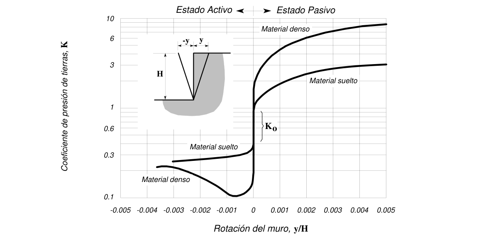
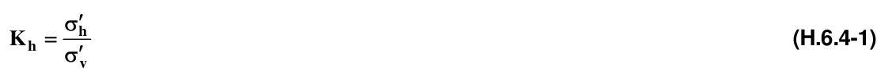
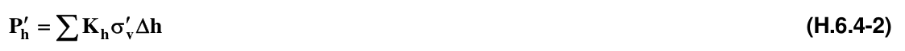
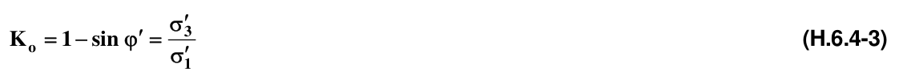
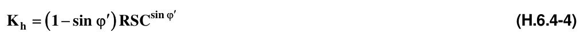
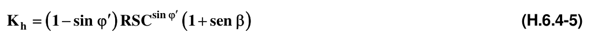
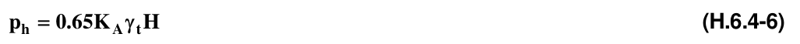
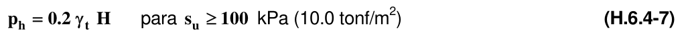
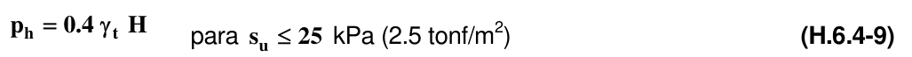

# H.6 — Estructuras de contención

### H.6.0 — NOMENCLATURA

$H$ = altura total del muro o estructura de contención

$h$ = tramo de altura en la estructura de contención

$K_{A}$= coeficiente de presión de tierras, estado activo

$K_{h}$ = coeficiente de presión de tierras para fuerzas horizontales

$K_{o}$ = coeficiente de presión de tierras en reposo

$K_{oh}$= coeficiente de presión de tierras horizontal, en reposo

$K_{p}$ = coeficiente de presión de tierras, estado pasivo

$P_{ex}$= Empuje lateral debido a cargas externas

$P_{h}$ = empuje lateral, horizontal, como suma de los demás empujes

$P_{w}$ = empuje debido al agua

$P_{h}'$ = empuje efectivo debido al suelo

$RSC$ = relación de sobre consolidación

$β$ = ángulo de inclinación del terreno por contener, positivo hacia arriba, negativo hacia abajo

$'φ$ = ángulo de fricción interna

$γ_{t}$ = peso unitario total

$σ_{h}'$ = esfuerzo efectivo horizontal

$σ'v$ = esfuerzo efectivo vertical

$σ_{1}'$ = esfuerzo efectivo principal

$σ'3$ = esfuerzo efectivo secundario o menor

### H.6.1 — GENERALIDADES

Las estructuras de contención proporcionan soporte lateral, temporal o permanente, a taludes verticales o cuasi verticales de suelo, enrocado o macizos rocosos muy fracturados o con discontinuidades desfavorables. Las estructuras de contención pueden ser autónomas, que soporten directamente las solicitudes de los materiales por contener, ó que involucren a dichos materiales con ayuda de refuerzos, para que éstos participen con sus propiedades a soportar dichas solicitudes en forma segura.

Las estructuras de contención pueden ser muros de gravedad (en mampostería, concreto ciclópeo, tierra reforzada, gaviones, o cribas), muros en voladizo (con o sin contrafuertes), tablestacas, pantallas atirantadas y estructuras entibadas.

### H.6.2 — ESTADOS LÍMITE

#### H.6.2.1 — ESTADOS LÍMITE DE FALLA

Los estados límite de falla que se deben considerar para un muro serán la rotura estructural, las deformaciones de la estructura, el volteo, la falla por capacidad de carga, la pérdida de apoyo por erosión del terreno, el deslizamiento horizontal de la base del mismo bajo el efecto del empuje del suelo y, en su caso, la inestabilidad general del talud en el que se encuentre desplantado el muro.

#### H.6.2.2 — ESTADOS LÍMITE DE SERVICIO

Cuando las deformaciones del sistema de contención afecten el funcionamiento de estructuras vecinas o generen procesos de falla en otras estructuras, se denomina estado límite de servicio.

### H.6.3 — CONSIDERACIONES DE DISEÑO

En el diseño de estructuras de contención se deben tener en cuenta las condiciones externas a que puede estar sometida, tales como las sobrecargas por otras estructuras, los procesos de construcción, las presiones hidrostáticas, las cargas de anclaje, las cargas de tráfico, las características del relleno, el sistema de drenaje, procesos de socavación o de oleaje (en vecindad de cuerpos de agua), efectos sísmicos y efectos de temperatura. También debe tenerse en cuenta el tiempo de servicio esperado de la estructura.

Las fuerzas actuantes sobre un muro de contención se considerarán por unidad de longitud. Las acciones que se deben tomar en cuenta, según el tipo de muro serán: el peso propio del muro, el empuje de tierras, la fricción entre muro y suelo que contiene, el empuje hidrostático o las fuerzas de filtración en su caso, las sobrecargas en la superficie del relleno y las fuerzas sísmicas. Los empujes desarrollados en condiciones sísmicas se evaluarán en la forma indicada en H.5 Estas estructuras deberán diseñarse de tal forma que no se rebasen los siguientes estados límite de falla: volteo, desplazamiento del muro, falla de la cimentación del mismo o del talud que lo soporta, o bien rotura estructural.

Además, se revisarán los estados límite de servicio, como asentamiento, giro o deformación excesiva del muro. Los empujes se estimarán tomando en cuenta la flexibilidad del muro, el tipo de material por contener y el método de colocación del mismo.

### H.6.4 — PRESIÓN DE TIERRAS

La presión que las tierras ejercen sobre la estructura que las contiene mantiene una estrecha interacción entre una y otro.

Depende, en términos generales del desplazamiento del conjunto, así: en el estado natural sin deformaciones laterales, se dice que la presión es la del reposo; si el muro cede, la presión disminuye hasta un mínimo que se identifica como el estado activo; si por el contrario, el muro se desplaza contra el frente de tierra, la presión sube hasta un máximo que se identifica como el estado pasivo. Si el desplazamiento del muro es vertical o implica un giro sobre la base, su distribución debe ser lineal o similar a la hidrostática; si el giro se efectúa alrededor del extremo superior del muro, la distribución debe adoptar una forma curvilínea. Los desplazamientos relativos se presentan en la figura H.6.4-1, y se cuantifican en la tabla H.6.4-1.

Figura H.6.4-1 – Variación del coeficiente de presión de tierras, $K$, con el desplazamiento

**Tabla H.6.4-1**

Movimientos horizontales en el muro de contención conducentes a los estados activo y pasivo

| Tipo de suelo | Estado activo | Estado pasivo |
|---|---|---|
| Granular denso | 0.001 $H$ | 0.020 $H$ |
| Granular suelto | 0.004 $H$ | 0.060 $H$ |
| Cohesivo firme | 0.010 $H$ | 0.020 $H$ |
| Cohesivo blando | 0.020 $H$ | 0.040 $H$ |

#### H.6.4.1 — COEFICIENTE DE PRESIÓN LATERAL DE TIERRAS

Se define como la relación entre el esfuerzo efectivo horizontal y el esfuerzo efectivo vertical en cualquier punto dentro de la masa de suelo, así que:

#### H.6.4.2 — EMPUJE LATERAL DE TIERRAS

Se define como la fuerza lateral ejercida por el suelo y se define como:

#### H.6.4.3 — ESTADO EN REPOSO

El coeficiente de presión de tierras en reposo está definido como

**H.6.4.3.1** — Suelo normalmente consolidado — En este caso $K_{oh}=K_{o}$, lo cual quiere decir que la presión horizontal de tierras es igual a la presión en reposo.

**H.6.4.3.2** — Suelo preconsolidado — cuando el suelo está pre consolidado este coeficiente debe evaluarse como se indica a continuación:

**H.6.4.3.3** — Terreno inclinado — Cuando el terreno por contener no es horizontal sino que posee una inclinación $β$ , este valor se convierte en

en la cual $β$ debe tomarse con su signo (+ hacia arriba y - hacia abajo) y válida para $β ≤φ'$

#### H.6.4.4 — ESTADO ACTIVO

El estado activo se identifica con un desplazamiento menor del muro en el sentido contrario al del banco de tierra que contiene. El valor del coeficiente activo de presión de tierras es entonces, $K_{A}$. Los empujes sobre muros de contención podrán considerarse de tipo activo solamente cuando haya posibilidad de deformación suficiente por flexión o giro alrededor de la base (por ejemplo gaviones). En caso contrario y en particular cuando se trate de muros perimetrales de cimentación en contacto con rellenos, los empujes considerados deberán ser por lo menos los del suelo en estado de reposo más los debidos al equipo de compactación del relleno, a las estructuras colindantes y a otros factores que pudieran ser significativos.

#### H.6.4.5 — ESTADO PASIVO

El estado pasivo se identifica con la resistencia del banco de tierra cuando es empujado por el muro; al contrario del caso activo, en este caso el desplazamiento es considerablemente mayor. El valor del coeficiente pasivo de presión de tierras es entonces $K_{p}$ .

#### H.6.4.6 — MUROS ATIRANTADOS O APUNTALADOS

Para este caso particular se ha verificado que la presión de tierras aparente adopta una distribución de tipo trapezoidal. Se ha propuesto entonces el uso de diagramas aparentes de presión de tierras que equivalen a una envolvente de las diferentes presiones observadas en los muros o a las cargas individuales de los elementos de soporte. Para hacer un prediseño de estas estructuras se pueden evaluar las presiones con las siguientes expresiones:

(a) Suelos Granulares

(b) Suelos Cohesivos para $s_{u}$ kPa (10.0 tonf/m2)

$p_{h}=0.3γ_{t}H$ para 25 kPa (2.5 tonf/m2) $<s_{u}<100$ kPa (10.0 tonf/m2) (H.6.4-8)

para $s_{u}$ kPa (2.5 tonf/m2)

**H.6.4.6.1** — Consideración del agua — El análisis precedente es correcto para un sistema de esfuerzos totales, en una masa de suelo eventualmente saturado, pero sin agua libre. En caso de presencia de agua libre o nivel freático, su influencia debe calcularse por separado.

#### H.6.4.7 — OTROS MÉTODOS

En casos donde se requiera un estricto control de las deformaciones se permite el empleo, con el mejor criterio posible, de metodologías tales como elementos finitos, diferencias finitas o elementos de borde.

#### H.6.4.8 — ESTADO DE CÁLCULO

La selección de los estados activos, en reposo o pasivos, actuantes sobre la estructura de contención debe quedar plenamente justificada, teniendo en cuenta los procedimientos constructivos, posibilidad de deformación de la estructura de contención y las características propias del suelo por soportar.

### H.6.5 — EMPUJES DEBIDOS AL AGUA

Los empujes debidos al agua subterránea deben minimizarse en lo posible, mediante el empleo de obras adecuadas de drenaje y despresurización. Sin embargo, cuando esto no es posible, deben sumarse a los empujes de tierras. Los muros de contención deberán siempre dotarse de un sistema de filtros y drenajes colocados atrás del muro. Estos dispositivos deberán diseñarse para evitar el arrastre de materiales provenientes del relleno y para buscar una conducción eficiente del agua infiltrada, sin generación de presiones de agua significativas. Cuando la permeabilidad de la estructura sea superior a 1 cm/seg, como en el caso de gaviones o cribas, se puede emplear la propia estructura de contención para la captación y conducción del agua, pero se debe evitar la erosión del suelo que soporta por medio de filtros y garantizar el desagüe. Se tomará en cuenta que, aún con un sistema de drenaje, el efecto de las fuerzas de filtración sobre el empuje recibido por el muro puede ser significativo.

### H.6.6 — EMPUJES POR CARGAS EXTERNAS

Los empujes resultantes de cargas externas, tales como sobrecargas en la parte superior del muro, cargas de compactación, cargas vivas temporales o permanentes, deben considerarse por separado de acuerdo con la incidencia sobre el muro que se calcula.

Los rellenos no incluirán materiales degradables ni compresibles y deberán compactarse de modo que sus cambios volumétricos por peso propio, por saturación y por las acciones externas a que estarán sometidos, no causen daños intolerables a los pavimentos ni a las instalaciones estructurales alojadas en ellos o colocadas sobre los mismos.

Para especificar y controlar en el campo la compactación por capas de los materiales cohesivos empleados en rellenos, se recurrirá a la prueba Proctor estándar, debiéndose vigilar el espesor, contenido de agua y tasa de colocación en altura de las capas colocadas. En el caso de materiales no cohesivos, el control se basará en el concepto de compacidad relativa en la prueba Proctor estándar o en métodos especiales para materiales muy gruesos Los rellenos se compactarán con procedimientos que eviten el desarrollo de empujes superiores a los considerados en el diseño.

### H.6.7 — CAPACIDAD ANTE FALLA

Debe verificarse la estabilidad al deslizamiento, la estabilidad al volcamiento, la capacidad portante del suelo de apoyo, la estabilidad general del conjunto terreno-estructura de contención y la estabilidad propia intrínseca de la estructura de contención.

En el caso de muros de gravedad o muros en voladizo:

$(a)$ La base del muro deberá desplantarse cuando menos a 1 m bajo la superficie del terreno enfrente del muro y debajo de la zona de cambios volumétricos estacionales y de rellenos.

$(b)$ La estabilidad contra deslizamiento deberá ser garantizada sin tomar en cuenta el empuje pasivo que puede movilizarse frente al pie del muro. Si no es suficiente la resistencia al desplazamiento, se podrá emplear uno o varios de los siguientes procedimientos: (1) cambiar la inclinación de la base del muro colocándola hacia adentro, (2) aumentar la rugosidad en el contacto muro-suelo, (3) colocar dentellones reforzados, (4) anclar o pilotear el muro, (5) profundizar la base del muro o (6) ampliar la base del mismo.

$(c)$ La capacidad de carga en la base del muro se deberá revisar por los métodos indicados en las presentes Normas para cimentaciones superficiales.

### H.6.8 — EMPUJES SÍSMICOS

Se deben incluir los empujes originados por efectos sísmicos, mediante métodos de reconocida aceptación técnica y las consideraciones de acuerdo con las zonas de amenaza sísmica del numeral A.2.3 y de los parámetros del numeral H.2. Se deben emplear los coeficientes sísmicos indicados en H.5.2.5 con las salvedades y métodos allí indicados

### H.6.9 — FACTORES DE SEGURIDAD INDIRECTOS

Los valores del factor de seguridad indirecto para las diversas verificaciones de comportamiento establecidas en H.5.1.2 y siguientes, deben ser, como mínimo, los indicados en la tabla H.6.9-1.

**Tabla H.6.9-1**

Factores de seguridad indirectos mínimos

| Condición | Construcción | Estático | Sismo | Seudo estático |
|---|---|---|---|---|
| Deslizamiento | 1.60 | 1.60 | Diseño | 1.05 |
| Volcamiento: el que resulte más crítico de Momento Resistente/ Momento Actuante Excentricidad en el sentido del momento (e/B) | ≥ 3.00 $≤$ 1/6 | ≥ 3.00 $≤$ 1/6 | Diseño Diseño | ≥ 2.00 $≤$ 1/4 |
| Capacidad portante | Iguales a los de la Tabla H.4.1 |  |  |  |
| Estabilidad Intrínseca materiales térreos (reforzados o no) | Iguales a los de la Tabla H.2.1 |  |  |  |
| Estabilidad Intrínseca materiales manufacturados | Según material (Concreto-Titulo C; Madera-Título G; etc.) |  |  |  |
| Estabilidad general del sistema: Permanente o de Larga duración ( > 6 meses) | 1.20 | 1.50 | Diseño | 1.05 |
| Temporal o de Corta duración ( < 6 meses) | 1.20 | 1.30 | 50% de Diseño | 1.00 |
| Laderas adyacentes (Zona de influencia > 2.5H) | 1.20 | 1.50 | Diseño | 1.05 |

█ Notas
