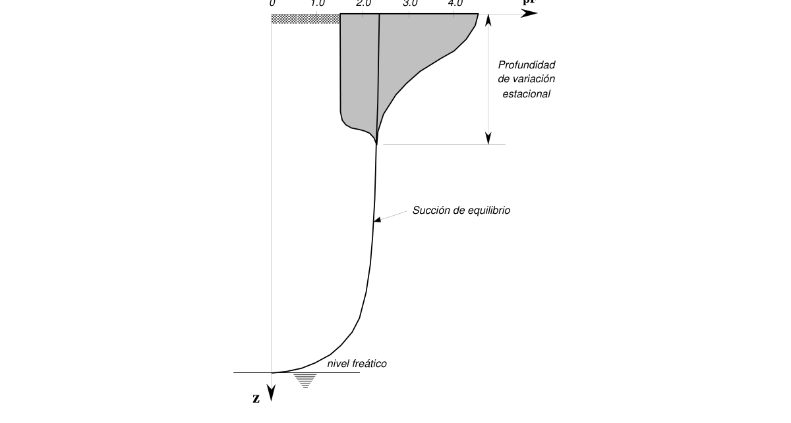
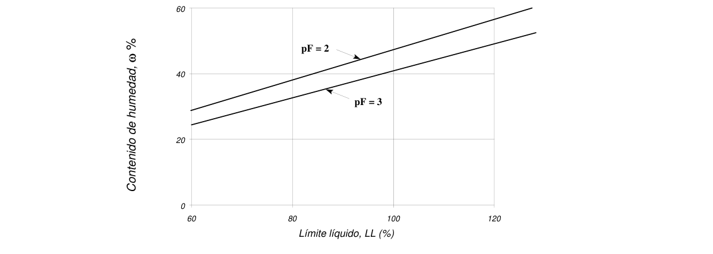
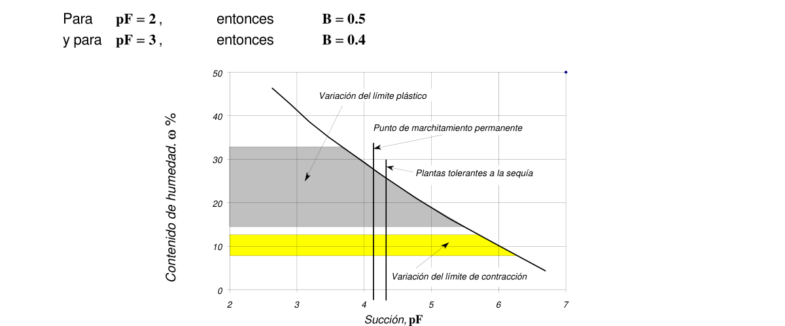

# H.9 — Condiciones geotécnicas especiales

### H.9.0 — NOMENCLATURA

$B$ = coeficiente de proporcionalidad

$c_{w}$ = coeficiente de hidroconsolidación

$G_{s}$ = gravedad específica del suelo

$h$ = altura negativa de agua en el suelo; altura de succión

$H_{i}$ = espesor de la capa $i$ del suelo potencialmente colapsable

$IP$ = Índice de plasticidad

$LL$ = límite líquido en porcentaje

$p$ = presión total en el suelo

$P_{ex}$= presión de expansión probable en el campo (kgf/cm2)

$pF$ = succión, expresada como el logaritmo de la altura negativa de presión de poros

$S$ = grado de saturación

$s$ = succión, en términos de presión

$S_{o}$ = grado de saturación inicial

$u$ = presión de poros

$w_{eq}$= humedad de equilibrio

$wℓ$ = límite líquido en fracción decimal

$W_{N}$ = Humedad natural

$z$ = profundidad

$α$ = saturación relativa, o grado de humedecimiento

$ω_{eq}$= humedad de equilibrio en porcentaje

$γ_{w}$= peso unitario del agua (g/cm3).

$γ_{d}$ = peso unitario seco (g/cm3)

$γdcrit$= peso unitario crítico como identificación de la colapsibilidad

$ε_{w}$ = potencial de hidrocolapso

$dε_{w}$= derivada del potencial de hidrocolapso

$δ_{w}$= asentamiento por hidroconsolidación

$σ_{t}$ = umbral de esfuerzo de colapso

$σ$ = esfuerzo vertical total

$α^{v}$ = fracción de la presión total que actúa como presión de poros

$ε_{w}$ = deformación potencial de hidrocolapso

$σ$ = esfuerzo normal al cual tiene lugar la hidroconsolidación

$ω_{N}$ = humedad natural en fracción decimal

$γ_{w}$= peso unitario del agua, en las unidades pertinentes

### H.9.1 — SUELOS EXPANSIVOS

#### H.9.1.1 — GENERALIDADES

Como característica especial, todas las arcillas tienen, de una forma u otra, la propiedad de contraerse cuando pierden humedad y de expandirse cuando la ganan de nuevo según las condiciones ambientales.

Como minerales activos se reconocen la montmorilonita, la vermiculita y algunas variedades de haloisita; la particularidad de éstos radica en que tienen la propiedad de "absorber" moléculas de agua dentro de su propia estructura molecular.

Los daños que presentan las edificaciones cimentadas superficialmente en estos suelos se manifiestan progresivamente mediante fisuramientos, agrietamientos y giros de conjunto de los muros y elementos estructurales, a causa de movimientos desiguales de sus cimientos, especialmente en los años de prolongados períodos de verano e invierno, como los causados por los fenómenos del Niño y de la Niña. En los artículos H-9.1.6 a H-9.1.8 se presentan algunas medidas para mitigar este fenómeno.

#### H.9.1.2 — PROFUNDIDAD DE LA ZONA ACTIVA

Se identifica la zona activa, en relación con los suelos expansivos, como la máxima profundidad a la que se observan fluctuaciones estacionales de humedad. La zona activa y su extensión se presentan esquemáticamente en la figura H-9-1.

$w_{N}$ $w_{N}$ $w_{N}$en inviernoProfundidad en verano de variación estacional Máxima profundidad de desecación $w_{N}$de equilibrio

Figura H.9.1-2 — Profundidad de la zona activa y variaciones estacionales de la humedad

**H.9.1.2.1** — Caso con el nivel freático — La expansividad cesa bajo la posición del nivel freático pero puede verse afectada por las oscilaciones de éste, de acuerdo con los factores climáticos.

#### H.9.1.3 — IDENTIFICACIÓN DE LOS SUELOS EXPANSIVOS

Se debe observar el comportamiento de edificaciones vecinas, en cuanto a señales de asentamientos diferenciales, pérdida de verticalidad, fisuras, etc., como resultado de procesos de expansión y contracción volumétrica del subsuelo. Si el reconocimiento se realiza en verano, se debe verificar la existencia de grietas en la superficie del terreno, tanto en la dirección vertical como horizontal.

En los mapas e informes de suelos del Instituto Geográfico Agustín Codazzi (IGAC) es posible identificar áreas donde existan suelos potencialmente expansivos, los cuales se denominan “vertisoles” o suelos con “característica vérticas”. En la taxonomía agrológica se identifican con el sufijo “ert” o con la palabra “Vertic”. (por ejemplo: Udert, Haplustert; Vertic Paleoudult, etc):

Los mapas geológicos y geomorfológicos del área, y especialmente las fotografías aéreas estereoscópicas, son útiles para la identificación de paleocauces que se encuentran cubiertos por eventos naturales o antrópicos en los procesos urbanísticos. Estos paleocauces pueden ocasionar importantes incrementos en el contenido de agua del subsuelo durante las temporadas de lluvias, y por lo tanto altas expansiones y posteriores contracciones diferenciales en el terreno durante el verano. Se debe verificar y precisar su localización, profundidad, dimensiones y materiales, mediante técnicas de exploración directas o indirectas.

Se debe evaluar el régimen de las aguas subterráneas, el nivel freático y las probables fluctuaciones durante la vida útil del proyecto, dado que estas condiciones son muy importantes para definir la profundidad de la zona activa.

Lentes o bolsas de materiales granulares pueden pertenecer a paleocauces y propiciar condiciones favorables para producir variaciones estacionales de la humedad en el subsuelo, incrementado considerablemente el espesor de la zona activa.

Se debe realizar la exploración de campo de acuerdo a los requisitos establecidos en el Capítulo H.3 de estas Normas. Por lo menos el 50 % de los sondeos deben reconocer suficientemente los materiales que se encuentran por debajo de la zona activa.

En la tabla H.9.1-1 se reproducen los criterios de laboratorio más aceptados para el reconocimiento de los suelos expansivos basados en altos valores del límite líquido, del índice de plasticidad, contenido de partículas coloidales y bajos valores del límite de contracción. Estos criterios deben verificarse en el laboratorio mediante ensayos de las propiedades índices correspondientes y de expansión en el consolidómetro.

**Tabla H.9.1-1**

Clasificación de suelos expansivos

| Potencial de expansión | Expansión (%) medida en consolidómetro bajo presión vertical de 0.07 kgf/cm2 | Límite líquido $LL$ , en (%) | Límite de contracción en (%) | Índice de plasticidad, $IP$ , en (%) | Porcentaje de partículas menores de una micra ($μ$) | Expansión libre $EL$ en (%), medida en probeta |
|---|---|---|---|---|---|---|
| Muy alto | > 30 | > 63 | < 10 | > 32 | > 37 | > 100 |
| Alto | 20 – 30 | 50 – 63 | 6 – 12 | 23 – 45 | 18 – 37 | > 100 |
| Medio | 10 –20 | 39 – 50 | 8 – 18 | 12 –34 | 12 – 27 | 50 100 |
| Bajo | < 10 | < 39 | > 13 | < 20 | < 17 | < 50 |

#### H.9.1.4 — HUMEDAD DE EQUILIBRIO

Se ha definido la humedad de equilibrio como aquella que corresponde a la avidez natural del suelo por el agua; si la humedad natural es inferior, el suelo buscará satisfacerla, proceso en el cual tiene lugar la expansión.

En terrenos de intensa dinámica fluvial, los climas estacionales producen fluctuaciones del nivel freático que ocasionan cambios de humedad/succión desiguales en el subsuelo, y por lo tanto cambios volumétricos desiguales en el subsuelo. En las zonas donde hay evidencias que existen paleocauces en el subsuelo, la cabeza piezométrica en ellos se incrementa durante la temporada lluviosa, ocasionando expansiones desiguales del terreno.

Cuando se interviene el terreno, se altera el equilibrio que la naturaleza establece entre el suelo, la vegetación y el clima. Al retirar la capa vegetal, la cual debido a su baja permeabilidad protege al subsuelo de la evaporación excesiva y de la infiltración de las aguas lluvias, se deja al terreno en condiciones más críticas para el control de los cambios de humedad, pues la evaporación se aumenta en el verano y la infiltración de las aguas lluvias se incrementa en el invierno. Si esta se reemplaza por materiales granulares de alta permeabilidad, la condición también es crítica.

Al edificar, o simplemente cubrir el terreno, se interrumpe su equilibrio pues se altera el gradiente térmico existente en el subsuelo y se producen fenómenos de migración de agua y acción capilar. Esto ocasiona un aumento desigual de la humedad en la zona activa, el cual es considerablemente mayor en el centro del área cubierta, y por lo tanto se produce una expansión desigual del terreno. Si las fugas de las redes del acueducto y alcantarillado se acumulan en el relleno de materiales muy permeables, también se incrementan las expansiones diferenciales de la zona activa.

La vegetación y especialmente las raíces de los árboles ornamentales que se siembran al urbanizar los terrenos, al extraer el agua que necesitan para su supervivencia también afectan el equilibrio dinámico del subsuelo. En los meses del año en que la evapotranspiración excede a la precipitación se reduce desigualmente la humedad de la zona activa. Se presenta mayor reducción de humedad en las áreas descubiertas y con mayor vegetación, mayor succión y por lo tanto se produce una mayor contracción del terreno en estas áreas. La substitución selectiva de los árboles restablece el equilibrio dinámico del subsuelo y detiene el proceso de desecación y asentamiento (véase el artículo H.9.4).

### H-9.1.5 — MODELOS GEOTÉCNICOS

Para desarrollar los modelos geotécnicos de la mecánica de suelos no saturados, relacionados con los cambios volumétricos, flujo de agua y resistencia al esfuerzo cortante, se ha propuesto el uso de las curvas de laboratorio que relacionan humedad-succión (curva característica suelo-agua), permeabilidad–succión y resistencia al esfuerzo cortante-succión. Estas relaciones se pueden determinar en el laboratorio mediante mediciones directas. Las investigaciones actuales están encaminadas a encontrar métodos indirectos que permitan obtener la curva característica suelo-agua a partir de las propiedades básicas del suelo, como la relación de vacíos, saturación, gravedad específica, límite líquido, granulometría y densidad seca.

Las formas de aproximarse al fenómeno de los suelos expansivos citadas en este Reglamento no son excluyentes, ni pretenden reemplazar otros métodos presentes o futuros; su uso a plena conciencia es respetado y alentado y está cubierto dentro de la responsabilidad propia del ejercicio de la ingeniería geotécnica.

#### H.9.1.6 — MEDIDAS PREVENTIVAS

Con el fin de alterar lo menos posible el equilibrio dinámico del subsuelo y reducir los potenciales cambios de humedad/succión, y por tanto las expansiones/contracciones del subsuelo las siguientes acciones preventivas son útiles:

(a) Cubrir el terreno sobre el cual se proyectan las edificaciones con membranas impermeables que impidan la filtración de agua hacia el suelo expansivo.

(b) Barreras de humedad — Colocadas perimetralmente a la estructura pueden coadyuvar al equilibrio; debe evitarse sin embargo, que se establezcan canales de humedecimiento como fenómenos termo- osmóticos que hagan inútil la precaución.

(c) Drenaje de las aguas de escorrentía — Debe proveerse un adecuado drenaje alrededor de las estructuras por medio de pendientados perimetrales (2-10%), cunetas revestidas, áreas pavimentadas y canalizaciones de las aguas lluvias.

(d) Sub-drenajes — para interceptar los flujos de aguas subterráneas, así como para disipar las presiones artesianas de los paleocauces existentes.

(e) Alcantarillados y rellenos — Los alcantarillados en suelos expansivos, deben ser estancos; así mismo los rellenos deben hacerse con materiales inertes de baja permeabilidad y compactados según la especificación compatible.

(f) Paisajismo e irrigación — Separar convenientemente las actividades de paisajismo, relacionadas con irrigación de plantas y jardines, de las estructuras adyacentes.

#### H.9.1.7 — ALTERACIÓN DEL SUELO EXPANSIVO

Puede lograrse por cualquiera de los siguientes métodos:

(a) Reemplazo — Consiste en la excavación y el reemplazo de la capa expansiva, cuando su espesor y profundidad no lo hacen prohibitivamente costoso.

(b) Tratamiento con cal — La mezcla superficial de cal con el suelo potencialmente expansivo o su inyección a presión es benéfica, según el estado del suelo (agrietado o no) y el método de aplicación (inyección a presión o mezcla mecánica). Se debe disponer del equipo adecuado para pulverizar el suelo en el sitio del tratamiento, o para realizar inyecciones a presión.

(c) Pre humedecimiento — El pre humedecimiento supone la expansión previa a la colocación de la estructura y el mantenimiento de esa humedad bajo una placa o un recubrimiento impermeable. Se debe tener presente que generalmente se requiere mucho tiempo para lograr que el agua penetre en la zona activa.

Adicionalmente, la pérdida de capacidad de soporte dificulta las operaciones de construcción.

#### H.9.1.8 — ELUSIÓN DE LOS SUELOS EXPANSIVOS

Se puede intentar por los siguientes procedimientos:

(a) Profundizar los cimientos — Hasta pasar, al menos parcialmente, la profundidad de la zona crítica donde la expansión es más severa.

(b) Pilotes pre excavados — A la profundidad necesaria para desarrollar la carga; puede completarse con el aislamiento del fuste del pilote en la zona activa. También puede considerarse el uso de micropilotes para reducir la fricción del fuste en la zona activa

(c) Placas aéreas — Para evitar el contacto de los pisos con el suelo potencialmente expansivo y mantener el gradiente térmico existente en el subsuelo.

#### H.9.1.9 — MITIGACIÓN DE TIPO ESTRUCTURAL

Este tipo de solución se logra por los siguientes caminos mutuamente excluyentes:

(a) Cimentación rígida — Rigidización de los elementos de la cimentación de manera que la estructura se mueva como un todo. Está acompañada a menudo de concentración de la carga en ciertos puntos y liberación en otros, para permitir el alivio de las presiones de expansión bajo losas huecas, tipo artesonado.

Los métodos convencionales de diseño de estas losas consideran las condiciones del clima, los parámetros del suelo (expansión, distancia de variación de la humedad, y rigidez), las condiciones de carga de la estructura, y las dimensiones y rigidez de la losa. También se han desarrollo modelos numéricos de interacción suelo-estructura. La estructura debe diseñarse en consecuencia.

(b) Construcción flexible — Que permita el movimiento sin daño de ciertos elementos de la estructura. Los elementos no estructurales deben estar concebidos para acomodarse a estos ajustes.

### H.9.2 — SUELOS DISPERSIVOS O ERODABLES

#### H.9.2.1 — GENERALIDADES

Se identifican como suelos erodables, las arenas muy finas o los limos no cohesivos que exhiben una manifiesta vulnerabilidad ante la presencia de agua.

#### H.9.2.2 — TIPOS DE SUELOS ERODABLES

Se distinguen dos tipos de suelos muy sensibles a la presencia de agua; éstos son:

(a) Suelos dispersivos — Arcillas cuya concentración de sales de sodio (Na) en el agua intersticial pasa de 40% o 60% del total de sales disueltas.

(b) Suelos erodables — Arenas finas, polvo de roca, limos no cohesivos y depósitos eólicos, propios de ambientes aluviales tranquilos y constantes que resultan en una granulometría relativamente homogénea.

#### H.9.2.3 — CARACTERÍSTICAS DE SU COMPORTAMIENTO

Los suelos dispersivos entran de manera espontánea en solución en presencia de agua, primero como una nube de materia en suspensión, y luego como una extensión generalizada del fenómeno. Los suelos erodables, en cambio, no se disuelven pero sí son afectados por corrientes de agua de menor caudal, inclusive a bajos niveles del gradiente hidráulico, formando carcavamientos, tubificación y erosión retrogresiva o remontante.

#### H.9.2.4 — MEDIDAS PREVENTIVAS

Las principales medidas preventivas cuyo análisis debe llevarse a cabo son:

(a) Remoción del suelo erosionable — Cuando la operación es económicamente factible, y cuando se ha identificado con antelación la extensión y profundidad de la zona vulnerable.

(b) Restricción severa del humedecimiento — Por medio de una combinación de drenajes, sub-drenajes, pavimentos impermeables y reglamentación del uso de agua.

(c) Recubrimiento impermeable — Terraplén debidamente gradado, colocado sobre una capa doble de geotextil impermeable, debajo, y geotextil no tejido encima.

(d) Recubrimiento vegetativo — Aplicable en las laderas de poca pendiente (< 20%), consiste en sembrar especies vegetales sobre geomalla, diseñada para el efecto, con restricciones laterales en maderas o cañas colocadas paralelamente a la curva de nivel, para evitar el transporte longitudinal del material a lo largo del plano de la pendiente.

#### H.9.2.5 — PRECAUCIÓN

No deben utilizarse por ningún motivo materiales identificados como dispersivos o erodables, como materia prima para rellenos o terraplenes. Tampoco se deben utilizar materiales sospechosos de serlo, hasta tanto no se compruebe su naturaleza por medio de ensayos apropiados.

### H.9.3 — SUELOS COLAPSABLES

#### H.9.3.1 — GENERALIDADES

Se identifican como suelos colapsables aquellos depósitos formados por arenas y limos, en algunos casos cementados por arcillas y sales (carbonato de calcio), que si bien resisten cargas considerables en su estado seco, sufren pérdidas de su conformación estructural, acompañadas de severas reducciones en el volumen exterior cuando se aumenta su humedad o se saturan

#### H.9.3.2 — TIPOS DE SUELOS COLAPSABLES

Se distinguen cuatro tipos principales de suelos colapsables, a saber:

(a) Suelos aluviales y coluviales — Depositados en ambientes semi-desérticos por flujos más o menos torrenciales, tienen con frecuencia una estructura inestable (suelos metastables).

(b) Suelos eólicos — Depositados por el viento, son arenas y limos arenosos con escaso cemento arcilloso en una estructura suelta o inestable. Reciben el nombre genérico de "loess" en las zonas templadas.

(c) Cenizas volcánicas — Provenientes de cenizas arrojadas al aire por eventos recientes de actividad volcánica explosiva, conforman planicies de suelos limosos y limo-arcillosos con manifiesto carácter metastable.

(d) Suelos residuales — Derivados de la descomposición in-situ de minerales de ciertas rocas, son luego lixiviados por el agua y pierden su cemento y su sustento por lo cual también terminan con una estructura inestable.

#### H.9.3.3 — IDENTIFICACIÓN DE COLAPSABILIDAD

Se identifica la colapsabilidad de estos depósitos, cuando el volumen de vacíos iguala la cantidad de agua en el punto del límite líquido. Para mayor cantidad de agua o menor volumen de vacíos el depósito es inestable. La evaluación se puede hacer mediante la siguiente formulación:

$$ \gamma_{dcrit} = \dfrac{\gamma_w}{(1/G_s) + w_\ell} \tag{H.9.3-1} $$

**H.9.3.3.1** — Criterio de evaluación — De esta manera, puede decirse que si: $\frac{γ_{d}}{γ_{dcirt}}>1$ el suelo es estable o expansivo, y si $γ_{d}$ $≤1$ el suelo es colapsable $γdcirt$

#### H.9.3.4 — CLASIFICACIÓN DE GRADO DE COLAPSIBILIDAD

Se define la deformación del hidrocolapso potencial como dependiente del coeficiente de hidroconsolidación y de la relación de esfuerzos entre el presente y el umbral de colapso, así:

$$ \varepsilon_w = c_w \left( \log \sigma - \log \sigma_t \right) = c_w \log \left( \dfrac{\sigma}{\sigma_t} \right) \tag{H.9.3-2} $$

donde:

$$ c_w = \dfrac{d\varepsilon_w}{d \left( \log \sigma \right)} \tag{H.9.3-3} $$

De acuerdo con la anterior definición de términos, la clasificación se presenta en la tabla H.9.3-1.

**Tabla H.9.3-1**

Clasificación de colapsibilidad

| Deformación potencial de hidrocolapso, $ε_{w}$ | Clasificación de severidad |
|---|---|
| 0 – 0.01 | sin problema |
| 0.01 – 0.05 | moderada |
| 0.05 – 0.10 | problema potencial |
| 0.10 – 0.20 | severa |
| > 0.20 | muy severa |

#### H.9.3.5 — CÁLCULO DE ASENTAMIENTOS POR COLAPSO

El cálculo de asentamientos por colapso de los suelos puede hacerse por medio de la siguiente formulación (Es posible utilizar otras expresiones de reconocida validez en la literatura):

$$ \delta_w = \sum \alpha\, c_w\, H_i \log \left( \dfrac{\sigma_v}{\sigma_t} \right) \tag{H.9.3-4} $$

donde $α =\frac{S−S_{o}}{1−S_{o}}$ equivale a una saturación relativa o a un coeficiente de humedecimiento.

**H.9.3.5.1** — Nótese que es éste un análisis por esfuerzos totales. Además, este asentamiento difiere del elástico o del de consolidación definidos en otros apartes de este Reglamento.

#### H.9.3.6 — MEDIDAS PREVENTIVAS

Las principales medidas preventivas se enuncian enseguida:

(a) Remoción del suelo colapsable — Cuando su profundidad y espesor lo hacen factible.

(b) Restricción o minimización del humedecimiento — Por medio de drenaje, pavimentos impermeables y reglamentación del uso del agua.

(c) Transferencia de las cargas a suelos inertes — Mediante cimentaciones profundas o semiprofundas, cuando la profundidad de estos suelos inertes es razonable. Debe tenerse en cuenta sobre los pilotes la posible fricción negativa originada en el fenómeno del colapso.

(d) Estabilización por inyección de agentes químicos — Puede aplicarse localmente o en reparación de estructuras dañadas. Su costo lo hace prohibitivo en grandes extensiones.

(e) Pre humedecimiento — Se recomienda el procedimiento en combinación con algún tipo de sobrecarga de manera que se logre el colapso anticipado del material defectuoso; es importante verificar el destino del agua agregada, porque es factible que a causa de la estratificación natural, su flujo se efectúe más horizontalmente que en forma vertical y no se logre el efecto esperado.

(f) Compactación — Puede lograrse con cilindros o compactadores vibratorias convencionales, en combinación con humedecimiento moderado. También debe considerarse la factibilidad de instalar pilotes de desplazamiento por hincado, o pilotes de grava, hasta la profundidad requerida para pasar la capa potencialmente problemática. En algunos casos, a prudente distancia de estructuras existentes, debe considerarse la aplicación de la técnica de la compactación dinámica profunda, consistente en dejar caer un peso considerable, desde una cierta altura, repetitivamente sobre una serie de puntos distribuidos en un patrón predeterminado.

(g) Vibroflotación — Esta técnica, consiste en la introducción dentro del suelo, mediante chorros de agua, de un cabezote vibratorio; ha demostrado su utilidad. Las perforaciones hechas con la herramienta citada, son luego rellenadas con gravas.

(h) Voladuras controladas a profundidad — Esta técnica, aún en estado experimental consiste en detonar cargas explosivas a profundidad, con un cierto patrón de localización y en presencia de agua.

(i) Diseño estructural tolerante — En los casos donde se demuestra que el asentamiento resultante del colapso no es inadmisible, debe diseñarse la estructura para resistir dicho movimiento sin distorsión ni daño aparente.

### H.9.4 — EFECTOS DE LA VEGETACIÓN

#### H.9.4.1 — DEFINICIÓN DEL PROBLEMA

Las raíces propias de la vegetación tienen la capacidad de extraer agua del suelo para garantizar su supervivencia. En consecuencia, la humedad natural del mismo suelo se altera en relación con el estado que tendría si no existieran tales raíces; la alteración de la humedad causa, a su vez, cambios en el volumen del suelo en relación inversa con su permeabilidad, por lo cual son afectados mayormente los suelos de carácter arcilloso, Así, las cimentaciones situadas en la vecindad, o apoyadas sobre los suelos afectados, pueden sufrir movimientos verticales y, eventualmente, también horizontales. La sección H.9.4 se relaciona con los movimientos del suelo originados en la acción de la vegetación.

#### H.9.4.2 — DEFINICIÓN DE SUCCIÓN

La presión del agua dentro del suelo puede expresarse como:

$$ u = \alpha p - s \tag{H.9.4-1} $$

donde la fracción de presión total $(αp)$ es siempre positiva, y la succión $( s)$ es siempre negativa. La succión puede expresarse en términos de la escala logarítmica $pF$ como función de la altura negativa del agua en cm, así:

$$ pF = \log_{10} \dfrac{h}{\gamma_w} \tag{H.9.4-2} $$

#### H-9.4.2.1 — Equivalencias de la succión

La succión es una expresión de la presión de poros negativa. La equivalencia entre succión, altura de agua y presión se presenta en la Tabla H.9.4-1

**Tabla H.9.4-1**

Equivalencias de la succión

| $pF$ | Altura de agua | Presión de poros ( negativa) |  |
|---|---|---|---|
|  | cm | kPa | kgf/cm2 |
| 0 | 1 | - | - |
| 1 | 10 | 0.981 | 0.01 |
| 2 | 102 | 9.81 | 0.1 |
| 3 | 103 | 98.1 | 1 |
| 4 | 104 | 981 | 10 |
| 5 | 105 | 9810 | 100 |
| 6 | 106 | 98100 | 1000 |
| 7 | 107 | 981000 | 10000 |

### H-9.4.3 — EQUILIBRIO DINÁMICO

Sin la intervención del hombre, la naturaleza establece un equilibrio dinámico entre el tipo de suelo, la vegetación y el clima. Cuando este equilibrio se altera se inducen cambios en el suelo que pueden acarrear asentamientos, expansiones o levantamientos, colapsos y otros cambios que es preciso controlar.

(Véase la Figura H.9.4-1.) 01.02.03.04.0$pF$

Figura H.9.4-1 — Variación estacional de la succión en relación con la profundidad

#### H.9.4.4 — CARACTERÍSTICAS DE LA VEGETACIÓN

**H.9.4.4.1** — Sistema radicular — El árbol, dependiendo de su especie particular, extiende una red de raíces primarias y secundarias hasta de cuarto orden, compuestas por raíces leñosas y no leñosas. El sistema de raíces es el encargado de tomar el agua del suelo, junto con los nutrientes, agua que se transpira a través de los estomas colocados principalmente en el anverso de las hojas.

**H.9.4.4.2** — Profundidad de la raíces — La profundidad de las raíces depende de la especie de que se trate, del tamaño del árbol y de la profundidad del nivel freático. Para crecer las raíces necesitan de aire, por lo cual su existencia está limitada por la posición del nivel freático; generalmente se observa que las raíces se desarrollan en el espacio medio entre la superficie y el nivel del agua y por lo regular a no más de 6.0 m. En casos de presencia de agua, las raíces abundan en superficie; en caso de escasez, ganan profundidad para recoger el agua disponible en los estratos más bajos. El crecimiento de las raíces puede llegar a 20 mm por día en búsqueda de agua y nutrientes.

**H.9.4.4.3** — Extensión del sistema radicular — El sistema de raíces se extiende lateralmente para reproducir la sombra del follaje, y a profundidad dependiendo de la especie y de las demás condiciones dadas. Según un criterio, las raíces se extienden hasta una y media veces la altura del árbol; según otro criterio, hasta una y media veces el radio de su follaje.

**H.9.4.4.4** — Requerimientos de agua — El requerimiento de agua depende del tamaño del árbol y de las variables del clima (temperatura, insolación y viento). Para un árbol adulto este requerimiento ha sido tasado en cientos de litros de agua por día. En la Tabla H.9.4-2 se presentan algunos valores típicos.

**Tabla H.9.4-2**

Requerimientos de agua

| Especie | Transpiración día soleado |
|---|---|
| Eucalyptus Macarthuri | 500 $ℓ$/día |
| Acacia Mollissima | 250 $ℓ$/día |
| Pasto (Themeda) | 1 $ℓ$/día/m2 |

**H.9.4.4.5** — Punto de marchitamiento — La cavitación del agua con oxigeno disuelto ocurre aproximadamente a una atmósfera de tensión. Esto, no obstante, el sistema de succión de las plantas está asegurado contra la cavitación, y las presiones de succión son más elevadas. En efecto, se define el punto de marchitamiento como la máxima succión aplicada por una planta para extraer el agua del suelo. Este punto equivale a una presión métrica de succión igual a $pF=4.2,$ que es superior a $10^{3} kPa$.

#### H.9.4.5 — RELACIÓN CON LOS SUELOS

**H.9.4.5.1** — Humedad de equilibrio — Se define, en este contexto, como la humedad de equilibrio aquella que adopta el suelo como respuesta a una succión determinada.

60

Figura H.9.4-2 — El contenido de humedad como expresión de la succión para diferentes tipos de suelos representados por el límite líquido

**H.9.4.5.2** — Tipo de suelos — La humedad de equilibrio depende del tipo de suelo expresado en términos del límite líquido. Se calcula así:

$$ w_{eq} = B\,LL \tag{H.9.4-3} $$

Para diferentes succiones, $B$ adopta diferentes valores, en concordancia con lo expresado en la ecuación H.2.4-1 (véase la figura H.9.4-3), así:

Figura H.9.4-3 — Relación entre la humedad natural y la succión para diferentes materiales arcillosos

**H.9.4.5.3** — Límites de consistencia — La succión se relaciona con los límites de consistencia de un suelo determinado y varía según el tipo de tal suelo. En general, el límite plástico corresponde a succiones $pF$ entre 4 y 5; y el límite de contracción a succiones $pF$ entre 5 y 6. Nótese que la succión correspondiente al límite de marchitamiento es menor que el límite de contracción de la mayoría de los suelos (Véase la figura H-9.4-3).

**H.9.4.5.4** — Movimiento de los suelos — Como consecuencia del equilibrio dinámico entre la vegetación, los suelos y el clima, se desatan fenómenos de contracción y expansión que es preciso calcular según los procedimientos dados en este Reglamento.

**H.9.4.5.4.1** — Límites Prácticos — Se ha establecido que para succiones $pF$ superiores a 3.0 se desencadena un proceso de desecación; por el contrario para succiones $pF$ inferiores a 3.0 se desencadena uno de expansión en suelos con el potencial correlativo.

#### H.9.4.6 — RELACIÓN CON LAS EDIFICACIONES

**H.9.4.6.1** — Acción de la vegetación — Deben considerarse los siguientes aspectos:

(a) Asentamientos — Producidos por los árboles individualmente o en conjunto, cuando son sembrados en las cercanías de edificaciones y el suministro de agua es deficiente ya sea por el clima o por reducción excesiva del área descubierta expuesta a la lluvia.

(b) Levantamientos — Producidos cuando un sistema de suelo-vegetación, previamente equilibrado, es súbitamente desprovisto de su cobertura vegetal; al cesar la succión, aumenta la humedad hasta aproximarse a su nuevo punto de equilibrio con la consiguiente expansión.

(c) Especies agresivas — Especies particularmente agresivas buscan el agua bajo la cubierta propicia de la edificación y en algunos casos invaden con sus raíces las tuberías de los alcantarillados.

(d) Cambios estacionales — Los cambios estacionales del clima y, aún alteraciones más substanciales como el Fenómeno del Niño, producen un desequilibrio puntual del sistema.

**H.9.4.6.2** — Medidas preventivas — Las medidas preventivas tienen que ver con la siembra de plantas ornamentales en nuevos proyectos y con el tratamiento de las especies ya sembradas. Estas son:

(a) Control de especies agresivas — Se consideran especies agresivas, aquellas originarias del extranjero, de zonas con climas particularmente severos. Se enuncian para estos efectos:

• Urapán (Fraxinus chinensis) • Eucalipto (Eucalyptus mobulus, viminalis y camaldulensis) • Sauce (Salix humboltiana • Pino (Pinus patula, radiata, taedo) • Acacia (Acacia melanoxylon) • Cerezo (Pronus serotina)

(b) Substitución selectiva de árboles dañinos — Ciertos árboles manifiestamente dañinos por su acción deletérea sobre edificaciones, pavimentos juegos deportivos, zonas de esparcimiento deben ser substituidos.

(c) Poda continuada — La poda continuada, bajo la dirección de manos expertas, contribuye a mantener el follaje en un tamaño adecuado a su función y al espacio disponible.

(d) Corte moderado de raíces — Se recomienda esta práctica en relación con las raíces invasoras que penetran bajo los pavimentos, en los muros o en las tuberías del alcantarillado.

(e) Suministro ponderado de agua — El suministro de agua, sobre todo en la estación seca, es una medida sana cuando se cuenta con el líquido y se trata de especies que se quiere conservar.

(f) Selección de especies — En ausencia de disposiciones distritales o municipales, respecto a las especies adecuadas al clima y al tipo de suelos de la localidad, se deben evitar aquellas especies sobre las que históricamente se tenga evidencia acerca de su comportamiento nocivo.

### H-9.4.7 — RELACIÓN DE LA VEGETACIÓN CON LAS LADERAS

Mientras las especies mencionadas en H.9.4.6.2a) pueden ser nocivas para las edificaciones, en las laderas el efecto es contrario y pueden ser muy benéficas, pues:

$(a)$ Con la interceptación de la lluvia con el follaje reducen la energía de las gotas y regulan la escorrentía reduciendo la erosión en la ladera $(b)$ El sistema radicular provee refuerzo al suelo, minimizando la posibilidad de deslizamientos someros $(c)$ La extracción del agua subterránea reduce las presiones de poros incrementando la estabilidad de la ladera.

█ Notas reforzamiento de cimentaciones
