# K.4 — Requisitos especiales para vidrios, productos de vidrio y sistemas vidriados

### K.4.1 — GENERAL

#### K.4.1.1 — ALCANCE

Las estipulaciones de este Capítulo se refieren a requisitos generales de diseño, de seguridad y constructivos, que deben aplicarse a:

(a) Vidrios, vidrieras, ventanales y productos de vidrio para uso en edificaciones.

(b) Láminas de vidrio verticales e inclinadas para uso en sistemas vidriados en fachadas.

(c) Láminas de vidrio para pisos y elementos estructurales de vidrio.

(d) Elementos complementarios en sistemas de vidriado.

#### K.4.1.2 — DEFINICIONES

Para la correcta interpretación del Reglamento contenido en este Capítulo, se adoptan las definiciones siguientes:

Abertura de perfil o galce (Rabbet) —Una sección “L” que puede estar revestida con vidrio o puede recibir un sello perimetral o pisavidrio removible para retener la lámina de vidrio en su lugar.

Choque térmico (Thermal shock) — Cambio abrupto de temperatura impuesto sobre un elemento de vidrio.

Cuñas o calzos de apoyo (Setting blocks) — Extrusiones de neopreno, EPDM (caucho sintético etileno propileno dieno tipo M ASTM), silicona, caucho u otro material aceptable como equivalente a los anteriores, generalmente rectangulares, sobre las cuales se coloca el borde inferior del producto de vidrio para soportar efectivamente el peso.

Cinta celular (Cellular strip) — Cintas hechas de caucho sintético autoadhesivo.

Compuesto bicomponente elástico (Two-part rubberizing compound) — Compuesto flexible para vidriado, aplicado a mano o con pistola, que cuando se mezcla cura para formar un material elástico.

Doble vidriado (Double glazing) — Vidriado aislante que incorpora dos láminas de vidrio separadas por una cámara de aire.

Grado de Desempeño – GD (Performance Grade – PG) — Indicador numérico que define el comportamiento del producto de vidriado para tragaluces o claraboyas, designado de acuerdo con los resultados de la realización exitosa de los ensayos aplicables citados en el Capítulo 5 de la norma AAMA/WDMA/CSA 101/I.S.2/A440-08.

Sello perimetral o Junquillo (Bead) — Sellante aplicado en una junta sin importar el método de aplicación.

Lámina (Lite) — Término arquitectónico para lámina u hoja de vidrio. Lámina u hoja que compone un vidrio laminado Material de vidriado (Glazing material) — Elementos de vidrio, incluyendo vidrio recocido, vidrio con recubrimiento orgánico, vidrio templado, vidrio laminado, vidrio armado, o combinaciones donde estos son usados.

Materiales para vidriado de seguridad (Safety glazing materials) — Estos son productos orgánicos o inorgánicos, construidos o tratados de tal manera que reduzcan la posibilidad de lesión a las personas como resultado de contacto con ellos, sea o no que se rompan. El Vidrio monolítico recocido de cualquier espesor no es considerado como material para vidriado de seguridad. Los Materiales para vidriado de seguridad deben cumplir los requisitos de la especificación ANSI Z97.1- 2004e. Ver Vidrio de Seguridad.

Material plástico de vidriado (Plastic glazing material) — Una hoja sencilla de material plástico sintético, una combinación de dos o más de tales hojas laminadas entre sí, o una combinación de material plástico y material de refuerzo en forma de fibras o escamas. Este material contiene como ingrediente esencial una sustancia orgánica de gran peso molecular, que es sólido en su estado terminado y al cual, en alguna etapa de su fabricación o procesamiento para llegar a ser un artículo acabado, se le puede dar forma por flujo.

Muro Cortina o Fachada Flotante (Curtain Wall) — Es el sistema que proporciona aislamientos relacionados con la luz, calor, ruido y viento, agregando carga a la estructura sin hacer parte del sistema de resistencia sísmica de la edificación.

Pisavidrio (Bead) — Pieza de pequeña sección que sirve para la fijación de los vidrios y paneles al marco.

Sistema de Baranda (Guard System) — Un sistema de protección a lo largo de los bordes de lugares accesibles como de terrazas, balcones, techos, plataformas, rampas, escaleras o descansos, que es diseñado para minimizar la probabilidad de una caída accidental desde la superficie de tránsito peatonal.

Tragaluz, Vidrio Inclinado o Claraboya (Skylight) — Vidrio plano que se instala en un ángulo mayor a 15° de la vertical en el exterior de un edificio.

Unidad de doble vidriado (Double glazing unit) —. Dos láminas de vidrio separadas por una cavidad sellada permanentemente y que cumple los requisitos de la especificación ASTM E2190-08.

Ventana de observación (Sight glass) — Ventana de vidrio para un puerto de visualización, por lo general para un sistema presurizado por ejemplo en piscinas.

Ventanal o ventanaje (Fenestration) — Panel de vidrio, unidad de ventana, tragaluz, puerta o muro cortina o fachada flotante en el exterior de una edificación.

Vidrio Endurecido químicamente (Chemically strengthened) — Vidrio al que se ha realizado intercambio de iones para producir una capa sometida a esfuerzos de compresión en la superficie tratada.

Vidriado (Glazing) — 1) Término genérico usado para describir un material que cubre un vano como vidrio, láminas, etc. 2) El proceso de instalar un material que cubre un vano en una abertura preparada para ventanas, puertas, paneles, particiones, etc.

Vidriado seco (Dry glazing) — Es la designación común para sistemas que utilizan empaques de caucho extruídos como uno o los dos sellos del vidriado. El desempeño no es afectado de la misma manera que los sistemas de vidriado húmedo, por factores como la instalación, intemperie, mano de obra y compatibilidad. También se conocen como sistemas vidriados de compresión del empaque.

Vidrio (Glass) — Producto inorgánico de fusión, constituido principalmente por compuestos de silicio, calcio y sodio, que se han enfriado hasta adquirir un estado rígido sin cristalización.

Vidrio Armado (Wired glass) — Vidrio plano con una capa de malla de alambre totalmente incluida en el vidrio y que cumple los requisitos de la especificación NTC 1909 (2009).

Vidrio con recubrimiento orgánico (Organic-coated glass) — Ensamble que consiste de una lámina de vidrio con una o ambas superficies cubiertas con 1) Una película o lámina orgánica adhesiva o; 2) Un recubrimiento aplicado.

Cuando un vidrio con recubrimiento orgánico se quiebra numerosas grietas aparecen, pero los fragmentos de vidrio tienden a adherirse al material orgánico aplicado. Vidrio que cumple los requisitos de la especificación ASTM C1048- 04.

Vidrio curvado (Bent Glass) — Vidrio Plano al cual se le ha dado forma curva a través de un elemento curvo cuando ha estado caliente y que cumple con los requisitos de la especificación ASTM C1464-06.

Vidrio Decorativo (Decorative glass) — Vidrio tallado, cubierto con plomo o Vidrio Dalle, o material para vidriado cuyo propósito es decorativo o artístico, y no funcional. En este vidrio el color, textura u otras cualidades o componentes del diseño no pueden ser removidos sin destruir el material para vidriado, y su superficie, o el ensamble dentro del que se incorporará, se divide en segmentos.

Vidrio de Seguridad (Safety glass) — Vidrio plano (incluso curvado) de tal forma fabricado, tratado, procesado o combinado con otros materiales que al romperse por contacto humano, la probabilidad y/o gravedad del corte y las heridas por esquirlas producidas por tal contacto es reducida. Ver Materiales para Vidriado de Seguridad. Vidrio que cumple los requisitos de la especificación ANSI Z97.1- 2004e.

Vidrio Estirado (Drawn Glass) — Vidrio plano elaborado mediante estirado continuo y que cumple los requisitos de la especificación NTC 1804 (1990).

Vidrio fabricado con rodillos de laminación (Rolled glass) — Vidrio plano formado mediante un proceso con rodillos.

Vidrio Flotado (Float glass) — Vidrio plano que ha sido formado sobre un metal fundido, por lo general estaño y que cumple los requisitos de la especificación NTC 1909 (2008).

Vidrio Impreso o Grabado (Patterned Glass) — Vidrio plano que tiene un patrón en una o ambas superficies y que cumple los requisitos de la especificación NTC 1909 (2008) Vidrio Laminado (Laminated Glass) — Un ensamble que consiste de al menos una lámina de vidrio adherida a al menos otra lámina de vidrio o material plástico de vidriado, con una entrecapa orgánica. NOTA: Cuando el Vidrio laminado se rompe aparecen numerosas grietas pero los fragmentos de vidrio tienden a adherirse a la entrecapa.

Vidrio que cumple los requisitos de la especificación ASTM C1172:09.

Vidrio Plano (Flat Glass) — Término general que comprende vidrio estirado, vidrio cilindrado, vidrio flotado y diversas formas de vidrio fabricado con rodillos de laminación y que cumple los requisitos de las especificaciones de las normas NTC 1909 (2008) o NTC 1804 (1990).

Vidrio-plástico para vidriado de seguridad — El término incluye laminados con una o más capas de vidrio y una o más capas de plástico.

Vidrio Recocido (Annealed glass) — Es una lámina de vidrio plano, monolítico, de espesor uniforme en el cual los esfuerzos superficiales residuales son cercanos a cero.

Vidrio Spandrel (Spandrel glass) — Vidrio arquitectónico que se utiliza en las áreas donde no hay visibilidad o como material de fachada para edificios y que cumple los requisitos aplicables de la especificación ASTM C1048-04.

Vidrio Templado (Fully tempered glass) — Vidrio plano que ha sido tratado térmicamente hasta obtener una compresión alta en la superficie o el borde y que cumple los requisitos de la especificación ASTM C1048-04. Cuando se rompe en cualquier punto, la pieza entera se fragmenta en pequeños pedazos que tienen bordes relativamente romos en comparación con los bordes de las piezas rotas de vidrio recocido.

Vidrio Termoendurecido (Heat-strengthened glass) — Vidrio plano que ha sido tratado térmicamente hasta lograr una compresión moderada en la superficie o en el borde, y que cumple los requisitos de la especificación ASTM C1048-04.

Vidrio Transparente (Transparent glass) — Vidrio que transmite la luz y permite una visión clara a través del mismo y que cumple los requisitos de la especificación NTC 1909 (2008) o de la NTC 1804(1990) según sea vidrio flotado o vidrio estirado respectivamente.

Vidrio Traslúcido (Translucent glass) — Vidrio que transmite la luz con grados variables de difusión de forma que la visión no es nítida. Nota: La difusión de la luz se puede producir mediante la impresión de un patrón en la superficie del vidrio en el proceso de fabricación, o mediante un tratamiento superficial después de la fabricación, por ejemplo grabado con chorro de arena o grabado químico.

Vidrio Tratado Térmicamente (Heat Treatred Glass) — Término general para el vidrio que se ha sometido a un tratamiento térmico caracterizado por un enfriamiento rápido para producir una capa superficial sometida a esfuerzo de compresión.

<!-- mod:1-decreto-092-2011-471 -->
> **Modificación — Decreto 092 de 2011** · anexo, p. 87
>
> En K.4.1.2 deben corregirse las siguientes definiciones:
>
> ***Materiales para vidriado de seguridad (Safety glazing materials)*** — Estos son productos orgánicos o inorgánicos, construidos o tratados de tal manera que reduzcan la posibilidad de lesión a las personas como resultado de contacto con ellos, sea o no que se rompan. El Vidrio monolítico recocido de cualquier espesor no es considerado como material para vidriado de seguridad. Los Materiales para vidriado de seguridad deben cumplir los requisitos de la especificación ANSI Z97.1. Ver Vidrio de Seguridad.
>
> ***Vidriado o vidriera (Glazing)*** — 1) Término genérico usado para describir un material que cubre un vano como vidrio, láminas, etc. 2) El proceso de instalar un material que cubre un vano en una abertura preparada para ventanas, puertas, paneles, particiones, etc.
>
> ***Vidrio con recubrimiento orgánico (Organic-coated glass)*** — Ensamble que consiste de una lámina de vidrio con una o ambas superficies cubiertas con 1) Una película o lámina orgánica adhesiva o; 2) Un recubrimiento aplicado. Cuando un vidrio con recubrimiento orgánico se quiebra numerosas grietas aparecen, pero los fragmentos de vidrio tienden a adherirse al material orgánico aplicado.
>
> ***Vidrio de seguridad (Safety glass)*** — Vidrio plano (incluso curvado) de tal forma fabricado, tratado, procesado o combinado con otros materiales que al romperse por contacto humano, la probabilidad y/o gravedad del corte y las heridas por esquirlas producidas por tal contacto es reducida. Ver Materiales para Vidriado de Seguridad. Vidrio que cumple los requisitos de la especificación ANSI Z97.1.
>
> ***Vidrio laminado (Laminated glass)*** — Un ensamble que consiste de al menos una lámina de vidrio adherida a al menos otra lámina de vidrio o material plástico de vidriado, con una entrecapa orgánica. NOTA: Cuando el Vidrio laminado se rompe aparecen numerosas grietas pero los fragmentos de vidrio tienden a adherirse a la entrecapa. Vidrio que cumple los requisitos de la especificación NTC 5783 Vidrio - Vidrio Plano Laminado (ASTM C1172).
>
> ***Vidrio plano (Flat Glass)*** — Término general que comprende vidrio estirado, vidrio flotado y diversas formas de vidrio fabricado con rodillos de laminación y que cumple los requisitos de las especificaciones de las normas NTC 1909.
>
> ***Vidrio templado (Fully tempered glass)*** — Vidrio plano que ha sido tratado térmicamente hasta obtener una compresión alta en la superficie o el borde y que cumple los requisitos de la especificación NTC 5756. Cuando se rompe en cualquier punto, la pieza entera se fragmenta en pequeños pedazos que tienen bordes relativamente romos en comparación con los bordes de las piezas rotas de vidrio recocido.
>
> ***Vidrio termoendurecido (Heat-strengthened glass)*** — Vidrio plano que ha sido tratado térmicamente hasta lograr una compresión moderada en la superficie o en el borde, y que cumple los requisitos de la especificación NTC 5756.

### K.4.2 — REQUISITOS DE DISEÑO

<!-- mod:1-decreto-092-2011-472 -->
> *Texto vigente según el Decreto 092 de 2011 (anexo, p. 87).*

**K.4.2.1** — Los elementos no estructurales de vidrio deben cumplir con las especificaciones del Capítulo A.9, y además con K.4.2.2, K.4.2.3 y K.4.3. Los elementos estructurales de vidrio deben cumplir con las especificaciones del Capítulo A.8, y además con K.4.2.3 y K.4.3.

**K.4.2.2** — Los elementos del marco se deben diseñar de acuerdo con las especificaciones de estas normas para el material empleado. El diseño de los elementos de soporte metálicos debe cumplir con especificaciones aplicables del Título F.

**Tabla K.4.2-0**

Características físicas y mecánicas convencionales de productos de base vítrea

| Característica | Símbolo | Valor numérico y unidad |
|---|---|---|
| Densidad (a 18 ºC) | $ρ$ | 2500 kg/m3 |
| Dureza |  | 6 unidades (escala de Mohs) |
| Módulo de Young (módulo de elasticidad) | $E$ | 7 x 1010 Pa |
| Índice de Poisson | $μ$ | 0.2 |
| Calor específico | $c$ | 0.72 x 103 J/(kg*K) |
| Coeficiente medio de dilatación lineal entre 20 ºC y 300 ºC | $α$ | 9 x 10-6 K-1 |
| Conductividad térmica | $λ$ | 1 W/(m*K) |
| Índice de refracción medio en el espectro visible (380 nm a 780 nm) | $n$ | 1.5 |

#### K.4.2.3 — ESPESORES DE LAS LÁMINAS DE VIDRIO

El espesor de una lámina de vidrio debe determinarse teniendo en cuenta sus dimensiones, la relación largo / ancho, los lados apoyados, la probabilidad de rotura, la condición de la superficie del vidrio, deflexiones máximas permitidas, y las cargas inducidas por el viento u otra causa, que actúen normalmente sobre la lámina, así como la duración de dichas cargas. Debe tenerse en cuenta el tipo de vidrio utilizado. Para vidrios laminados y unidades de vidrio aislante se debe evaluar la interacción de las capas o láminas componentes.

Para el dimensionamiento de espesores de láminas de vidrio sometidas a cargas de viento, empozamiento y peso propio, con una magnitud combinada total menor que o igual a 10 kPa, se permite el uso del método establecido en la norma ASTM E1300-09a.

Adicionalmente, para el dimensionamiento de espesores de láminas y selección de tipos de vidrio, se deben considerar otros parámetros como esfuerzos térmicos, rotura espontánea de vidrios templados, efectos de escombros llevados por el viento, efectos sísmicos, flujo de calor, marcas en el borde, atenuación de ruido, consecuencias potenciales después de la rotura, comportamiento de fragmentos de vidrio después de la rotura, resistencia al impacto humano accidental y otros. (Véanse los numerales K.4.2.4.3 y K.4.4).

<!-- mod:1-decreto-092-2011-473 -->
> *Texto vigente según el Decreto 092 de 2011 (anexo, p. 88).*

**K.4.2.3.1** — *Espesores de las láminas de material plástico para vidriado* — Para la determinación de espesores de las láminas de material plástico para vidriado se deben seguir las especificaciones del fabricante. Los materiales plásticos para vidriado deben cumplir con las especificaciones de seguridad y construcción indicadas en K.4.3.

<!-- mod:1-decreto-092-2011-474 -->
> **Modificación — Decreto 092 de 2011** · anexo, p. 87
>
> El tercer parágrafo de K.4.2.3 debe quedar así:
>
> Adicionalmente, para el dimensionamiento de espesores de láminas y selección de tipos de vidrio, se deben considerar otros parámetros como esfuerzos térmicos, rotura espontánea de vidrios templados, efectos de escombros llevados por el viento, efectos sísmicos, flujo de calor, marcas en el borde, atenuación de ruido, consecuencias potenciales después de la rotura, comportamiento de fragmentos de vidrio después de la rotura, resistencia al impacto humano accidental y otros. (Véanse los numerales K.4.2.4.3 y K.4.3). Los requisitos por cargas de viento pueden eventualmente superar los requisitos de impacto humano del numeral K.4.3.

#### K.4.2.4 — CARGAS

**K.4.2.4.1** — Cargas de Viento — Los componentes exteriores de vidriados, ventanales y vidrieras de toda instalación, conformados por láminas de vidrio, deben diseñarse para resistir las presiones inducidas por las cargas de viento, evaluadas de acuerdo con el Título B.

**K.4.2.4.2** — Efectos Sísmicos — Los componentes exteriores de vidriados, ventanales y vidrieras de toda instalación, conformados por láminas de vidrio, deben diseñarse para resistir las fuerzas inducidas por los efectos sísmicos, evaluadas de acuerdo con el Capítulo A.2, para elementos estructurales, y de acuerdo con el Capítulo A.9, para elementos no estructurales.

**K.4.2.4.2.1** — Cuando el diseño se ejecuta de acuerdo con el Capítulo A.9, la fuerza sísmica debe considerarse actuando perpendicularmente al plano del sistema vidriado.

**K.4.2.4.2.2** — Para efectos de clasificación en función del Grado de Desempeño relacionado con los efectos sísmicos, debe tenerse en cuenta las definiciones del Capítulo A.9.2:

(a) Superior — Es aquel en el cual el daño que se presenta en los elementos no estructurales es mínimo y no interfiere con la operación de la edificación debido a la ocurrencia de un sismo.

(b) Bueno — Es aquel en el cual el daño que se presenta en los elementos no estructurales es totalmente reparable y puede haber alguna interferencia con la operación de la edificación con posterioridad a la ocurrencia del sismo.

(c) Bajo — Es aquel en el cual se presentan daños graves en los elementos no estructurales, inclusive no reparables.

**K.4.2.4.3** — Esfuerzos Térmicos — Los esfuerzos térmicos son causados generalmente por diferencias de temperatura entre los bordes cubiertos y el centro del vidrio. Los esfuerzos en el centro del vidrio aumentan al aumentar la diferencia de temperatura entre el borde y el centro. La probabilidad de rotura aumenta a la vez que el esfuerzo térmico aumenta.

Se recomienda realizar un análisis individual para cada proyecto de construcción donde se considere que los esfuerzos térmicos tengan relevancia.

En el proceso de diseño y selección deben considerarse todos los requisitos de diseño estructural para vidrio especificados en K.4.2, así como los requisitos de seguridad de K.4.3. Si después de considerar dichos aspectos el vidrio se sigue encontrando apto deben tenerse en cuenta las siguientes consideraciones:

(a) Para vidrio recocido se sugiere hacer una evaluación de esfuerzos térmicos, como la presentada en ASTM STP 1434 (páginas 105 a 118) donde se calculan las tensiones admisibles asociadas con la probabilidad de rotura escogida por el diseñador.

(b) La rotura del vidrio recocido por esfuerzos térmicos ocurre cuando el esfuerzo térmico excede la resistencia del borde del vidrio. Con el uso del vidrio templado y el vidrio termoendurecido normalmente se evita la rotura debida a esfuerzos térmicos.

(c) Entre mayor sea la absorción de calor en el vidrio, mayor es el esfuerzo térmico. Los vidrios con color y los reflectivos tienen mayor absorción de calor y por lo tanto son más susceptibles de rotura por esfuerzos térmicos.

(d) De tratarse de vidrio laminado se pueden realizar ensayos como los especificados en ASTM F1233-06 en los numerales 7.5, 8.0 y en el apéndice A.

**K.4.2.4.3.1** — En la evaluación preliminar de esfuerzos térmicos se sugiere considerar la influencia de, entre otros, los siguientes aspectos:

(a) Disipadores térmicos.

(b) Magnitud de la mordedura en el borde del vidrio.

(c) Sombras verticales, horizontales o diagonales.

(d) Utilización de láminas con formas triangulares o redondeadas.

(e) Trampas de calor no ventiladas.

(f) Rótulos aplicados en la superficie del vidrio.

(g) Vidrio reflectivo con recubrimientos aplicados en las superficies.

(h) Unidades selladas dobles o triples.

(i) Elementos del marco en el exterior.

(j) Desportillados en concha, daños por impacto u otros daños en el borde del vidrio.

(k) Orientación de las superficies vidriadas.

(l) Áreas de los bordes del vidrio.

(m) Posibles roturas por causas que no son térmicas y que pueden estar relacionadas con el tipo de marco.

(n) Sombras interiores por cortinas, persianas u otros elementos.

(o) Superficies reflectantes adyacentes tales como agua o vidrios reflectivos.

(p) Color y características de absorción de calor del vidrio.

(q) Relación largo/ancho.

(r) Tipo, masa, conducción térmica y color de los elementos del marco.

(s) Sombras exteriores por retrocesos, proyecciones o voladizos.

(t) Bordes del vidrio dentados o con marcas, desportillados o astillados.

(u) Temperatura exterior, temperatura interior y flujo de aire.

(v) Altitud.

(w) Intensidad solar

(x) Vidrio recocido incoloro con espesores superiores a 6 mm

<!-- mod:1-decreto-092-2011-476 -->
> **Modificación — Decreto 092 de 2011** · anexo, p. 88
>
> Los siguientes literales del literal K.4.2.4.3.1 debe quedar así:
>
> b) Magnitud del borde cubierto del vidrio. 
> f) Rótulos aplicados en la superficie del vidrio mayores al 1% del área del vidrio 
> g) Vidrio reflectivo aplicado en las superficies 2 y 3. 
> i) Elementos gruesos en el exterior del marco. 
> l) Áreas de los bordes del vidrio mayores de 10 m². 
> m) Marcos sin puente de rotura térmica. 
> q) Relación largo/ancho mayor de 5. 
> v) Altitud sobre 1500 m.

**K.4.2.4.3.2** — Es necesario estimar o calcular el nivel de los esfuerzos de borde inducidos al vidrio que es sometido a un conjunto de condiciones definidas. El mejor método para calcular los esfuerzos de borde para una situación dada es usar técnicas de Análisis de Elementos Finitos, para lo cual es necesario desarrollar un modelo detallado que represente con exactitud la situación bajo consideración incluyendo una descripción detallada de la geometría y de las condiciones de exposición. Se recomienda que se use un Análisis de Elementos Finitos detallado especialmente para todos los proyectos de magnitud significante, particularmente para aquellos que contienen grandes láminas de vidrio, un gran número de láminas de vidrio, o condiciones inusuales de vidriado y construcción.

<!-- mod:1-decreto-092-2011-477 -->
> **Modificación — Decreto 092 de 2011** · anexo, p. 88
>
> El inicio de K.4.2.4.3.2 debe quedar así:
>
> Se sugiere estimar o calcular el nivel...

**K.4.2.4.3.3** — Se debe determinar una probabilidad de rotura aceptable y la tensión admisible asociada, que deben ser consistentes con las expectativas del proyecto. La probabilidad de rotura aceptable para una situación particular se debe basar en varios factores en los que se incluyen el número de láminas en la edificación y las consecuencias asociadas con las fallas térmicas. El profesional de diseño debe determinar la probabilidad de rotura aceptable para cada aplicación con base en cada situación única. La selección final de la probabilidad de rotura aceptable es responsabilidad del profesional de diseño. Sin embargo es recomendable que no sea superior al 0.8%.

<!-- mod:1-decreto-092-2011-475 -->
> **Modificación — Decreto 092 de 2011** · anexo, p. 88
>
> El último parágrafo del literal K.4.2.4.3 debe quedar así:
>
> En el proceso de diseño y selección deben considerarse todos los requisitos de diseño estructural para vidrio especificados en K.4.2, así como los requisitos de seguridad de K.4.3. Si después de considerar dichos aspectos el vidrio se sigue encontrando apto se sugiere tener en cuenta las siguientes consideraciones:

<!-- mod:1-decreto-092-2011-478 -->
> **Modificación — Decreto 092 de 2011** · anexo, p. 88
>
> El final de la última frase de K.4.2.4.3.3 debe quedar así:
>
> ... es recomendable que no sea superior al 8 por 1000.

**K.4.2.4.4** — Otras Cargas — Adicionalmente a las cargas consideradas en K.4.2.4.1 y K.4.2.4.2, los componentes exteriores de vidriados, ventanales y vidrieras de toda instalación, conformados por láminas de vidrio, deben diseñarse considerando los efectos de otras cargas como peso propio, lluvia, granizo y empozamiento, de acuerdo con las definiciones que para estas cargas se presentan en el titulo B.

#### K.4.2.5 — COMBINACIONES DE CARGAS PARA DISEÑO

En esta sección se presentan algunas especificaciones sobre combinaciones de carga y otros criterios específicos de diseño; sin embargo, la carga máxima admisible para el vidrio y el diseño definitivo deberán ser establecidos por el diseñador responsable de los sistemas vidriados que puede ser el diseñador de elementos no estructurales para el caso de sistemas vidriados no estructurales.

**K.4.2.5.1** — Vidrio Vertical — Puede considerarse que un sistema vidriado está instalado verticalmente si tiene una inclinación igual o menor de 15° con respecto a la vertical, en cuyo caso el diseño debe basarse en la siguiente ecuación:

$$ F_{gw} \le F_{ga} \tag{K.4.2-1} $$

Donde:

$Fgw$ = carga sobre el vidrio calculada de acuerdo con K.4.2.4

$Fga$ = carga de corta duración sobre el vidrio, determinada de acuerdo con las especificaciones de ASTM E1300-09a.

**K.4.2.5.2** — Vidrio Inclinado — Un sistema vidriado debe considerarse inclinado cuando tiene una inclinación de más de 15° con respecto a la vertical, utilizado, como sucede en tragaluces o claraboyas, soláriums, techos inclinados u otras aplicaciones similares, en cuyo caso su diseño debe basarse en la siguiente ecuación:

$$ F_g \le F_{ga} \tag{K.4.2-2} $$

Donde:

$F g$ = carga total sobre el vidrio determinada como la más crítica de las combinaciones de carga especificadas con las ecuaciones K.4.2-3, K.4.2-4 y K.4.2-5.

$$ F_g = W_o - D \tag{K.4.2-3} $$

$$ F_g = W_i + D + 0.5P \tag{K.4.2-4} $$

$$ F_g = 0.5W_i + D + P \tag{K.4.2-5} $$

Donde:

$D$ = carga muerta del vidrio, expresada en kN/m2 y cuyos valores son: Vidrio inclinado 60°, o más, con respecto a la vertical:

Para vidrio inclinado menos de 60° con respecto a la vertical:

$D$ = carga total sobre el vidrio, expresada en kN/m2.

$P$ = carga de empozamiento, expresada en kN/m2.

$tg$ = espesor total del vidrio, incluyendo los paneles de vidrio y las demás capas intermedias (mm).

$W_{i}$ = fuerza de viento hacia el interior, calculada de acuerdo con el Capítulo B.6, expresada en kN/m2.

$Wo$ = fuerza de viento hacia el exterior, calculada de acuerdo con el Capítulo B.6, expresada en kN/m2.

$θ$ = ángulo de inclinación con respecto a la vertical.

$Fga$ = carga máxima admisible de corta duración para el vidrio, determinada de acuerdo con la norma ASTM E1300-09a para las ecuaciones K.4.2-3 y K.4.2-4; o Carga máxima admisible de larga duración para el vidrio, determinada de acuerdo con la norma ASTM E1300-09a para la ecuación K.4.2-5.

<!-- mod:1-decreto-092-2011-483 -->
> *Texto vigente según el Decreto 092 de 2011 (anexo, p. 90).*

**K.4.2.5.2.1** - *Excepción*. Las unidades para tragaluces o claraboyas se deben diseñar de acuerdo con la sección K.4.2.5.5.

**K.4.2.5.3** — Vidrio Impreso o Grabado — Un sistema vidriado se considera impreso cuando contiene vidrio plano fabricado con rodillos de laminación que tiene un patrón en una o ambas superficies. El Vidrio Impreso debe cumplir con los requisitos de la NTC 1909 (2009).

**K.4.2.5.3.1** — Vidrio Impreso Vertical — Puede considerarse que un sistema vidriado impreso está instalado verticalmente si tiene una inclinación igual o menor de 15° con respecto a la vertical, en cuyo caso el diseño debe basarse en la siguiente ecuación:

$$ F_{gw} < F_{ge} \tag{K.4.2-9} $$

Donde:

$Fgw$ = carga sobre el vidrio calculada de acuerdo con K.4.2.3.

$Fge$ = carga no factorada de la norma ASTM E1300-09a. El valor para vidrio impreso se debe basar en la parte más delgada del vidrio. Se permite la interpolación entre gráficos de carga no factorada de la norma ASTM E1300-09a.

**K.4.2.5.3.2** — Vidrio Impreso Inclinado — Un sistema vidriado impreso debe considerarse inclinado cuando tiene una inclinación de más de 15° con respecto a la vertical, utilizado, como sucede en tragaluces o claraboyas, soláriums, techos inclinados u otras aplicaciones similares, en cuyo caso su diseño debe basarse en una de las siguiente ecuaciones, de acuerdo con la combinación de carga utilizada:

$$ F_{gw} < 0.5F_{ge} \tag{K.4.2-10} $$

$$ F_g \le 0.6F_{ge} \tag{K.4.2-11} $$

Donde:

$Fg$ = carga total sobre el vidrio determinada así:

Para la Ecuación K.4.2-10, la más crítica de las combinaciones de carga K.4.2-3 y K.4-4.

Para la Ecuación K.4.2-11, la determinada de la combinación de carga K.4.2-5.

$Fge$ = carga no factorada de la norma ASTM E1300-09a. El valor para vidrio impreso se debe basar en la parte más delgada del vidrio. Se permite la interpolación entre gráficos de carga no factorada de la norma ASTM E1300-09a.

**K.4.2.5.4** — Vidrio Grabado con Chorro de Arena — Un sistema vidriado se considera grabado con chorro de arena cuando contiene vidrios tratados superficialmente por medio de rociado con partículas granulares duras para dar aspereza a una o ambas superficies del vidrio.

**K.4.2.5.4.1** — Vidrio Vertical Grabado con Chorro de Arena — Puede considerarse que un sistema vidriado grabado con chorro de arena está instalado verticalmente si tiene una inclinación igual o menor de 15° con respecto a la vertical, en cuyo caso el diseño debe basarse en la siguiente ecuación:

$$ F_g < 0.5F_{ge} \tag{K.4.2-12} $$

Donde:

$F_{g}$ carga total sobre el vidrio.

$Fge$ = carga no factorada de la norma ASTM E1300-09a. El valor para vidrio grabado con chorro de arena es para niveles moderados de dicho grabado.

**K.4.2.5.5** — Unidades de Tragaluces o Claraboyas — Las unidades de tragaluces o claraboyas deben cumplir con las especificaciones dadas en esta sección y en K.4.3.5 El fabricante debe garantizar que las unidades de tragaluces o claraboyas cumplen con lo establecido en las normas AAMA/WDMA/CSA 101/I.S.2/A440-08. Cada unidad debe tener un rótulo fácilmente visible que contenga, por lo menos, el nombre del fabricante, la designación del producto y clasificación del grado de desempeño como se especifica en AAMA/WDMA/CSA 101/I.S.2/A440-08. Si el fabricante del producto ha clasificado el grado de desempeño de la claraboya independientemente para presiones de diseño positiva y negativa, entonces el rótulo debe establecer las dos clasificaciones de grados de desempeño como se especifica en AAMA/WDMA/CSA 101/I.S.2/A440-08. Además de lo anterior, el diseño de las unidades de claraboya debe ceñirse a las especificaciones dadas en K.4.2.5.6.1 y K.4.2.5.6.2.

**K.4.2.5.5.1** — Unidades de Tragaluces o Claraboyas Clasificadas con el Mismo Grado de Desempeño para Presiones de Diseño Positiva y Negativa — El diseño de unidades de tragaluces o claraboyas clasificadas con el mismo grado de desempeño para presiones de diseño positiva y negativa debe basarse en la siguiente ecuación:

$$ F_g \le GD \tag{K.4.2-13} $$

Donde:

$Fg$ = carga total sobre el vidrio determinada como la más crítica de las combinaciones de carga especificadas con las ecuaciones K.4.2-3, K.4.2-4 y K.4.2-5.

$GD$ = clasificación del grado de desempeño de la claraboya o tragaluz (ver definición en K.4.1.2).

**K.4.2.5.5.2** — Unidades de Tragaluces o Claraboyas Clasificadas con Grados de Desempeño Independientes para Presiones de Diseño Positiva y Negativa — El diseño de unidades de tragaluces o claraboyas clasificadas con grado de desempeño independientes para presiones de diseño positiva y negativa, debe basarse en las siguientes ecuaciones:

$$ F_{gi} \le GD_{Pos} \tag{K.4.2-14} $$

$$ F_{go} \le GD_{Neg} \tag{K.4.2-15} $$

Donde:

$Fgi$ y $Fgo$ carga sobre la claraboya determinada así:

Para $W Do ≥$

$Fgi$ = carga crítica entre las ecuaciones K.4.2-4 y K.4.2-5.

$Fgo$ = carga crítica entre las ecuaciones K.4.2-4.

Para $Wo <D$

$Fgi$ = carga crítica entre las ecuaciones K.4.2-4 y K.4.2-5.

$Fgo$ = 0

$GDPos$ = clasificación del grado de desempeño de la claraboya bajo la presión de diseño positiva.

$GDNeg$ = clasificación del grado de desempeño de la claraboya bajo la presión de diseño negativa.

$W_{o}$ = fuerza de viento hacia el exterior, calculada de acuerdo con K.4.2.4.

$D$ = peso muerto del vidriado determinado como se indica en la sección K.4.2.5.2 para vidrio, o en función del peso del plástico para vidriado plástico.

<!-- mod:1-decreto-092-2011-484 -->
> **Modificación — Decreto 092 de 2011** · anexo, p. 90
>
> En el final de K.4.2.5.5 las referencias deben quedar así:
>
> ... debe ceñirse a las especificaciones dadas en K.4.2.5.5.1 y K.4.2.5.5.2.

**K.4.2.5.6** — Sistemas de Vidriados para Pisos — Para el diseño de vidrios usados en pisos, descansos, escalones y lugares similares se debe considerar las cargas que produzcan mayores esfuerzos de acuerdo con las siguientes combinaciones de carga:

$$ F_g = 2F_u + D \tag{K.4.2-16} $$

$$ F_g = \left( 8F_c / A \right) + D \tag{K.4.2-17} $$

$$ F_g = F_a + D \tag{K.4.2-18} $$

Donde:

$A$ = área del vidrio rectangular

$D$ = carga muerta del vidrio

$Fa$ = carga distribuida real producida por el uso previsto

$Fc$ = carga concentrada especificada en la Tabla K.4.2-1

$Fg$ = carga total sobre el vidrio

$Fu$ = carga uniformemente distribuida, especificada en el numeral B.4.2 de este Reglamento

**Tabla K.4.2-1**

Cargas mínimas concentradas a

|  | Carga (kN) |
|---|---|
| Pisos de oficinas | 9.0 |
| Escotillones, nervaduras de tragaluces o claraboyas y techos accesibles | 1.0 |
| Escalones (sobre un área equivalente a un cuadrado de no más de 5 cm de lado, en el centro del escalón) | 1.5 |

a Carga uniformemente distribuida sobre un área equivalente a un cuadrado de no más de 4 cm de lado, a menos que se indique otra cosa.

**K.4.2.5.6.1** — Aplicaciones dinámicas — Los valores de $F_{a}$ , $F_{c}$ , $F_{u}$ , deben duplicarse para aplicaciones dinámicas.

**K.4.2.5.6.2** — Vidrio laminado — Para sistemas vidriados de piso es necesario usar vidrio laminado que tenga un mínimo de dos o más capas componentes de acuerdo con los resultados del análisis y el diseño. El vidrio debe ser capaz de soportar la carga de diseño total, con cualquiera de sus capas componentes rota. El vidrio monolítico, incluyendo el vidrio templado, no se considera seguro, independientemente de su espesor o del factor de seguridad utilizado en su diseño.

**K.4.2.5.6.3** — Resistencia al deslizamiento — La superficie en contacto con el tránsito peatonal debe tener una resistencia al deslizamiento adecuada; se recomienda que ésta sea ensayada y evaluada de acuerdo con la norma UL 410.

**K.4.2.5.7** — Barandas y pasamanos — Los paneles para barandas y pasamanos, y sus sistemas de soporte, se deben diseñar para soportar las cargas especificadas en B.4.2.2, usando un factor de seguridad igual a cuatro (4).

**K.4.2.5.8** — Sistemas vidriados con apoyos puntales — Los sistemas vidriados que tengan apoyos puntuales deben diseñarse con base en las especificaciones dadas en K.4.2.4. Sin embargo, deben tenerse en cuenta las consideraciones adicionales que se presentan a continuación.

**K.4.2.5.8.1** — Métodos de análisis — Los elementos del sistema de soportes puntuales se pueden analizar mediante modelos de elementos finitos. Los soportes puntuales y su área circundante se deben modelar de manera que se obtengan resultados representativos.

El análisis de las láminas de vidrio con orificios se puede realizar mediante modelos de elementos finitos. Es necesario que en el análisis y diseño se consideren tanto las tensiones como las deflexiones de la lámina. La presencia de orificios en la lámina implica inevitables concentraciones de tensiones que deben considerarse en el diseño. El modelo de las láminas de vidrio debe incluir datos de la geometría de los orificios, como por ejemplo el diámetro y la forma del orificio (cilíndrico, cónico, etc.).

El número de elementos utilizados en la discretización del modelo debe permitir la precisión adecuada. La malla del modelo debe configurarse radialmente. Teniendo en cuenta las altas concentraciones de tensiones en los bordes de orificios, sólo deben usarse los resultados para vértices realmente calculados y no deben extrapolarse otros resultados a los vértices. En el modelo se debe integrar la información correspondiente a holguras, áreas de contacto entre el vidrio y el material de los soportes. En el análisis es necesario considerar el tipo de soporte puntual (rígido, elastómero o rótula), y la localización de su centro de gravedad. Se debe considerar el efecto de la expansión y contracción térmica de todos los materiales, así como los esfuerzos térmicos en las láminas de vidrio.

En los casos en que lo considere la dependencia encargada de estudiar, tramitar y expedir la licencia de construcción, puede ser necesaria la realización de ensayos para demostrar que el sistema propuesto cumple con los propósitos en cuanto a seguridad, durabilidad y resistencia especialmente sísmica.

**K.4.2.5.9** — Movimientos térmicos — En algunos diseños de los elementos de soporte, las expansiones y las contracciones térmicas en sistemas vidriados se pueden considerar mediante el cálculo del incremento de esfuerzos y las deformaciones correspondientes, sin contar con juntas de expansión. También se pueden considerar mediante una combinación de las juntas de expansión y los incrementos de esfuerzos a que halla lugar. En cualquier caso el método utilizado debe proporcionar el comportamiento estructural adecuado para el sistema en condiciones de expansiones o contracciones térmicas, y sin exceder las deflexiones ni los esfuerzos máximos establecidos.

**K.4.2.5.10** — Cargas por equipos de limpieza para ventanas

**K.4.2.5.10.1** — Conexión continua — En el diseño de los elementos del marco que sirven como conexión continúa para equipos de limpieza, y de los anclajes, se deben considerar las cargas causadas por equipos para limpieza de ventanas.

La carga por equipos de limpieza para ventanas que actúa perpendicular al plano del muro debe incluir la carga del equipo más un tercio de la carga de viento de diseño que actúa hacia el interior. El diseño de los elementos del marco estará gobernado por la combinación de carga antes descrita o por la carga de viento únicamente, la que sea mayor. En los casos en que las cargas por equipos de limpieza sean muy severas, el diseñador debe evaluar e incluir un factor de seguridad en estas cargas.

**K.4.2.5.10.2** — Estabilización intermitente del equipo de limpieza para ventanas — El método de estabilización intermitente únicamente se debe usar cuando los vientos previstos sean menores que 11 m/s. Todas las edificaciones que utilicen este método de estabilización se deben equipar con un instrumento para medir la velocidad del viento.

Cuando se utilice estabilización intermitente del equipo de limpieza, los anclajes se deben localizar en filas verticales con puntos de estabilización cada tercer piso como máximo y horizontalmente cerca de los cables para permitir la estabilización de la conexión para cada uno de los dos cables de suspensión de la plataforma.

La plataforma no debe ser más grande que 10 m de largo y 1 m de ancho. Cada anclaje a la edificación debe estar en capacidad de sostener la carga máxima actuando en dirección tanto paralela como perpendicular a la superficie de la edificación, pero no aplicadas simultáneamente.

**K.4.2.5.11** — Otros sistemas — Para el diseño de sistemas vidriados no contemplados en este Capítulo el diseñador de elementos no estructurales debe presentar el diseño correspondiente acompañado de las respectivas memorias de cálculo, planos detallados de fabricación e instalación y toda la información de soporte pertinente tal como certificaciones, ensayos de laboratorio, etc.

#### K.4.2.6 — ÁREAS MÁXIMAS DE LAS LÁMINAS DE VIDRIO

En las tablas K.4.2-3 a K.4-2.6, las cuales han sido elaboradas a partir de la norma ASTM E1300-09a, se presenta el área máxima permitida para una lámina de vidrio recocido, termoendurecido, templado o laminado (recocido), con relación largo/ancho menor o igual a 2 y soportada en los cuatro lados. Los valores de área máxima se dan para cada espesor y para varios valores de presión de viento calculados según K.4.2.4 y B.6, indicando los intervalos de presión para cada región en la que se ubica la edificación, de acuerdo con la clasificación de las velocidades de viento de diseño especificadas en el Mapa de Amenaza Eólica de la Figura B.6.4.1, considerando que la presión del viento actúa por un solo lado de la lámina.

**Tabla K.4.2-2**

Áreas máximas, en m2, de acuerdo con el espesor, en mm, de vidrios recocidos colocados verticalmente, con relación largo/ancho menor o igual a dos (2) y soportados en los cuatro lados

| Región a |  |  |  | Presión producida por el viento kN/m2 | Área del vidrio en m2 |  |  |  |  |  |
|---|---|---|---|---|---|---|---|---|---|---|
|  |  |  | 1 2 3 4 5 3 mm | 1 2 3 4 5 3 mm | 4 mm |  | 5 mm |  | 6 mm 8 mm | 10 mm |
|  | • • • • • |  |  | 0.50 | 4.40 | 6.60 | 9.00 |  | 12.18 19.76 | - |
|  | • • • • • |  |  | 0.75 | 2.85 | 4.27 | 5.76 | 7.72 | 11.52 | 14.58 |
|  | • • • • • |  |  | 1.00 | 2.00 | 3.03 | 3.92 | 4.99 | 7.22 | 9.59 |
|  |  | • • • • |  | 1.25 | 1.55 | 2.18 | 2.76 | 3.59 | 5.31 | 6.85 |
|  |  | • • • • |  | 1.50 | 1.18 | 1.62 | 2.06 | 2.76 | 4.06 | 5.45 |
|  |  | • • • |  | 2.00 | 0.73 | 1.08 | 1.38 | 1.84 | 2.88 | 3.92 |
|  |  | • • • |  | 3.00 | 0.43 | 0.63 | 0.86 | 1.16 | 1.84 | 2.65 |
|  |  | • • |  | 4.00 | 0.30 | 0.47 | 0.62 | 0.87 | 1.42 | 1.97 |
|  |  |  | • | 5.00 | 0.23 | 0.38 | 0.50 | 0.70 | 1.09 | 1.50 |
|  |  |  |  | 7.00 | 0.17 | 0.26 | 0.35 | 0.50 | 0.81 | 1.10 |

<!-- mod:1-decreto-092-2011-479 -->
> **Modificación — Decreto 092 de 2011** · anexo, p. 88
>
> Las Tablas K.4.2-2 a K.4.2-5 deben quedar así además en las notas de todas estas tablas donde se menciona el mapa de amenaza eólica debe substituirse la referencia de la figura a B.6.4.1, en vez de B.6.5.1, la cual es incorrecta.
>
> 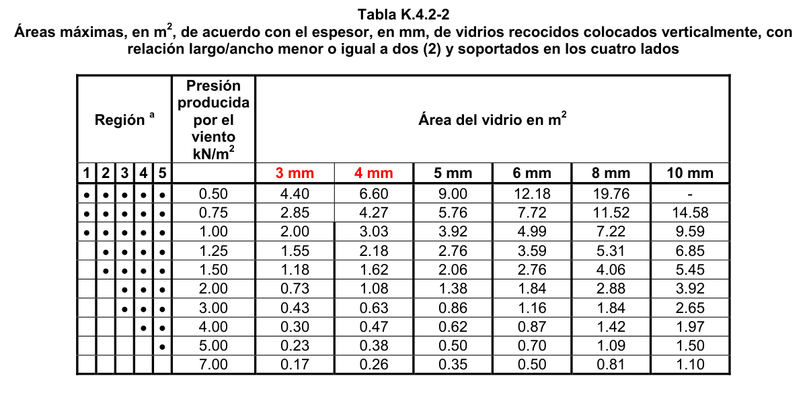

**Tabla K.4.2-3**

Áreas máximas en m2 por espesor para vidrios termoendurecidos Colocados verticalmente, con relación largo/ancho menor o igual a dos (2) y soportados en los cuatro lados

| Región a |  |  |  | Presión producida por el viento kN/m2 | Área del vidrio en m2 |  |  |  |  |  |
|---|---|---|---|---|---|---|---|---|---|---|
|  |  |  | 1 2 3 4 5 3 mm | 1 2 3 4 5 3 mm | 4 mm |  | 5 mm |  | 6 mm 8 mm | 10 mm |
|  | • • • • • |  |  | 1.00 | 4.40 | 6.60 | 9.00 |  | 12.18 19.76 | - |
|  |  | • • • • |  | 1.50 | 2.85 | 4.27 | 5.76 | 7.72 | 11.52 | 14.58 |
|  |  | • • • |  | 2.00 | 2.00 | 3.03 | 3.92 | 4.99 | 7.22 | 9.59 |
|  |  | • • • |  | 3.00 | 1.18 | 1.62 | 2.06 | 2.76 | 4.06 | 5.45 |
|  |  | • • |  | 4.00 | 0.73 | 1.08 | 1.38 | 1.84 | 2.88 | 3.92 |
|  |  |  |  | 6.00 | 0.43 | 0.63 | 0.86 | 1.16 | 1.84 | 2.65 |

<!-- mod:1-decreto-092-2011-480 -->
> **Modificación — Decreto 092 de 2011** · anexo, p. 89
>
> Las Tablas K.4.2-2 a K.4.2-5 deben quedar así además en las notas de todas estas tablas donde se menciona el mapa de amenaza eólica debe substituirse la referencia de la figura a B.6.4.1, en vez de B.6.5.1, la cual es incorrecta.
>
> 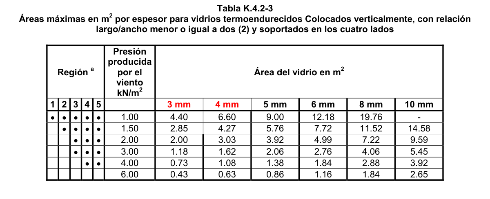

**Tabla K.4.2-4**

Áreas máximas en m2 por espesor para vidrios templados colocados verticalmente, con relación largo/ancho menor o igual a dos (2) y soportados en los cuatro lados

| Región a |  |  | Presión producida por el viento kN/m2 | Área del vidrio en m2 |  |  |  |  |  |
|---|---|---|---|---|---|---|---|---|---|
|  |  | 1 2 3 4 5 3 mm | 1 2 3 4 5 3 mm | 4 mm |  | 5 mm |  | 6 mm 8 mm | 10 mm |
|  | • • • |  | 2.00 | 4.40 | 6.60 | 9.00 |  | 12.18 19.76 | - |
|  | • • • |  | 3.00 | 2.85 | 4.27 | 5.76 | 7.72 | 11.52 | 14.58 |
|  | • • |  | 4.00 | 2.00 | 3.03 | 3.92 | 4.99 | 7.22 | 9.59 |
|  |  | • | 5.00 | 1.55 | 2.18 | 2.76 | 3.59 | 5.31 | 6.85 |
|  |  |  | 6.00 | 1.18 | 1.62 | 2.06 | 2.76 | 4.06 | 5.45 |

<!-- mod:1-decreto-092-2011-481 -->
> **Modificación — Decreto 092 de 2011** · anexo, p. 89
>
> Las Tablas K.4.2-2 a K.4.2-5 deben quedar así además en las notas de todas estas tablas donde se menciona el mapa de amenaza eólica debe substituirse la referencia de la figura a B.6.4.1, en vez de B.6.5.1, la cual es incorrecta.
>
> 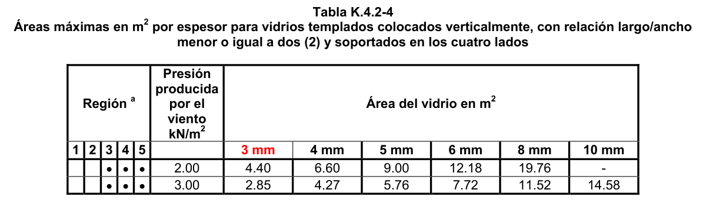
>
> 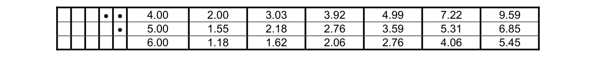

**Tabla K.4.2-5**

Áreas máximas en m2 por espesor para vidrios recocidos laminados con PVB colocados verticalmente, con relación largo/ancho menor o igual a dos (2) y soportados en los cuatro lados

| Región $a$ |  |  |  | Presión producida por el viento kN/m2 | Área del vidrio en m2 |  |  |  |  |  |
|---|---|---|---|---|---|---|---|---|---|---|
|  |  |  | 1 2 3 4 5 5 mm |  | 6 mm |  | 8 mm |  | 10 mm 12 mm | 16 mm |
|  | • • • • • |  |  | 0.50 | 8.64 | 11.56 | - | - | - | - |
|  | • • • • • |  |  | 0.75 | 5.45 | 7.57 | 12.33 | - | - | - |
|  | • • • • • |  |  | 1.00 | 3.84 | 5.31 | 8.08 | 10.26 | - | - |
|  |  | • • • • |  | 1.25 | 2.42 | 3.92 | 6.02 | 7.76 | 9.50 | - |
|  |  | • • • • |  | 1.50 | 2.31 | 3.13 | 4.65 | 6.06 | 7.61 | 13.36 |
|  |  | • • • |  | 2.00 | 1.57 | 2.08 | 3.25 | 4.21 | 5.38 | 8.90 |
|  |  | • • • |  | 3.00 | 0.91 | 1.28 | 2.00 | 2.65 | 3.38 | 5.71 |
|  |  | • • |  | 4.00 | 0.63 | 0.90 | 1.30 | 1.84 | 2.41 | 4.15 |
|  |  |  | • | 5.00 | 0.52 | 0.64 | 0.90 | 1.41 | 1.88 | 3.23 |
|  |  |  |  | 7.00 | 0.32 | 0.48 | 0.71 | 0.96 | 1.27 | 2.16 |

<!-- mod:1-decreto-092-2011-482 -->
> **Modificación — Decreto 092 de 2011** · anexo, p. 90
>
> Las Tablas K.4.2-2 a K.4.2-5 deben quedar así además en las notas de todas estas tablas donde se menciona el mapa de amenaza eólica debe substituirse la referencia de la figura a B.6.4.1, en vez de B.6.5.1, la cual es incorrecta.
>
> 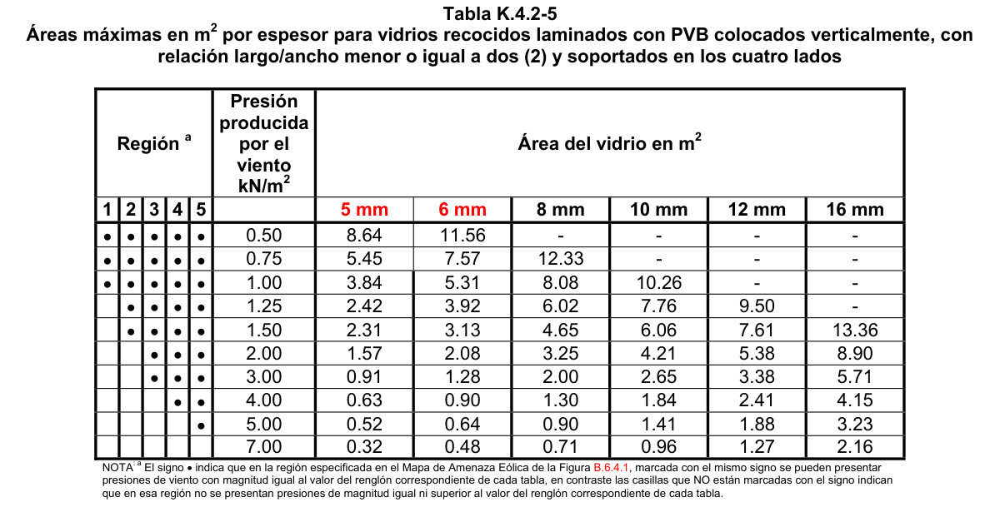

NOTA: a El signo • indica que en la región especificada en el Mapa de Amenaza Eólica de la Figura B.6.5.1, marcada con el mismo signo se pueden presentar presiones de viento con magnitud igual al valor del renglón correspondiente de cada tabla, en contraste las casillas que NO están marcadas con el signo indican que en esa región no se presentan presiones de magnitud igual ni superior al valor del renglón correspondiente de cada tabla.

**K.4.2.6.1** — Se prohíbe el uso de vidrios de 2 mm debido a su excesiva flexibilidad.

<!-- mod:1-decreto-092-2011-485 -->
> **Modificación — Decreto 092 de 2011** · anexo, p. 90
>
> El comienzo de K.4.2.6 debe quedar así:
>
> En las Tablas K.4.2-2 a K.4.2-5 las cuales han sido elaboradas...

#### K.4.2.7 — DEFLEXIONES ADMISIBLES

Deben determinarse analíticamente las deflexiones bajo cargas de diseño de los elementos que sirvan de apoyo a los vidrios en cualquier sistema vidriado. Cuando se requieran ensayos estructurales para determinar las deflexiones, éstos deben realizarse de acuerdo con la norma ASTM E330-

02. Cuando en los sistemas de marco se utilicen perfiles extruídos para los cuales se han determinado las propiedades físicas y se han ensayado los sistemas de anclajes y conexiones, no se requiere la realización de ensayos estructurales.

**K.4.2.7.1** — Bajo cargas de diseño, para elementos que soporten vidrio cuyos bordes se consideren firmemente soportados, la deflexión de los elementos en la dirección perpendicular al plano del muro debe satisfacer los requisitos de estas normas, pero no debe exceder la longitud de la luz dividida por 175 (L/175) en luces de hasta 4 m, y la longitud de la luz dividida por 240 más 6.35 mm (L/240 + 6.35 mm) en luces entre 4 m y 12 m. Las luces mayores que 12 m pueden requerir restricciones adicionales y deben ser analizadas por el diseñador estructural o por el diseñador de elementos no estructurales, según sea el caso. Si el valor L/175 se considera excesivo para aplicaciones específicas, el diseñador puede especificar menores deflexiones. Cuando se afecta un panel de yeso la deflexión no debe exceder 1/360 de la luz.

Cuando los elementos que soportan el vidrio (marco) no cumplan los anteriores requisitos de deflexión, el análisis de las láminas de vidrio, debe considerar las deflexiones del marco.

**K.4.2.7.2** — Bajo carga muerta, para elementos horizontales del marco, que soporten vidrio, su deflexión en la dirección paralela al plano del muro no debe exceder una cantidad que reduzca la mordedura en el borde del vidrio a menos del 75% de la dimensión de diseño ni una cantidad con la cual se puedan reducir las holguras necesarias del vidriado. La deflexión en esta dirección también se debe limitar para proporcionar al menos 3 mm de holgura entre el elemento y la parte superior del panel de vidrio fijado, o cualquier otra parte inmediatamente debajo del elemento. La holgura entre el elemento y una ventana o puerta operable por debajo debe ser al menos de 1.5 mm.

**K.4.2.7.3** — La torsión de los elementos horizontales debida al peso del vidrio no debe exceder 1º, medido entre los extremos y el centro de cada luz.

**K.4.2.7.4** — Se debe considerar que algunos sellantes requieren deflexiones menores a las aquí especificadas; para estos casos la deflexión en los elementos del marco deberá evitar el daño a los acabados interiores o la desconexión de elementos de revestimiento aplicados exteriormente.

**K.4.2.8** — MOVIMIENTOS DE LA ESTRUCTURA —Se requiere que el diseño garantice que no se transmitan cargas a los vidrios debidas a movimientos de la estructura.

**K.4.2.8.1** — Juntas de expansión

**K.4.2.8.1.1** — Debe haber una junta de expansión vertical por cada piso de la edificación, colocada preferencialmente en un miembro de soporte horizontal.

**K.4.2.8.1.2** — Las juntas de expansión horizontal deben colocarse, bien en cada eje de columnas ó a 6.0 m de distancia cada una, según lo que resulte menor. La expansión debe ser desde el centro hacia los extremos para minimizar los movimientos de la junta y así reducir los esfuerzos sobre sellantes y conectores.

**K.4.2.8.1.3** — Para el dimensionamiento de juntas se deben considerar la expansión y contracción máxima, así como la diferencia de coeficientes de dilatación térmica entre el vidrio y los elementos metálicos del marco.

**K.4.2.8.1.4** — En las juntas de expansión en montantes no se debe permitir la aplicación de cargas al vidrio debidas a movimientos de la estructura o al sistema de marco.

**K.4.2.8.2** — Marcos de sujeción

**K.4.2.8.2.1** — Los marcos de sujeción del vidrio se deben diseñar para que se acomoden a la deriva y para eliminar las cargas sobre los bordes y superficies del vidrio, por medio de holguras perimetrales y laterales.

**K.4.2.8.2.2** — Los elementos de amortiguación que se coloquen en el marco o en los bordes de las esquinas del vidrio para eliminar cualquier contacto entre el vidrio y el marco por la oscilación prevista del marco debido a los efectos sísmicos, deben fabricarse con material de dureza Shore A de 50 a 70.

**K.4.2.8.2.3** — La aplicación de sellantes se debe realizar de manera que admitan los movimientos previstos del sistema de vidriado y para proporcionar la capacidad estructural junto con los requisitos de impermeabilización y la habilidad de retención del vidrio.

**K.4.2.8.3** — Sistemas de anclaje

**K.4.2.8.3.1** — En el diseño de los anclajes de muros cortina y de juntas se deben considerar los movimientos de la estructura principal de la edificación y del muro cortina o fachada flotante por cargas gravitacionales, efectos sísmicos, cargas térmicas, de viento u otra causa.

**K.4.2.8.3.2** — La expansión y la contracción de los materiales no deben causar pandeo, falla de sellos de junta, reducción del desempeño u otros efectos perjudiciales. Adicionalmente las puertas y ventanas deben funcionar normalmente en todo el intervalo de temperaturas de funcionamiento normal de la edificación.

**K.4.2.8.3.3** — Los anclajes para cargas de viento deben permitir la libre expansión vertical de los montantes sin causar esfuerzos adicionales sobre los montantes, conectores o anclajes. Los cojinetes de deslizamiento son lo más aconsejable para este propósito; el aceite y la grasa pierden sus cualidades de lubricación al pasar un largo tiempo.

**K.4.2.8.3.4** — Los montantes de doble luz deben tener un anclaje de carga muerta localizado tan cerca como sea posible de su punto medio, para así igualar la expansión y contracción hacia arriba y hacia abajo.

**K.4.2.8.3.5** — Los anclajes deben tener la dureza, flexibilidad y resistencia suficientes para soportar las cargas muertas y las cargas dinámicas a que puedan estar sometidos, y además en el diseño se deben considerar las tolerancias de fabricación y construcción. Adicionalmente los anclajes deben permitir al muro cortina o fachada flotante desempeñarse satisfactoriamente en cuanto a su función básica de proteger el interior de la edificación del ambiente exterior.

**K.4.2.8.3.6** — El diseño de los anclajes debe considerar los efectos sísmicos mediante la aplicación de una carga calculada de acuerdo con el Capítulo A.9. En el diseño también se deben considerar las demás especificaciones del Capítulo A.9.

**K.4.2.8.3.7** — En cada detalle de anclaje se debe revisar cuidadosamente la capacidad de las conexiones pernadas y la localización y tamaño de las soldaduras.

**K.4.2.8.3.8** — Se deben usar dispositivos de cierre para evitar que los elementos se desconecten o se desajusten a causa de movimientos inducidos por cambios térmicos o por el viento.

**K.4.2.8.3.9** — Los anclajes no deben estar en el área húmeda de un sistema.

**K.4.2.8.4** — En los casos en que se permita la rotación de los montantes del sistema vidriado por efecto de las derivas, es necesario que los vidrios puedan rotar libremente sin romperse. En los casos en que se utilicen siliconas para las juntas entre paneles, éstas deben permitir que los paneles de vidrio se muevan con relación a los adyacentes. Igualmente, es necesario considerar, además de las cargas inerciales, las cargas generadas por la rotación de los paneles de vidrio como consecuencia de la deriva.

**K.4.2.8.5** — Los sistema en muros cortina vidriados, fachadas vidriadas, o particiones vidriadas deben evaluarse de acuerdo con AAMA 501.6-01 Recommended Dynamic Test Method for Determining the Seismic Drift Causing Glass Fallout from a Wall System, o por análisis de ingeniería, de manera que se especifique explícitamente la deriva que causa la caída del vidrio $(Δ\text{caída})$ del muro cortina o fachada flotante, fachada, o partición.

**K.4.2.8.6** — Para los sistemas en muros cortina vidriados o fachadas flotantes, fachadas vidriadas, o particiones vidriadas debe verificarse que:

$$ \Delta_{\text{caída}} \ge 1.25ID_p \ge 13\,\mathrm{mm} \tag{K.4.2-19} $$

Donde:

$(Δ\text{caída})$ = deriva que causa la caída del vidrio del muro cortina o fachadas flotantes, fachada, o partición, determinada de acuerdo con K.4.2.8.5.

$Dp$ = deriva o desplazamiento relativo calculado del análisis sísmico para el sistema vidriado.

$I$ = coeficiente de Importancia para el Grupo de Uso.

**K.4.2.8.6.1** — El requisito anterior puede obviarse en los siguientes casos:

(a) Vidrios que tengan holguras perimetrales alrededor de su marco, calculadas de acuerdo con la Ecuación K.4.2-20, de tal forma que no ocurra contacto físico entre el vidrio y el marco cuando se aplique la deriva de diseño.

$$ D_{libre} \ge 1.25D_p \tag{K.4.2-20} $$

Donde:

$Dlibre$ = desplazamiento relativo horizontal, medido sobre la altura del panel de vidrio bajo consideración, que causa el contacto inicial entre el vidrio y su marco y que para paneles de vidrio rectangulares dentro de un marco rectangular tiene el valor dado por la Ecuación K.4.2-21.

$$ D_{libre} = 2c_1 \left( 1 + \dfrac{h_p c_2}{b_p c_1} \right) \tag{K.4.2-21} $$

Donde:

$hp$ = altura del panel de vidrio rectangular

$bp$ = ancho del panel de vidrio rectangular

$C1$ = holgura perimetral entre los bordes verticales del vidrio y el marco

$C2$ = holgura perimetral entre los bordes horizontales del vidrio y el marco

(b) Vidrios templados de seguridad monolíticos en edificaciones de los Grupos de Uso I y II, que estén localizados a no más de 3 m por encima de una superficie de tránsito peatonal.

(c) Vidrios recocidos laminados o termoendurecidos laminados con entrecapa no menor que 0.76 mm, que son capturados mecánicamente en la cavidad del sistema de vidriado, y cuyo perímetro está asegurado al marco por un tipo de sello perimetral como sellante elastomérico de curado húmedo con mínimo 13 mm de ancho en el contacto con el vidrio, u otro sistema de anclaje aprobado.

#### K.4.2.9 — CONSIDERACIONES DE LOS EFECTOS SÍSMICOS PARA EL USO DE OTROS ELEMENTOS EN

SISTEMAS VIDRIADOS

**K.4.2.9.1** — Desempeño de empaques (burletes) — Para un sistema de vidriado seco consiste en un empaque insertado por un lado y un empaque aplicado (húmedo) por el otro lado del vidrio, el empaque húmedo debe tener un método para asegurar de modo que no se desacople del sistema de marco metálico durante el movimiento vertical y lateral que ocurre durante un evento sísmico. El empaque debe permanecer en su lugar cuando el vidrio se mueva por la oscilación de la edificación.

**K.4.2.9.2** — Cuñas de apoyo y soportes — Las cuñas de apoyo se deben posicionar de manera permanente mediante acuñado en un elemento horizontal del marco, usando un sellante compatible para la colocación u otro método que no permita movimiento del calzo o cuña. Cuando se usen soportes para las cuñas, deben ser anclados o asegurados permanentemente al elemento horizontal del marco y deben posicionar las cuñas de apoyo como se especificó anteriormente.

**K.4.2.9.3** — Bandas de acabado aplicadas y empaques u otros elementos a presión — Los elementos del sistema de vidriado que actúen como bandas de acabado y/o elementos de soporte del vidrio que utilizan la compresión de empaques o acoples metálicos para permanecer en su posición, se deben diseñar y sujetar para que el elemento no llegue a interrumpir, de forma permanente o temporal, el soporte que le suministra al vidrio, debido a la vibración y oscilación por efectos sísmicos.

### K.4.3 — SEGURIDAD

**K.4.3.1** — Es preciso establecer las medidas y elementos de seguridad y características apropiadas de los materiales vidriados, de tal manera que puedan utilizarse en cualquier lugar en las edificaciones, sin riesgo para sus ocupantes y otras personas que transiten por sitios aledaños.

<!-- mod:1-decreto-092-2011-486 -->
> *Texto vigente según el Decreto 092 de 2011 (anexo, p. 90).*

**K.4.3.2** - Se exige el uso exclusivo de vidrios de seguridad laminados, templados o recubiertos, en los espacios señalados en el numeral K.4.3.9.

<!-- mod:1-decreto-092-2011-487 -->
> *Texto vigente según el Decreto 092 de 2011 (anexo, p. 90).*

**K.4.3.3** - No deben emplearse vidrios que presenten fallas, defectos o ambas imperfecciones que puedan afectar las propiedades físicas indispensables para la función que desempeñan. Se debe cumplir con las normas NTC 1909, NTC 1804, NTC 5724 y/o NTC 5756 según el caso.

**K.4.3.4** — Si los vidrios son fijos, con pisavidrios, es necesario sellarlos con empaques de neopreno o similar, silicona u otro sellador garantizado, a lo largo del contorno para evitar vibraciones susceptibles de ocasionar rotura o ruido molesto.

**K.4.3.5** — Los ensayos para los tipos de vidrio de seguridad deben realizarse según los requisitos estipulados en la Norma NTC 1578.

**K.4.3.6** — Los sistemas que usen vidrios deben diseñarse de tal manera que no haya humedad durante períodos de tiempo prolongados en los canales de fijación de los vidrios.

**K.4.3.7** — Con el fin de evitar roturas en las láminas de vidrio, inducidas por su propio peso o por deformaciones o protuberancias en el marco de la ventana (tornillos, puntos de soldadura, etc.), se exige colocar en la parte inferior como mínimo, dos soportes blandos para todas las unidades de vidrio.

**K.4.3.8** — Deben emplearse empaques no duros (neopreno o similares) cuando la lámina de vidrio pueda verse sometida a impactos, altas presiones normales, choques térmicos, vibraciones o filtraciones.

#### K.4.3.9 — Requerimientos de seguridad ante el impacto humano

Este numeral contiene los requerimientos de visibilidad, puertas, paneles laterales y divisiones para el diseño de vidrieras ubicadas en lugares con riesgo de impacto humano.

Para efectos de la aplicación de las disposiciones establecidas en el presente numeral se entienden sujetas al riesgo al impacto humano las vidrieras ubicadas hasta una altura de 2000 mm con relación al nivel del piso. Los niveles de riesgo se calificarán de acuerdo con la siguiente figura:

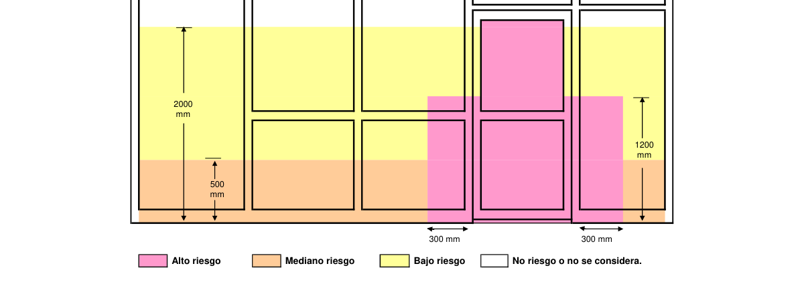

Figura K.4.3-0 — Calificación de niveles de riesgo

**K.4.3.9.1** — Visibilidad

**K.4.3.9.1.1** — Si el material transparente de una vidriera puede ser confundido con el vano de una puerta o con trayectos despejados, la presencia del vidrio debe hacerse visible ya sea colocando una banda opaca que cumpla con los numerales K.4.3.9.1.2 y K.4.3.9.1.3, a lo ancho de toda la vidriera, o mediante un adorno u otro tratamiento decorativo. Si se colocan adornos u otros tratamientos decorativos, estos deben proporcionar niveles de visibilidad similares a la banda opaca (desde ambos lados). Tales marcas no sustituyen el uso de vidrio de seguridad, cuando sea requerido por este Capítulo.

**K.4.3.9.1.2** — Cuando se coloque una banda opaca de visibilidad, deberá tener más de 20 mm de alto y deberá estar localizada de tal manera que la distancia vertical desde el nivel del piso sea:

(a) No menor de 700 mm hasta el borde superior de la banda

(b) No más de 1000 mm hasta el borde inferior de la banda

**K.4.3.9.1.3** — La banda deberá ser fácilmente visible. Esto se puede lograr ya sea empleando una banda que contraste con el fondo, o incrementando el ancho de la banda. Líneas discontinuas con diseños discontinuos son formas aceptables de bandas de advertencia.

**K.4.3.9.1.4** — No se requieren bandas ni marcas en los siguientes casos:

(a) La altura del panel de vidrio no supera los 1000 mm en ninguna de sus dimensiones.

(b) El ancho del panel de vidrio no supera los 500 mm en ninguna de sus dimensiones (incluye paneles individuales con vidrio a tope.

(c) No hay vidrios hasta 500 mm a partir del nivel del piso;

(d) El panel de vidrio ha sido entregado con al menos un perfil firmemente asegurado para proteger cada una de las caras del vidrio. Al menos uno de los perfiles deberá ser colocado con su borde superior a menos de 500 mm y su borde inferior a más de 1000 mm sobre el nivel del piso. El ancho de la cara del perfil no deberá ser menor a 40 mm.

(e) Cuando el vidrio de seguridad es empleado en viviendas.

<!-- mod:1-decreto-092-2011-489 -->
> **Modificación — Decreto 092 de 2011** · anexo, p. 91
>
> Los siguientes literales de K.4.3.9.1.4 deben quedar así:
>
> (a) La altura del panel de vidrio no supera los 1000 mm en ninguna de sus partes,
>
> (b) El ancho del panel de vidrio no supera los 500 mm en ninguna de sus partes (incluye paneles individuales con vidrio a tope.
>
> (d) El panel de vidrio ha sido entregado con al menos un perfil firmemente asegurado para proteger cada una de las caras del vidrio. Al menos uno de los perfiles deberá ser colocado con su borde superior a no menos de 500 mm y su borde inferior a no más de 1000 mm sobre el nivel del piso. El ancho de la cara del perfil no deberá ser menor a 40 mm.

**K.4.3.9.1.5** — Sustitución del vidrio de seguridad — El vidrio de seguridad puede ser sustituido directamente, en las circunstancias en que el vidrio recocido es permitido, con la misma área y con los mismos límites de espesor establecidos en la tabla apropiada para vidrio recocido.

**K.4.3.9.1.6** — Unidades de vidrio doble

**K.4.3.9.1.6.1** — El área máxima permitida de unidades de vidrio doble deberá ser 1.5 veces el área permitida para el espesor de un sola lámina de vidrio, que es igual a la más delgada de las dos láminas utilizadas en la unidad sellada.

**K.4.3.9.1.6.2** — Cuando una unidad de vidrio doble se instala en un lugar con acceso a peatones por ambos lados de la unidad, las dos láminas de vidrio deberán cumplir con los requerimientos de este Capítulo. En situaciones en que el acceso de peatones es restringido a un solo lado de la unidad, el único lado accesible deberá cumplir con esta exigencia.

**K.4.3.9.1.7** — Identificación del vidrio de seguridad.

**K.4.3.9.1.7.1** — Cada lámina de vidrio de seguridad deberá ser marcada en forma legible y permanente.

**K.4.3.9.1.7.2** — Cuando, con posterioridad a su fabricación, un distribuidor o un instalador cortan un vidrio de seguridad, tal distribuidor o instalador deberá marcar cada pieza en forma permanente - en el caso de que la marcación no haya sido ya realizada para certificar que fue cortada a partir de una lámina de vidrio de seguridad.

**K.4.3.9.1.7.3** — Cada lámina deberá ser marcada con los requerimientos mínimos siguientes:

(a) Nombre, marca registrada o código del fabricante o proveedor.

(b) Tipo de vidrio de seguridad. Puede ser en forma de código, tal como T, para vidrio templado, o L, para vidrio laminado, como se indica en la Norma de prueba relevante.

(c) Estándar contra el que el vidrio de seguridad ha sido probado.

(d) En caso de ser aplicable, la clasificación relativa al comportamiento en la prueba de impacto, i. e A por Grado A, B por Grado B, C por Grado C.

**K.4.3.9.1.8** — Reposición de vidrios — Cuando se hagan reposición de vidrios, debido a roturas o por cualquier otra razón, el vidrio de reposición deberá cumplir con las disposiciones de este Capítulo.

**K.4.3.9.1.9** — Escuelas y guarderías — En escuelas y guarderías, todos los paneles de vidrio que se encuentren a una altura de hasta 800 mm sobre el nivel del piso, el nivel del terreno o el nivel de la terraza, deberán ser en vidrio de seguridad, según las tablas K.4.3-1 ó K.4.3- 4. Los vidrios colocados a más de 800 mm sobre el nivel del piso deberán cumplir con los requerimientos del presente capitulo.

**K.4.3.9.1.10** — Edificaciones con áreas de actividad de alto riesgo — Se deberá usar vidrio , de acuerdo con las tablas K.4.3-1 o K.4.3-4, en aquellos espacios de las edificaciones donde las actividades planeadas generan un alto riesgo, tales como gimnasios, piscinas y áreas húmedas, spas, algunas áreas de escuelas, vestíbulos, balcones o miradores públicos, estadios y similares.

NOTA — Las áreas de las escuelas a las que se hace referencia en los requerimientos de esta cláusula incluyen las vidrieras a menos de 5 mts. de las áreas donde se desarrollen actividades tales como aquellas relacionadas con zonas de recreación, canchas o campos deportivos.

**K.4.3.9.2** — Puertas

**K.4.3.9.2.1** — El vidriado de las puertas se hará con vidrio de seguridad, según la tabla K.4.3-1 y la cláusula K.4.3.9.1, con las excepciones mencionadas en cada literal:

(a) Puertas batientes, puertas giratorias y puertas o divisiones plegables en dos partes — Se permite vidrio recocido hasta un área máxima de 0.5 m2, según la columna 1 de la tabla K.4.3-2. No se puede usar vidrio recocido de ningún espesor en áreas superiores a 0.5 m2.

(b) Puertas corredizas — Se permite vidrio recocido con un espesor mínimo de 5 mm, según la columna 2 de la tabla K.4.3-2, siempre y cuando la puerta incorpore uno o más travesaños horizontales. Los travesaños serán perfiles firmemente remachados y asegurados a la puerta para proteger cada una de las caras del vidrio. Se deberá colocar al menos un travesaño con el borde superior a no menos de 700 mm, y el borde inferior a no más de 1000 mm, sobre el nivel del piso. El ancho de las caras de los travesaños no será inferior a 20 mm.

(c) Puertas con vidrio a tope — El vidriado será realizado con vidrio de seguridad templado, que tenga un espesor mínimo de 10 mm, y deberá cumplir con K.4.3.9.1.

(d) Puertas de duchas y cabinas de baños — El vidriado se hará en conformidad con K.4.3.9.6.

(e) Puertas de closets y guardarropas — El vidriado debe ser con vidrio de seguridad en conformidad con la tabla K.4.3-1. Cuando se use espejo de 4 mm de seguridad con respaldo de vinilo, el área máxima será 3 m2.

(f) Puertas corredizas, puertas inclinadas y puertas plegadizas — El vidrio debe ser de seguridad, según la tabla K.4.3-1, o con vidrio recocido según la columna 2 de la tabla K.4.3-2.

(g) Paneles de vitrinas deslizantes — Las puertas vidrieras deslizantes, dentro de salas de exhibición de automóviles y similares, con marcos muy grandes que normalmente son usados para puertas de entrada y salida - pero ocasionalmente empleados con el propósito acceder a la exhibición - deberán estar de acuerdo con la tabla K.4.3-2, columna 3, y cumplir con el numeral K.4.3.9.1.

<!-- mod:1-decreto-092-2011-490 -->
> **Modificación — Decreto 092 de 2011** · anexo, p. 91
>
> Los siguientes literales de K.4.3.9.2.1 debe quedar así:
>
> (d) ***Puertas de duchas, cabinas de baños y cerramientos de tinas o jacuzzi*** — El vidriado se hará en conformidad con K.4.3.9.6.
>
> (f) ***Puertas enrollables, puertas inclinadas y puertas plegadizas***. El vidrio debe ser de seguridad, según la tabla K.4.3-1, o con vidrio recocido según la columna 2 de la tabla K.4.3-2.
>
> (g) ***Paneles de vitrinas movibles*** — Los paneles de vidrio completamente enmarcados de tamaño grande y de tipo movible, usados dentro de salas de exhibición de automóviles y similares, que normalmente no son usados como puertas de entrada o salida y solo son utilizados ocasionalmente con el propósito de acceder a la exhibición, deberán estar de acuerdo con la Tabla K.4.3-2, columna 3, y cumplir con el numeral K.4.3.9.1.

**K.4.3.9.2.2** — Las puertas de escuelas y guarderías deberán ser construidas con vidrio de seguridad, según la tabla K.4.3-1

**K.4.3.9.3** — Paneles Laterales

**K.4.3.9.3.1** — General

**K.4.3.9.3.1.1** — Un panel lateral se define como un panel con vidrio que tiene un borde vertical visible menor de 300 mm al borde más cercano del vano de la puerta y dentro de 30o al plano de la puerta cerrada, excepción hecha cuando K.4.3.9.3.1.3 lo define en forma diferente.

**K.4.3.9.3.1.2** — Un panel que es adyacente a una puerta - ya sea curvo o con un ángulo mayor de 30o con relación al plano de la puerta cerrada, no es un panel lateral, pero puede ser clasificado como tal por la cláusula K.4.3.9.4 y otras de este numeral.

**K.4.3.9.3.1.3** — Una división interna en vidrio, que conste de más de un panel con bordes laterales sin enmarcar, adyacente a una puerta, no debe ser considerada como un panel lateral y debe cumplir con los requerimientos de la tabla K.4.3-4 y del numeral K.4.3.9.1, excepto cuando el espesor del vidrio recocido no es inferior a 10 mm.

**K.4.3.9.3.1.4** — Todos los paneles laterales, en escuelas y guarderías, deberán ser construidos con vidrio de seguridad, según la tabla K.4.3-1.

**K.4.3.9.3.2** — Paneles laterales enmarcados

**K.4.3.9.3.2.1** — Todos los paneles laterales con vidrio enmarcado deberán ser construidos con vidrio de seguridad, excepto cuando lo provean de otra forma los numerales K.4.3.9.3.2.2 y K.4.3.9.3.2.3

**K.4.3.9.3.2.2** — El vidrio recocido puede ser usado en cualquier panel vidriado, de acuerdo con la columna 2 de la tabla K.4.3-2, si cumple con uno de los siguientes casos:

(a) La altura del panel de vidrio no es superior a 1000 mm en ninguna de sus dimensiones.

(b) El ancho del panel de vidrio no es superior a 500 mm en ninguna de sus dimensiones.

(c) El panel lateral cuenta como mínimo con un riel protector, o con un perfil, firmemente remachado y asegurado para proteger cada una de las caras del vidrio. Al menos uno de los rieles deberá estar localizado, ya sea horizontal o diagonalmente, con su borde superior a no menos de 700 mm y su borde inferior a no más de 1000 mm, sobre el nivel del piso. El riel protector, o el perfil, deberán tener un ancho no inferior a 20 mm.

<!-- mod:1-decreto-092-2011-491 -->
> **Modificación — Decreto 092 de 2011** · anexo, p. 91
>
> Los literales (a) y (b) de K.4.3.9.3.2.2 deben quedar así:
>
> (a) La altura del panel de vidrio no es superior a 1000 mm en ninguna de sus partes.
>
> (b) El ancho del panel de vidrio no es superior a 500 mm en ninguna de sus partes.

**K.4.3.9.3.2.3** — En una vitrina se puede usar vidrio recocido, según la columna 3 de la tabla K.4.3-2, siempre y cuando el ancho del vano donde se ha de colocar el vidrio sea superior a 2000 mm y además:

(a) No haya vidriado a menos de 500 mm del nivel del piso; o

(b) Se use vidrio recocido de no menos de 10 mm nominales.

**K.4.3.9.3.3** — Paneles laterales con vidrio sin enmarcar o parcialmente enmarcado

**K.4.3.9.3.3.1** — Los paneles laterales sin enmarcar o parcialmente enmarcado, sin bordes expuestos, con excepción hecha de los definidos en K.4.3.9.3.1.3, deberán ser con vidrio de seguridad, según los requerimientos de las tablas K.4.3-4 y K.4.3-5 y deberán cumplir con el numeral K.4.3.9.1

**K.4.3.9.3.3.2** — Los paneles laterales con vidrio sin enmarcar, deberán ser colocados con vidrio templado de seguridad de no menos de 10 mm de espesor y deberán cumplir con el numeral K.4.3.9.1

**K.4.3.9.4** — Paneles con vidrio que puede ser confundidos con trayectos despejados

**K.4.3.9.4.1** — Se debe considerar que todo panel con vidrio es susceptible de ser confundido con el vano de una puerta o con un trayecto despejado (que da acceso o salida de una edificación a otra, o entre el interior y el exterior de la misma), a menos que cumpla con uno de los siguientes casos:

(a) La altura del panel de vidrio no es superior a 1000 mm en ninguna de sus dimensiones.

(b) El ancho del panel de vidrio no es superior a 500 mm en ninguna de sus dimensiones (incluye los paneles individuales para vidrio a tope)

(c) No hay áreas con vidrio a menos de 500 mm sobre el nivel del piso.

(d) El panel de vidrio es suministrado con al menos un perfil, firmemente remachado y asegurado para asegurar y proteger cada una de las caras del vidrio. Como mínimo se debe colocar un perfil con su borde superior a no menos de 500 mm y su borde inferior a no más de 1000 mm, sobre el nivel del piso. El perfil deberá tener un ancho no inferior a 40 mm.

(e) El panel de vidrio es marcado con una banda opaca u otro tratamiento decorativo, según los requerimientos del numeral K.4.3.9.1

(f) El panel con vidrio protege una diferencia de nivel de 1000 mm o más.

NOTA – Una desnivel de 1000 mm o más se considera como una barrera visual Si la vidriera cumple con ya sea (a), (b), (c) ó (d), se deberá usar vidrio recocido de acuerdo con la columna 3 de la tabla K.4.3-2 Si la vidriera cumple con (e), se deberá usar vidrio recocido de acuerdo con la columna 2 de la tabla K.4.3-2, y el vidrio deberá marcarse y cumplir con el numeral K.4.3.9.1.

Si la vidriera cumple con (f), deberá ajustarse a los requerimientos del numeral K.4.3.9.7.

<!-- mod:1-decreto-092-2011-492 -->
> **Modificación — Decreto 092 de 2011** · anexo, p. 91
>
> Los literales (a) y (b) de K.4.3.9.4.1 deben quedar así:
>
> (a) La altura del panel de vidrio no es superior a 1000 mm en ninguna de sus partes.
>
> (b) El ancho del panel de vidrio no es superior a 500 mm en ninguna de sus partes (incluye los paneles individuales para vidrio a tope).

**K.4.3.9.4.2** — Cualquier panel con vidrio que pueda ser confundido con un vano de una puerta o con un trayecto despejado, debe ser vidriado como sigue:

(a) Para paneles con marco – Vidrio de seguridad que cumple con los requerimientos de la tabla K.4.3-1 y del numeral K.4.3.9.1.

(b) Para paneles sin marco – Vidrio de seguridad que cumple con los requerimientos de las tablas K.4.3-4 o K.4.3-5, y del numeral K.4.3.9.1.

**K.4.3.9.5** — Vidrieras a baja altura

**K.4.3.9.5.1** — Cualquier vidrio recocido a menos de 500 mm sobre el nivel del piso no debe tener menos de 5 mm de espesor, según la columna 2 de la tabla K.4.3-2.

**K.4.3.9.5.2** — Cuando la altura del vano para el vidrio es superior a 1000 mm, y excede los 500 mm de ancho, podría ser confundido con un trayecto sin impedimentos y por lo tanto debe cumplir con los requerimientos del numeral K.4.3.9.4, es decir, un espesor mínimo de 5 mm.

**K.4.3.9.5.3** — Cuando el la vidriera protege una diferencia de nivel de 1000 mm o más, por debajo del sillar de la ventana, esta deberá cumplir con los requerimientos de K.4.3.9.7, con un espesor mínimo de 5 mm.

**K.4.3.9.6** — Vidrieras en baños, spas y jacuzzi

**K.4.3.9.6.1** — Vidrio de seguridad de acuerdo a la tabla K.4.3-1 se debe usar en:

(a) Puertas y divisiones de baño, enmarcadas o sin enmarcar;

(b) Toda vidriera a menos de 2000 mm del nivel del piso en cuartos de baño y cubículos que contengan jacuzzi o spas.

<!-- mod:1-decreto-092-2011-503 -->
> **Modificación — Decreto 092 de 2011** · anexo, p. 94
>
> El literal (b) de K.4.3.9.6.1 debe quedar así:
>
> (b) Toda vidriera localizada a menos de 1500 mm medidos desde el nivel del piso o de sitios donde las personas pueden estar de pie en cuartos de baño y cubículos que contengan jacuzzi o spas, excepto que haya frente al vidriado una unidad de tocador o una banca de mínimo 760 mm de altura y de mínimo 300 mm de fondo.

**K.4.3.9.6.2** — En cuartos de baño, los paneles o puertas de vidrio, con una o dos bordes opuestos sin enmarcar, deben ser en vidrio templado de seguridad no menor de 5 mm de espesor.

<!-- mod:1-decreto-092-2011-493 -->
> **Modificación — Decreto 092 de 2011** · anexo, p. 91
>
> En K.4.3.9.6.2 cambiar la palabra una por uno:
>
> En cuartos de baño, los paneles o puertas de vidrio, con uno o dos bordes opuestos sin enmarcar, deben ser en vidrio templado de seguridad no menor de 5 mm de espesor.

**K.4.3.9.6.3** — En cuartos de baño, los paneles o puertas de vidrio, con dos o tres o más bordes adyacentes a tope, deben ser en vidrio templado de seguridad no menor de 6 mm de espesor.

**K.4.3.9.6.4** — Las puertas de vidrio para duchas, que van sin enmarcar o a tope y que utilizan pivotes o bisagras, serán hechas de vidrio templado de seguridad no menor de 6 mm de espesor.

**Tabla K.4.3-1**

Áreas máximas de vidrio de seguridad para vidrieras totalmente enmarcadas

| Tipo de vidrio | Espesor nominal (mm) | Área máxima (m2) |
|---|---|---|
| Vidrio de seguridad (*) |  |  |
| Vidrio templado de seguridad | 3 | 1.0 |
|  | 4 | 2.0 |
|  | 5 | 3.0 |
|  | 6 | 4.0 |
|  | 8 | 6.0 |
|  | 10 | 6.0 |
|  | 12 | 10.0 (+) |
| Vidrio laminado de seguridad (++) | 5 | 2.0 |
|  | 6 | 3.0 |
|  | 8 | 5.0 |
|  | 10 | 7.0 |
|  | 12 | 9.0 (+) |
| Vidrio y Espejo recubierto con película orgánica de seguridad | Refiérase a especificaciones detalladas sobre proveedores de películas de seguridad contra impacto. En ausencia de gráficos para diseños específicos, refiérase a las anteriores áreas máximas para vidrio laminado de seguridad |  |

<!-- mod:1-decreto-092-2011-496 -->
> **Modificación — Decreto 092 de 2011** · anexo, p. 92
>
> La octava línea de la Tabla K.4.3-1 debe quedar así:
>
> 

(*) Vidrio de seguridad (+) Esta área puede no estar fácilmente disponible (++) Basado únicamente en el espesor de vidrio total (no se incluye el espesor de la capa intermedia)

**Tabla K.4.3-2**

Áreas máximas de vidrio recocido para zonas de riesgos alto, mediano y bajo

| Espesor nominal (mm) | Columna 1 Alto riesgo (m2) | Columna 2 Mediano riesgo (m2) | Columna 3 Bajo riesgo (m2) |
|---|---|---|---|
| 3 | 0.25 | 0.1 | 0.3 |
| 4 | 0.2 | 0.3 | 1.1 |
| 5 | 0.5 | 1.2 | 2.2 |
| 6 | 0.9 | 2.1 | 3.3 |
| 8 | 1.8 | 3.2 | 4.5 |
| 10 | 2.7 | 4.4 | 6.0 |
| 12 | 4.5 | 6.3 | 8.0 |
| 15 | 6.3 | 8.2 | 10.0 |
| 19 | 8.5 | 10.3 | 12.0 |
| 25 | 12.0 | 13.5 | 15.0 |

<!-- mod:1-decreto-092-2011-497 -->
> **Modificación — Decreto 092 de 2011** · anexo, p. 92
>
> La segunda línea de la Tabla K.4.3-2 debe quedar así:
>
> 

**Tabla K.4.3-3**

Áreas máximas de vidrio recocido para vidriado totalmente enmarcado

| Espesor nominal (mm) | Área máxima Completamente enmarcada (m2) |
|---|---|
| 3 | 0.5 |
| 4 | 2.0 |
| 5 | 3.3 |
| 6 | 4.6 |
| 8 | 7.0 |
| 10 | 9.5 |
| 12 | 12.0 |
| 15 | 16.0 |
| 19 | 16.0 |
| 25 | 16.0 |

<!-- mod:1-decreto-092-2011-498 -->
> **Modificación — Decreto 092 de 2011** · anexo, p. 92
>
> Al final del texto del título de la Tabla K.4.3-3 debe incluirse un llamado (\*) y se debe además incluir una nota en la parte inferior de la Tabla que substituye la nota existente, la cual dice:
>
> (\*) La rigidez de los elementos enmarcados se debe verificar con las deflexiones máximas permitidas de acuerdo con K.4.2.7. Solo aplica para muros cortina o fachadas flotantes.

NOTA — Las áreas máximas son basadas en un diseño ULS de carga frontal de 1.3 kPa. Las máximas áreas se basan generalmente en una carga frontal de 1.3 kPa, porque se considera que éste es el mínimo nivel de protección contra impacto. En las situaciones en que la presión de diseño del viento exceda los 1.3 kPA, se debe seleccionar un vidrio que soporte la carga de viento correspondiente. ULS: (Ultimate Limit State) Estado Límite Último.

**Tabla K.4.3-4**

Divisiones internas con bordes laterales sin enmarcar

| Altura del vidrio (vano) (m) | Tipo de vidrio | Espesor nominal estándar mínimo (mm) | Número máximo de uniones a tope por vano | Número máximo de paneles de vidrio individuales por vano | Ancho máximo del panel individual |
|---|---|---|---|---|---|
| ≤ 1.3 | Recocido | 5* | 2 | 3 | 1000 |
|  | Recocido | 6* | sin límite | sin límite | sin límite |
|  | Templado (+) | 4 | 2 | 3 | 1000 |
|  | Templado (+) | 5 | sin límite | sin límite | sin límite |
|  | Laminado (+) (++) | 6 | 2 | 3 | 1000 |
|  | Laminado (+) (++) | 8 | sin límite | sin límite | sin límite |
| >1.3 ≤ 2.0 | Recocido | 6* | 1 | 2 | 1000 |
|  | Recocido | 8* | 2 | 3 | 1000 |
|  | Recocido | 10 | 2 | 3 | 1200 |
|  | Templado (+) | 6 | 2 | 3 | 1000 |
|  | Templado (+) | 8 | sin límite | sin límite | sin límite |
|  | Laminado (+) (++) | 6 | 2 | 3 | 1000 |
|  | Laminado (+) (++) | 8 | 2 | 3 | 1000 |
|  | Laminado (+) (++) | 10 | sin límite | sin límite | sin límite |
| >2 ≤ 2.6 | Recocido | 8* | 1 | 2 | 1000 |
|  | Recocido | 10 | 2 | 3 | 1000 |
|  | Recocido | 12 | 2 | 3 | 1200 |
|  | Templado (+) | 8 | sin límite | sin límite | sin límite |
|  | Templado (+) | 10 | sin límite | sin límite | sin límite |
|  | Laminado (+) (++) | 8 | 1 | 2 | 1200 |
|  | Laminado (+) (++) | 10 | 2 | 3 | 1200 |
|  | Laminado (+) (++) | 12 | sin límite | sin límite | sin límite |
| >2.6 ≤ 3.0 | Recocido | 10 | 1 | 2 | 1000 |
|  | Recocido | 12 | 2 | 3 | 1000 |
|  | Templado (+) | 10 | sin límite | sin límite | sin límite |
|  | Templado (+) | 12 | sin límite | sin límite | sin límite |
|  | Laminado (+) (++) | 10 | 2 | 3 | 1000 |
|  | Laminado (+) (++) | 12 | 2 | 3 | 1000 |

<!-- mod:1-decreto-092-2011-499 -->
> **Modificación — Decreto 092 de 2011** · anexo, p. 92
>
> Las notas de la Tabla K.4.3-4 deben quedar así:
>
> \* Un mínimo de 10 mm para paneles laterales (refiérase a K.4.3.9.3.1.3) 
> \+ Material vidriado de seguridad 
> \++ Basado en espesor del vidrio total únicamente (no se incluye la capa intermedia, la cual debe ser sumada)
>
> Notas:
>
> 1) Alturas superiores a 3.0 m requieren diseño específico 
> 2) Se requiere cubrimiento adecuado de bordes para asegurar el vidrio contra cargas. 
> 3) El diseño del vidrio de seguridad se basa en una presión máxima de 0.45 kPa

* Un mínimo de 10 mm para paneles laterales (refiérase a K.4.3.9.3.1.3) + Material vidriado de seguridad ++ Basado en espesor del vidrio total únicamente (no se incluye la capa intermedia, la cual debe ser agregada) NOTA – 1) Alturas superiores a 3.0 mts requieren diseño específico 2) Se requiere cubrimiento adecuado de bordes para asegurar el vidrio contra cargas.

3) El diseño del vidrio de seguridad se basa en una presión máxima ULS de 0.45 kPA

**Tabla K.4.3-5**

Vitrinas con vidrio a tope

| Altura del vidrio (vano) (m) | Tipo de vidrio | Espesor nominal estándar mínimo (mm) | Número máximo de uniones a tope por vano | Número máximo de paneles de vidrio individuales por abertura | Ancho máximo del panel individual |
|---|---|---|---|---|---|
| ≤ 1.3 | Recocido | 8 | 1 | 2 | 1200 |
|  | Recocido | 10 | sin límite | sin límite | sin límite |
|  | Templado (*) | 6 | 2 | 3 | 1200 |
|  | Templado (*) | 8 | sin límite | sin límite | sin límite |
|  | Laminado (*+) | 8 | 2 | 3 | 1200 |
|  | Laminado (*+) | 10 | sin límite | sin límite | sin límite |
| >1.3 ≤ 2.0 | Recocido | 8 | 1 | 2 | 1200 |
|  | Recocido | 10 | 2 | 3 | 1000 |
|  | Recocido | 12 | 2 | 3 | 1200 |
|  | Templado (*) | 8 | 2 | 3 | 1200 |
|  | Templado (*) | 10 | sin límite | sin límite | sin límite |
|  | Laminado (*+) | 10 | 1 | 2 | 1200 |
|  | Laminado (*+) | 12 | 2 | 3 | 1000 |
| >2 ≤ 2.6 | Recocido | 10 | 1 | 2 | 1000 |
|  | Recocido | 12 | 2 | 3 | 1000 |
|  | Templado (*) | 10 | 2 | 3 | 1200 |
|  | Templado (*) | 12 | sin límite | sin límite | sin límite |
|  | Laminado (*+) | 10 | 1 | 2 | 1200 |
|  | Laminado (*+) | 12 | 2 | 3 | 1200 |
| >2.6 ≤ 3.0 | Recocido | 12 | 1 | 2 | 1200 |
|  | Templado (*) | 10 | 1 | 2 | 1500 |
|  | Templado (*) | 12 | 2 | 3 | 1200 |
|  | Templado (*) | 15 | sin límite | sin límite | sin límite |
|  | Laminado (*+) | 12 | 1 | 3 | 1200 |

<!-- mod:1-decreto-092-2011-500 -->
> **Modificación — Decreto 092 de 2011** · anexo, p. 92
>
> En la Tabla K.4.3-5 debe insertarse una nueva línea inmediatamente antes de la línea número 17 la cual debe decir:
>
> | >2 ≤ 2.6 | Templado (\*) | 8 | 1 | 2 | 1500 |
> |---|---|---|---|---|---|
>
> Además, la última línea de la Tabla K.4.3-5 del rango «>2 ≤ 2.6» dado en la primera columna, debe quedar así:
>
> | >2 ≤ 2.6 | Laminado (\*+) | 12 | 2 | 3 | 1000 |
> |---|---|---|---|---|---|
>
> Las notas de la Tabla K.4.3-5 deben quedar así:
>
> Notas:
>
> 1) Alturas superiores a 3.0 m requieren diseño específico 
> 2) Se requiere cubrimiento adecuado de bordes para asegurar el vidrio contra cargas. 
> 3) El diseño del vidrio de seguridad se basa en una presión máxima de 0.45 kPa

* Vidrio de seguridad + Basado en espesor del vidrio total únicamente NOTA – 1) Alturas superiores a 3.0 mts requieren diseño específico 2) Se requiere cubrimiento adecuado de bordes para asegurar el vidrio contra cargas.

3) El diseño con vidrio de seguridad se basa en una presión máxima de 0.45 kPA

**Tabla K.4.3-6**

Vidrio a tope

| Altura máxima | Radio Máximo | Tipo y espesor mínimo de vidrio para presiones ULS |  |  |  |  |
|---|---|---|---|---|---|---|
|  |  | Vidriado interno 0.45 kPA | Área de vidriado externo |  |  |  |
|  |  |  | Baja 0.51 a 0.65 kPA | Media 0.66 a 0.85 kPA | Alta 0.86 a 1.2 kPA | Muy alta 1.21 a 1.55 kPA |
| Hasta 1.3 m | 2 m | 5 mm T, 6 mm A | 5 mm T, 6 mm A | 6 mm A,L,T | 8 mm A,L,T | 10 mm T, 6 mm A |
|  | 3 m | 6 mm A,L,T | 6 mm A,L,T | 8 mm A,L,T | 10 mm A,L,T | 12 mm A,L,T |
|  | 4 m | 6 mm A,L,T | 6 mm A,L,T | 10 mm A,L,T | 12 mm A,L,T | 12 mm A,L,T |
| Hasta 1.3 m | Más de 4 m | 6 mm A | 8 mm A | 8 mm A | 10 mm A | 12 mm A |
|  |  | 8 mm L | 8 mm L | 8 mm L | 10 mm L | 12 mm L |
|  |  | 5 mm T | 5 mm T | 6 mm T | 8 mm T | 8 mm T |

<!-- mod:1-decreto-092-2011-501 -->
> **Modificación — Decreto 092 de 2011** · anexo, p. 93
>
> La Tabla K.4.3-6 debe quedar así:
>
> 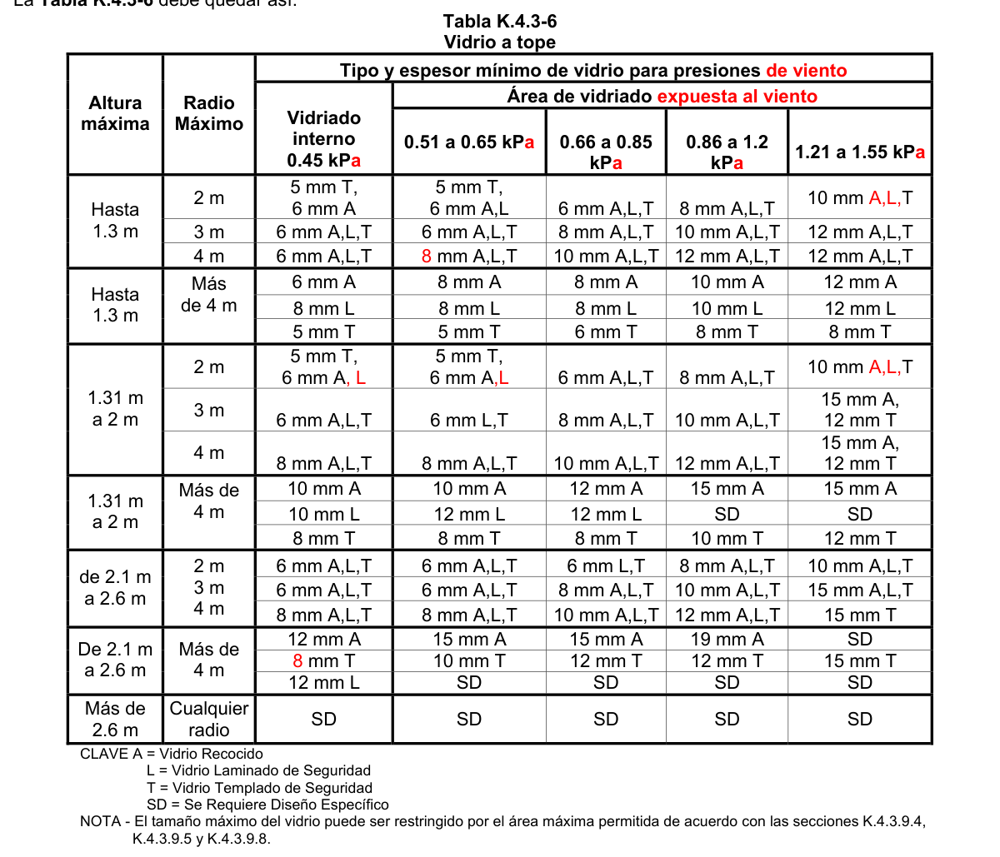

**Tabla K.4.3-6**

Vidrio a tope

| Altura máxima | Radio Máximo | Tipo y espesor mínimo de vidrio para presiones ULS |  |  |  |  |
|---|---|---|---|---|---|---|
|  |  | Vidriado interno 0.45 kPA | Área de vidriado externo |  |  |  |
|  |  |  | Baja 0.51 a 0.65 kPA | Media 0.66 a 0.85 kPA | Alta 0.86 a 1.2 kPA | Muy alta 1.21 a 1.55 kPA |
| 1.31 m a 2 m | 2 m | 5 mm T, 6 mm A | 5 mm T, 6 mm A | 6 mm A,L,T | 8 mm A,L,T | 10 mm T, 6 mm A |
|  | 3 m | 6 mm A,L,T | 6 mm A,L,T | 8 mm A,L,T | 10 mm A,L,T | 15 mm A, 12 mm T |
|  | 4 m | 8 mm A,L,T | 8 mm A,L,T | 10 mm A,L,T | 12 mm A,L,T | 15 mm A, 12 mm T |
| 1.31 m a 2 m | Más de 4 m | 10 mm A | 10 mm A | 12 mm A | 15 mm A | 15 mm A |
|  |  | 10 mm L | 12 mm L | 12 mm L | SD | SD |
|  |  | 8 mm T | 8 mm T | 8 mm T | 10 mm T | 12 mm T |
| de 2.1 m a 2.6 m | 2 m 3 m 4 m | 6 mm A,L,T | 6 mm A,L,T | 6 mm A,L,T | 8 mm A,L,T | 10 mm A,L,T |
|  |  | 6 mm A,L,T | 6 mm A,L,T | 8 mm A,L,T | 10 mm A,L,T | 15 mm A,L,T |
|  |  | 8 mm A,L,T | 8 mm A,L,T | 10 mm A,L,T | 12 mm A,L,T | 15 mm T |
| De 2.1 m a 2.6 m | Más de 4 m | 12 mm A | 15 mm A | 15 mm A | 19 mm A | SD |
|  |  | 10 mm T | 10 mm T | 12 mm T | 12 mm T | 15 mm T |
|  |  | 12 mmT | SD | SD | SD | SD |
| Más de 2.6 m | Cualquie r radio | SD | SD | SD | SD | SD |

CLAVE A = Vidrio Recocido L = Vidrio Laminado de Seguridad T = Vidrio Templado de Seguridad SD = Se Requiere Diseño Específico NOTA - El tamaño máximo del vidrio puede ser restringido por el área máxima permitida de acuerdo con las secciones K.4.3.9.4, K.4.3.9.5 y K.4.3.9.8.

**K.4.3.9.7** — Vidriera que protege de una diferencia de nivel

**K.4.3.9.7.1** — La vidriera empleada en cualquier edificación, en situaciones en las que se requiera una protección para los ocupantes contra desniveles de 1000 mm o más, a partir del nivel del piso, deberá cumplir con los requerimientos de la tabla K.4.3-7

**Tabla K.4.3-7**

Vidrieras para proteger diferencias de nivel en cualquier edificación (desniveles)

|  | TIPO A | TIPO B | TIPO C |
|---|---|---|---|
| Unidades familiares | Vidrio de seguridad según tabla 4.3.1 o vidrio recocido según columna 1 tabla 4.3.2 | Vidrio de seguridad según tabla 4.3.1 o vidrio recocido según columna 2 tabla 4.3-2 con 5 mm de espesor mínimo (+) | Seleccione el espesor del vidrio con referencia a las cargas de viento. La Tabla 4.3-3 de esta sección son los requisitos mínimos (++) |
| Todos las demás edificaciones ($) | Material vidriado de seguridad según tabla 4.3.1 o vidrio recocido según columna 1 tabla 4.3.2 | Material vidriado de seguridad según tabla 4.3.1 o vidrio recocido según columna 3 tabla 4.3.2 con 5 mm de espesor mínimo | Seleccione el espesor del vidrio con referencia a las cargas de viento. La Tabla 4.3-3 de esta sección son los requisitos mínimos (++) |

<!-- mod:1-decreto-092-2011-502 -->
> **Modificación — Decreto 092 de 2011** · anexo, p. 93
>
> El texto de la Tabla K.4.3-7 debe quedar así:
>
> 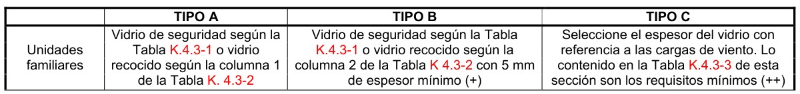
>
> 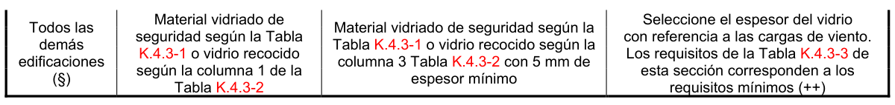

* Los rieles de protección deberían ser diseñados para disuadir a la gente a que se siente sobre ellos + Si un travesaño está firmemente asegurado, la parte superior del panel puede ser tipo C ++ Refiérase también a la sección K.4.3.9.5 $ Para áreas de actividad de alto riesgo, refiérase a K.4.3.9.1.10. Para vanos de escalera, refiérase a la sección K.4.3.9.11

**K.4.3.9.8** — Divisiones Internas

**K.4.3.9.8.1** — Divisiones internas con marco — Las divisiones internas con marco, diferentes de aquellas definidas como puertas o paneles laterales (refiérase a K.4.3.9.3.1.3), deben ir en vidrio recocido según la columna 3 de la tabla K.4.3-2. Cuando la parte más baja del vidrio esté a menos de 500 mm sobre el nivel del piso colindante, se puede usar vidrio recocido de no menos de 5 mm de espesor, en concordancia con las áreas máximas especificadas en la columna 1 de la tabla k.4.3-2.

Las divisiones internas con marco cumplirán con el numeral K.4.3.9.1.

<!-- mod:1-decreto-092-2011-504 -->
> **Modificación — Decreto 092 de 2011** · anexo, p. 94
>
> El título de K.4.3.9.8.1 debe quedar así:
>
> **K.4.3.9.8.1 — Divisiones internas con marco (enmarcadas)**

**K.4.3.9.8.2** — Divisiones internas con vidrio a tope

(a) Bordes superiores sin enmarcar — Los paneles con marco por tres de sus lados, pero no por el borde superior, serán instalados con vidrio recocido, según la columna 1 de la tabla 4.3.2, siempre y cuando el borde superior esté a 1500 mm o más sobre el nivel más alto del piso, y el panel no pueda ser confundido con un vano o un trayecto despejado.

Alternativamente, tales paneles pueden ser considerados como completamente enmarcados y serán vidriados con vidrio de seguridad, según la tabla K.4.3-1.

(b) Bordes laterales sin enmarcar — Los paneles que tienen los bordes superior e inferior enmarcados y uno o más bordes laterales sin enmarcar, pero no expuestos, debe llevar vidrio según la tabla K.4.3-4 y cumplirán con el numeral K.4.3.9.1.

(c) Otros paneles sin enmarcar — Los paneles sin enmarcar que no estén cubiertos por

(a) ó (b) estarán sujetos a diseño específico y cumplirán con el numeral K.4.3.9.1.

<!-- mod:1-decreto-092-2011-505 -->
> **Modificación — Decreto 092 de 2011** · anexo, p. 94
>
> El título de K.4.3.9.8.2 debe quedar así:
>
> **K.4.3.9.8.2 — Divisiones internas sin enmarcar con vidrio a tope**

**K.4.3.9.9** — Barandas y pasamanos

**K.4.3.9.9.1** — Barandas y pasamanos completamente enmarcados — Para barandas y pasamanos completamente enmarcados se empleará vidrio de seguridad, de no menos de 6 mm de espesor, según las áreas máximas mostradas en la tabla K.4.3-1, excepto cuando se use vidrio recocido de no menos de 4 mm de espesor, el cual es permitido hasta un área máxima de 0.3 m2

**K.4.3.9.9.2** — Barandas y pasamanos sin enmarcar o parcialmente enmarcados — Para barandas y pasamanos parcialmente enmarcados se usará vidrio de seguridad, de no menos de 6 mm de espesor, como se indica a continuación:

(a) Se puede usar la tabla 4.3.8 para vidrio soportado por dos bordes, donde las barandas o pasamanos son sostenidos por los pilares.

(b) Para otras barandas se requieren sistemas de diseño específicos

<!-- mod:1-decreto-092-2011-494 -->
> **Modificación — Decreto 092 de 2011** · anexo, p. 92
>
> La referencia a la tabla 4.3-8 debe ser a la Tabla K.4.3-8.

**K.4.3.9.9.3** — Barandas y pasamanos estructurales — Cuando se emplee vidrio como un elemento estructural, se usará vidrio templado de seguridad.

**Tabla K.4.3-8**

Barandas y pasamanos sin marco o parcialmente enmarcados

|  | Presión horizontal ULS (kPA) | Tramo máximo de vidrio * (m) |  |  |  | Tramo máximo de vidrio (m) |  |  |  | Presión horizontal SLS (kPA) |
|---|---|---|---|---|---|---|---|---|---|---|
|  |  | Vidrio de seguridad laminado ++ (mm) |  |  |  | Vidrio de seguridad templado (mm) |  |  |  |  |
|  |  | 6 | 8 | 10 | 12 | 6 | 8 | 10 | 12 |  |
| Edificaciones residenciales y piscinas | 1200 | 0.88 | 1.16 | 1.44 | 1.71 | 1.24 | 1.65 | 2.08 2.50 | 2.08 2.50 | 750 |
| Otras edificaciones y áreas públicas de edificaciones residenciales | 1600 | 0.76 | 1.00 | 1.24 | 1.48 | 1.13 | 1.50 | 1.89 2.28 | 1.89 2.28 | 1000 |
| Teatros, salas de cine, salones de reunión, asambleas, estadios, etc. | 2400 | 0.62 | 0.82 | 1.01 | 1.21 | 1.00 | 1.31 | 1.65 2.00 | 1.65 2.00 | 1500 |

<!-- mod:1-decreto-092-2011-507 -->
> **Modificación — Decreto 092 de 2011** · anexo, p. 94
>
> La Tabla K.4.3-8 debe quedar así:
>
> 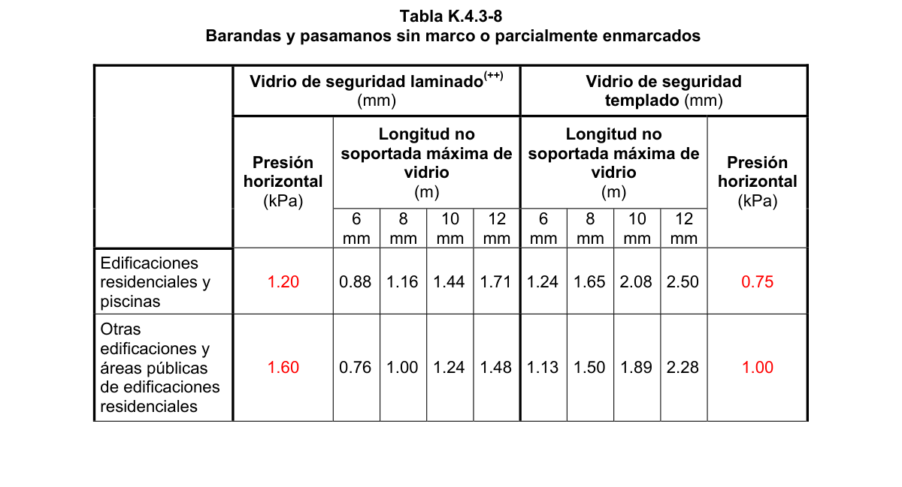
>
> 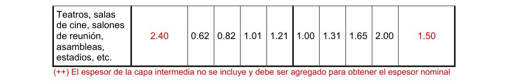

(*) Para vidrio de seguridad laminado las presiones horizontales prevalentes son el Estado Límite Último (Ultimate Limit State), tabla 4.3.1 e incluyen el factor de carga ULS (+) Para vidrio de seguridad templado las presiones horizontales prevalentes son el Estado Límite de Servicio, (Serviceability Limit State). Los vanos se basan en el límite de deflexión del vidrio 1/60 para estas cargas.

(++) El espesor de la capa intermedia no se incluye y debe ser agregado para obtener el espesor nominal

<!-- mod:1-decreto-092-2011-506 -->
> **Modificación — Decreto 092 de 2011** · anexo, p. 94
>
> Al final de K.4.3.9.9.3 debe se debe agregar «... con las presiones dadas en la Tabla K.4.3-8.».

**K.4.3.9.9.4** — Tipos de barandas

(a) Tipo I — Ensamble de baranda o balaustrada cuyo relleno es una sola lámina de material para vidriado la cual está totalmente capturada en todos sus bordes. Véase figura K.4.3-1

Figura K.4.3-1 — Soporte en cuatro lados — Una lámina de material para vidriado

(b) Tipo II — Ensamble de baranda o balaustrada cuyo relleno puede ser una única lámina o múltiples unidades de material para vidriado, capturado(s) en dos bordes. Véanse figura K.4.3-2 y K.4.3-3 Figura K.4.3-2 — Soporte en dos lados — Una lámina de material para vidriado

Figura K.4.3-3 — Soporte en dos lados — Múltiples láminas de material para vidriado

(c) Tipo III — Un ensamble de baranda o balaustrada con una única lámina de material para vidriado, que está sujetada por un sistema de soportes puntuales, soportes en las esquinas u otro apoyo no continuo a lo largo de una parte del vidriado. Véase figura K.4.3-4

Figura K.4.3-4 — Sistema vidriado con soportes puntuales.

(d) Tipo IV — Un ensamble de baranda o balaustrada cuyo relleno es una sola lámina de material para vidriado que está capturada en tres bordes. Véase figura K.4.3-5

Figura K.4.3-5 — Soporte en tres lados - Estructural.

(e) Tipo V — Un ensamble de baranda o balaustrada cuyo relleno es una sola lámina de material para vidriado que está capturada en un solo borde. El vidrio puede o no tener adjunto un pasamanos decorativo o de protección que no proporciona soporte estructural al sistema. Véase figuras K.4.3-6, K.4.3-7 y K.4.3-8

Figura K.4.3-6 — Soporte en un solo lado - Estructural.

Figura K.4.3-7 — Soporte en un solo lado con pasamanos de Protección en el borde superior — Estructural.

.

Figura K.4.3-8 — Soporte en un solo lado con pasamanos adjunto o atornillado a la superficie — Estructural.

**K.4.3.9.10** — Vanos de escaleras y patios K.4.3.9.10. 1 — Dentro de 2000 mm horizontales a partir del peldaño inferior de cada tramo de escalera – que comprenda como mínimo dos peldaños – se usará vidrio de seguridad, de acuerdo con la tabla K.4.3-1. Cualquier otro vidriado en vanos de escaleras, a menos de 2000 mm sobre el nivel del piso – ya sea que proteja o no una diferencia de nivel - cumplirá con los requerimientos de la tabla K.4.3-7

<!-- mod:1-decreto-092-2011-508 -->
> **Modificación — Decreto 092 de 2011** · anexo, p. 95
>
> El título de K.4.3.9.10 debe quedar así:
>
> **K.4.3.9.10** — *Vanos de escaleras y terrazas*

**K.4.3.9.11** — Otras vidrieras — Todo vidriera a menos de 2000 mm sobre cualquier plataforma que se encuentre al nivel del terreno, de la cubierta, o del piso, y que no haya sido incluido en este Capítulo, será diseñado de acuerdo con la tabla K.4.3-3.

**K.4.3.9.12** — Colocación de vidrios a tope — La colocación de vidrios a tope unidos con silicona para formar un radio, deberán cumplir con los requerimientos de la tabla K.4.3-6.

<!-- mod:1-decreto-092-2011-495 -->
> *Texto vigente según el Decreto 092 de 2011 (anexo, p. 92).*

<!-- mod:1-decreto-092-2011-509 -->
> *Texto vigente según el Decreto 092 de 2011 (anexo, p. 95).*

**K.4.3.9.13** — *Vidrieras con vidrio a tope por dos lados* — Vidrio a tope enmarcado por dos lados, en puertas, paneles laterales, vidrieras a baja altura o en asientos de ventana, cuartos de baño, vitrinas, vanos de escaleras, o que protejan diferencias de nivel, deben ser con vidrio de seguridad, para cumplir con lo requerimientos de la columna 2 de la Tabla K.4.3-3. Todas las demás ventanas con dos bordes sin enmarcar, que abran o cierren, cumplirán con los requerimientos de carga de viento según K.4.2.6.

**K.4.3.10** — Antes de iniciarse una demolición, es necesario extraer todos los vidrios que hubiera en la obra.

<!-- mod:1-decreto-092-2011-488 -->
> **Modificación — Decreto 092 de 2011** · anexo, p. 91
>
> El texto de K.4.3.9 debe quedar así:
>
> **K.4.3.9** – *Requerimientos de seguridad ante el impacto humano* — En esta sección se dan los requisitos mínimos para los vidriados en lugares donde el impacto humano es factible. Solo los vidriados que están dentro de los 2000 mm medidos hacia arriba desde el piso tienen la probabilidad de estar normalmente expuestos a impacto humano, por tal razón esta sección hace referencia únicamente de los vidriados de esta zona.
>
> Los niveles de riesgo se califican de acuerdo con la Figura K.4.3-1. Esta figura se debe utilizar con los requisitos específicos de los respectivos numerales de la presente sección K.4.3.9.

<!-- mod:2-decreto-340-2012-86 -->
> **Modificación — Decreto 340 de 2012** · anexo, p. 15
>
> En la sección K.4.3.9 la referencia a la figura debe ser a la Figura K.4.3-0.

#### K.4.3.11 — VIDRIO ESTRUCTURAL Y DE PISO

El vidrio estructural y de piso, deberá tener dimensiones no mayores de 0.30 m de lado y debe ser capaz de soportar la sobrecarga prevista para la estructura en donde está ubicado. Los vidrios deberán estar perfilados cuando vayan dentro de soportes de concreto armado. En caso de que los vidrios se apoyen en estructura metálica, ésta se ejecutará con perfiles especiales escogidos al efecto. Las juntas entre paños, deben sellarse con cemento asfáltico u otro material elástico similar.

<!-- mod:1-decreto-092-2011-510 -->
> **Modificación — Decreto 092 de 2011** · anexo, p. 95
>
> La sección K.4.3.11 debe suprimirse. Se incluyó por error y pertenecía al Reglamento NSR-98.

#### K.4.3.12 — REVESTIMIENTO CON VIDRIOS

La colocación de revestimientos con piezas o placas de vidrio, requiere que se asegure su perfecta adherencia a los muros y se evite la presencia de aristas cortantes. Las piezas de vidrio que se usen para revestir deben tener las siguientes dimensiones máximas:

(a) 0.95 m2, si se colocan a altura menor de 2.5 m, medida sobre el solado.

(b) 0.50 m2, si se colocan arriba de 2.50 m, el lado máximo de la pieza será de 1.50 m.

<!-- mod:1-decreto-092-2011-511 -->
> **Modificación — Decreto 092 de 2011** · anexo, p. 95
>
> La sección K.4.3.12 debe suprimirse. Se incluyó por error y pertenecía al Reglamento NSR-98.

#### K.4.3.13 — VIDRIOS EN CUBIERTA

Los vidrios de cubierta deben cumplir los siguientes requisitos:

(a) Claraboyas — Toda claraboya debe construirse con base en marcos y bastidores de metal o concreto armado, anclados firmemente.

(b) Bóvedas y cúpulas — Toda bóveda o cúpula debe construirse con base en estructura metálica y vidrios soportados o estructura de concreto armado y vidrios perfilados inclinados dentro de los soportes.

(c) Techos transitables — Todo techo o azotea de esta clase debe responder a las especificaciones tal como lo define el numeral K.4.3.11.

#### K.4.3.14 — NORMAS TÉCNICAS COLOMBIANAS

NTC 1909 (2008) — Vidrio. Vidrio Plano Flotado. Vidrio Plano Impreso (grabado). Vidrio Plano Armado (alambrado). Adopción Modificada de La ASTM C 1036-06. Standard Specification for Flat Glass.

(Especificaciones para Vidrio Plano) NTC 1804 (1990) — Vidrio. Vidrio plano estirado.

NTC 5579 (2007) — Terminología normalizada de vidrio y productos de vidrio.

<!-- mod:1-decreto-092-2011-512 -->
> **Modificación — Decreto 092 de 2011** · anexo, p. 95
>
> La sección K.4.3.14 debe suprimirse. Se incluyó por error y pertenecía al Reglamento NSR-98.
>
> La sección K.4.3.14 debe quedar ahora así:
>
> **K.4.3.11 — NORMAS TÉCNICAS COLOMBIANAS**
>
> **NTC 1909** — Vidrio. Vidrio Plano Flotado. Vidrio Plano Impreso (grabado). Vidrio Plano Armado (alambrado). (ASTM C 1036).
>
> **NTC 1804** — Vidrio. Vidrio plano estirado.
>
> **NTC 5724** —Vidrio Plano. Vidrio con Recubrimiento Pirolítico y con Deposición al vacío o Magnetrónico. (ASTM C1376)
>
> **NTC 5756** — Vidrio Plano Tratado con calor. Categoría Termoendurecido (HS), Categoría Templado (FT) con y sin Recubrimiento. (ASTM C1048)
>
> **NTC 5579** — Terminología normalizada de vidrio y productos de vidrio. (ASTM C162)
>
> **NTC 5783** —Vidrio. Vidrio Plano Laminado. (ASTM C1172)

#### K.4.3.15 — NORMAS TÉCNICAS AMERICANAS (ASTM)

ASTM C1048-04 — Standard Specification for Heat-Treated Flat Glass—Kind HS, Kind FT Coated and Uncoated Glass. (Vidrio plano tratado con calor, categoría termoendurecido (HS) y categoría templado (FT) con y sin recubrimiento) ASTM C1172 (2009) — Standard Specification for Laminated Architectural Flat Glass.(Vidrio Laminado Plano para Arquitectura) ASTM C1376-03 — Standard Specification for Pyrolytic and Vacuum Deposition Coatings on Flat Glass.(Vidrios recubiertos por Deposición al vació y con recubrimiento Pirolítico) ) ASTM C1464-06 — Standard Specification for Bent Glass.(Vidrio Curvado) ASTM C1503-08 — Standard Specification for Silvered Flat Glass Mirror.(Espejos) ASTM E283-04 — Standard Test Method for Determining Rate of Air Leakage Through Exterior Windows, Curtain Walls, and Doors Under Specified Pressure Differences Across the Specimen.

ASTM E330-02 — Test Method for Structural Performance of Exterior Windows, Doors, Skylights and Curtain Walls by Uniform Static Air Pressure Difference.

ASTM E331-00(2009) — Standard Test Method for Water Penetration of Exterior Windows, Skylights, Doors, and Curtain Walls by Uniform Static Air Pressure Difference.

ASTM E547-00(2009) — Standard Test Method for Water Penetration of Exterior Windows, Skylights, Doors, and Curtain Walls by Cyclic Static Air Pressure Difference.

ASTM E783-02 — Standard Test Method for Field Measurement of Air Leakage through Installed Exterior Windows and Doors.

ASTM E935-00(2006) — Standard Test Methods for Performance of Permanent Metal Railing Systems and Rails for Buildings.

ASTM E1105-00(2008) — Standard Test Method for Field Determination of Water Penetration of Installed Exterior Windows, Skylights, Doors, and Curtain Walls, by Uniform or Cyclic Static Air Pressure Difference.

ASTM E1300-09a — Standard Practice for Determining Load Resistance of Glass in Buildings.

ASTM E2025-99(2006) — Standard Test Method for Evaluating Fenestration Components and Assemblies for Resistance to Impact Energies.

ASTM E2353-06 — Standard Test Methods for Performance of Glass in Permanent Glass Railing Systems, Guards, and Balustrades.

ASTM F1233-06 — Standard Test Method for Security Glazing Materials And Systems.

ASTM F1915-07a — Standard Test Methods for Glazing for Detention Facilities.

ASTM STP 1434 — The Use of Glass in Buildings. Páginas 105 a 118.

ASTM E2190-08 — Standard Specification for Insulating GlassUnit Performance and Evaluation. (Unidades de Vidrio Aislante o Doble Vidriado) ASTM C1349-04 — Standard Specification for Architectural Flat Glass Clad Polycarbonate ASTM C1422-99(2005)e1 — Standard Specification for Chemically Strengthened Flat Glass

<!-- mod:1-decreto-092-2011-513 -->
> **Modificación — Decreto 092 de 2011** · anexo, p. 95
>
> La sección K.4.3.15 debe quedar así:
>
> **K.4.3.12 – OTRAS NORMAS TÉCNICAS**
>
> **AAMA 501.1** — Standard test method for metal curtain walls for water penetration using dynamic pressure
>
> **AAMA 501.6** — Recommended Dynamic test method for determining the seismic drift causing glass fallout from a wall system
>
> **AAMA/WDMA/CSA 101/I.S.2/A440** — Standard specification for windows, doors, and unit skylights.
>
> **ANSI Z97.1** — American National Standard for Safety Glazing Materials Used in Buildings – Safety Performance Specifications and Methods of Test.
>
> **ASTM C1048** — Standard Specification for Heat-Treated Flat Glass—Kind HS, Kind FT Coated and Uncoated Glass.
>
> **ASTM C1172** — Standard Specification for Laminated Architectural Flat Glass.
>
> **ASTM C1376** — Standard Specification for Pyrolytic and Vacuum Deposition Coatings on Flat Glass.
>
> **ASTM C1464** — Standard Specification for Bent Glass.
>
> **ASTM C1503** — Standard Specification for Silvered Flat Glass Mirror
>
> **ASTM E283** — Standard Test Method for Determining Rate of Air Leakage Through Exterior Windows, Curtain Walls, and Doors Under Specified Pressure Differences Across the Specimen.
>
> **ASTM E330** — Test Method for Structural Performance of Exterior Windows, Doors, Skylights and Curtain Walls by Uniform Static Air Pressure Difference.
>
> **ASTM E331** — Standard Test Method for Water Penetration of Exterior Windows, Skylights, Doors, and Curtain Walls by Uniform Static Air Pressure Difference.
>
> **ASTM E547** — Standard Test Method for Water Penetration of Exterior Windows, Skylights, Doors, and Curtain Walls by Cyclic Static Air Pressure Difference.
>
> **ASTM E783** — Standard Test Method for Field Measurement of Air Leakage through Installed Exterior Windows and Doors.
>
> **ASTM E935** — Standard Test Methods for Performance of Permanent Metal Railing Systems and Rails for Buildings.
>
> **ASTM E1105** Standard Test Method for Field Determination of Water Penetration of Installed Exterior Windows, Skylights, Doors, and Curtain Walls, by Uniform or Cyclic Static Air Pressure Difference.
>
> **ASTM E1300** — Standard Practice for Determining Load Resistance of Glass in Buildings.
>
> **ASTM E2025** — Standard Test Method for Evaluating Fenestration Components and Assemblies for Resistance to Impact Energies.
>
> **ASTM E2353** — Standard Test Methods for Performance of Glass in Permanent Glass Railing Systems, Guards, and Balustrades.
>
> **ASTM F1233** — Standard Test Method for Security Glazing Materials And Systems.
>
> **ASTM F1915** — Standard Test Methods for Glazing for Detention Facilities.
>
> **ASTM STP 1434** — The Use of Glass in Buildings.
>
> **ASTM E2190** — Standard Specification for Insulating GlassUnit Performance and Evaluation.
>
> **ASTM C1349** — Standard Specification for Architectural Flat Glass Clad Polycarbonate
>
> **ASTM C1422** — Standard Specification for Chemically Strengthened Flat Glass
>
> **NZS 4223** — New Zealand Standards.
>
> **UL 410** — Slip Resistance of Floor Surface Materials

#### K.4.3.16 — OTRAS NORMAS TECNICAS

AAMA 501.1-05 — Standard test method for metal curtain walls for water penetration using dynamic pressure AAMA 501.6-01 — Recommended Dynamic test method for determining the seismic drift causing glass fallout from a wall system AAMA/WDMA/CSA 101/I.S.2/A440-08 — Standaard specification for Windows, Doors, and unit skylights.

ANSI Z97.1- 2004e — American National Standard for Safety Glazing Materials Used in Buildings - Safety Performance Specifications and Methods of Test. (Se puede usar esta version o versiones posteriores a esta que esten vigentes en el momento de su aplicación) NZC 4223:1999 - New Zealand Standards. Estándar de nueva Zelanda : Vidrieras para edificios . Parte 3 :

1999 UL 410 — Slip Resistance of Floor Surface Materials.

█ Notas:
